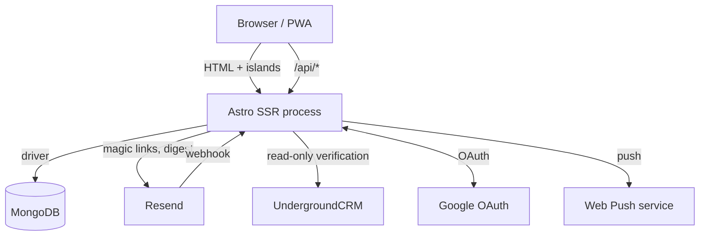

# Architecture overview

**Status:** Current · **Verified:** 13 November 2026

## Stack

| Concern | Choice |
|---|---|
| Framework | Astro 7 with `output: "server"` and `@astrojs/node` standalone |
| UI islands | React 19, mounted with `client:load` |
| Styling | Tailwind CSS 4 via `@tailwindcss/vite`; Horizon tokens in `src/styles/global.css` |
| Language | TypeScript, Node 22+ (`engines.node >= 22.23.4`) |
| Persistence | MongoDB 6 driver; in-memory fallback in development |
| Authentication | Better Auth 1.7 (email magic link, Google, passkeys, MongoDB adapter) |
| Email | Resend REST API |
| Push | `web-push` with VAPID |
| Package manager | pnpm 10.28 |
| Tests | `node --test --experimental-strip-types`; Playwright journeys in CI |

There is no ORM, no schema validation library, no job queue, no middleware layer and no separate backend service. The application is one Node process serving SSR pages and API routes.

## Runtime shape



All pages are server-rendered on request. No route sets `prerender = true`; 79 route files explicitly set `prerender = false`. Only hashed `_astro` assets are static.

## Canonical locations

| Area | Location |
|---|---|
| Public and member pages | `src/pages/**/*.astro` |
| API routes | `src/pages/api/**/*.ts` |
| Layouts | `src/layouts/SiteLayout.astro`, `AdminLayout.astro`, `ErrorLayout.astro` |
| React islands | `src/components/**/*.tsx` |
| Astro components | `src/components/**/*.astro` |
| shadcn primitives | `src/components/ui/**` |
| Admin Astro wrappers | `src/components/admin/**`, `admin-kit.tsx` |
| Domain services | `src/lib/store.ts`, `ballots.ts`, `branch-participation.ts`, `membership-verification.ts`, `notifications.ts`, `engagement-email.ts` |
| Governance model | `src/lib/matters.ts`, `proposal-revision.ts`, `ballot-binding.ts`, `governance-relationships.ts` |
| Authorisation | `src/lib/auth.ts`, `rbac.ts`, `roles-store.ts` |
| Persistence | `src/lib/db.ts`, `vote-storage.ts`, `read-models.ts`, `migrations.ts` |
| API contracts | `src/lib/api-contracts.ts`, `public-api.ts` |
| Configuration | `src/lib/site-config.ts`, `src/lib/integrations.ts`, `.env.example` |
| Background entry points | `src/pages/api/cron/*`, `src/pages/api/email/digest.ts` |
| Operational scripts | `scripts/**` |
| Tests | Co-located `src/lib/*.test.ts` |
| Deployment | `Dockerfile`, `docker-compose*.yml`, `docker/`, `deploy/`, `.github/workflows/` |

`store.ts` is the largest module (about 2,900 lines) and the de facto domain service for proposals, comments, votes and members. Treat it as the primary business-logic file, not as a storage utility.

## Layering

Intended direction:

```
pages / API routes
        │
        ▼
domain services (store, ballots, branch-participation, …)
        │
        ▼
persistence (db, vote-storage, migrations)
        │
        ▼
MongoDB
```

Cross-cutting leaves:

```
api-contracts ── DTO allowlists
public-api ───── ETag/caching ── public-origin
resilience ───── logging/pagination helpers
types ────────── shared records
```

### Actual violations

These are real and should be considered before adding code:

1. **Pages query MongoDB directly.** About 31 page/API files call `db.collection(...)`. This couples views to document shape and bypasses DTO allowlists. Examples include `src/pages/index.astro`, `src/pages/proposals/[slug].astro`, `src/pages/admin/reports/index.astro` and several admin policy endpoints.
2. **`store.ts` is a god module.** It spans proposals, deliberation, ballots, members and RBAC checks, and is imported by email, PDF, reporting and membership-verification services. A change to proposal internals can affect unrelated send paths.
3. **Service-to-infrastructure inversion.** `engagement-email.ts` imports `store.ts` for `listMembers` / `listProposals`. Digest sending is therefore sensitive to any store change.
4. **Auth cycle break by dynamic import.** `branch-participation.ts` imports `canAdministerBranch` from `auth.ts`; `auth.ts` lazily imports branch participation. `store.ts` also lazily imports eligibility. There is no static cycle today, but it depends on these dynamic imports remaining lazy.
5. **No route guard layer.** There is no `src/middleware.ts`, so every route authenticates and authorises itself. Some routes use `requireApiPermission`; many hand-roll `isAdmin` / `isStaff` checks. A new endpoint inherits nothing by default.
6. **In-memory database fidelity.** The development fallback implements a subset of the driver. `project()` and `createIndex()` are no-ops and there are no transactions. Tests that depend on projections, unique indexes or transactions are meaningful only against real MongoDB.

## Request lifecycle

### A server-rendered page

1. Astro runs the page frontmatter on the server.
2. The layout calls `getDatabase()`, `getSessionUser(request, env)` and `getSiteConfig()`.
3. The page queries services or MongoDB, applies visibility rules, and renders HTML.
4. React islands hydrate with `client:load` for interactive controls.
5. The response sets `cache-control: private, no-store` for authenticated views.

### An API request

1. Route calls `runtimeEnv(locals)` to resolve environment.
2. `getSessionUser(request, env)` resolves the Better Auth session or the development cookie.
3. The route returns 401/403 if unauthenticated or unauthorised.
4. It parses and validates input by hand.
5. It calls a domain service, which re-checks permissions where the action is consequential.
6. It returns a DTO through `privateJson` (or `publicJson` for public reads), never a raw MongoDB document.
7. Domain errors are mapped to 400/403/404/409/503 responses.

### Authentication

`getAuth()` refuses to construct an auth instance unless `BETTER_AUTH_URL`, a 32+ character `BETTER_AUTH_SECRET`, MongoDB and at least one login method are configured. Sessions are re-resolved per request (`cookieCache` disabled), so role revocation is immediate. Disabled accounts cannot create or retain sessions.

The development cookie (`engage_dev_user`) is accepted only when `APP_MODE` is exactly `development`, `test` or `preview`. Missing or unknown modes fail closed.

## Cross-cutting concerns

### Configuration

`runtimeEnv(locals)` merges `process.env`, `locals.runtime.env` and `locals.env`. Environment variables are documented in `.env.example` and typed as `PlatformEnv`. Never read `process.env` directly in a domain service; pass the resolved environment.

Feature flags currently include:

- `APP_MODE`
- `ENGAGE_ALLOW_INDEXING`
- `ENGAGE_DIGEST_ENABLED`
- `ENGAGE_CRM_VERIFICATION_ENABLED` and related CRM settings
- `LEGAL_ACCEPTANCE_ENABLED`
- `BALLOT_ENCRYPTION_MODE`
- `ENGAGE_PUBLIC_PULSE_POLL` (inert; no poll implementation)
- `FORMAL_BALLOTS_ENABLED` (present in local env but not read by code)

### Caching

- Authenticated and admin JSON: `private, no-store` via `privateJson`.
- Public API: SHA-256 ETag, `If-None-Match` → 304, canonical `Link`, `stale-while-revalidate`; immutable for revision responses.
- Pages: explicit `no-store` for member/proposal/admin; short public cache for `/changelog/`.
- No CDN, ISR or `Astro.cache` abstraction.

### Error handling

Handlers return `{ error: string }` with a status. Typed domain errors (`BallotBindingError`, `BranchParticipationError`, `RbacError`, `LegalAcceptanceError`, `MigrationError`, `SenseError`, `CrmUnavailableError`) are caught and mapped. There is no global error middleware and no uniform error code envelope. Error pages (`403`, `404`, `500`) are branded and do not depend on the database.

### Security posture

Implemented: Better Auth rate limiting, Origin checks on selected state-changing routes, Astro `checkOrigin` for form posts, DTO minimisation, partial unique vote indexes, ballot encryption option, secret-redacting operational logs, signed email webhooks and one-click unsubscribe.

Not implemented: a Content Security Policy, HSTS, `X-Frame-Options`, `X-Content-Type-Options`, general API rate limiting, CSRF tokens on every route, and a central route guard. Any perimeter headers must come from the reverse proxy or tunnel; they are not in this repository.

### Observability

`logOperationalEvent` writes structured events with key redaction. `/api/health` pings MongoDB and reports latency. There is no metrics or tracing backend. Application logs are the container's stdout/stderr.

## Where to add a capability

| Task | Put it in |
|---|---|
| New member-facing page | `src/pages/**/*.astro`, reuse `SiteLayout` |
| New admin screen | `src/pages/admin/**/*.astro`, reuse `AdminLayout` and `admin/Card` |
| New interactive control | React island in `src/components`, primitives from `src/components/ui` |
| New domain rule | `src/lib/<domain>.ts`, called by routes; re-check authorisation server-side |
| New API route | `src/pages/api/**`, DTO through `api-contracts.ts`, explicit auth check |
| New persistence shape | Extend `db.ts` indexes and normalisation; add a migration if existing data must change |
| New notification | `src/lib/notifications.ts` + `engagement-email.ts` + preferences topic |
| New scheduled work | Bearer-secret cron endpoint + external scheduler; do not add an in-process timer |
| New integration | `src/lib/integrations.ts` adapter seam + documented contract + env vars |

## Architectural rules

1. Pages may read services; services must not import pages.
2. New API responses must use an allowlist DTO. Never spread a Mongo document.
3. Authorisation belongs on the server and in the service that performs the act.
4. Governance acts must write an audit record.
5. Do not add a second state store, queue or scheduler without an explicit decision record.
6. Prefer extending the existing domain module over inventing a parallel abstraction.
7. Remove dead code rather than leaving a compatibility layer with no documented reason.
