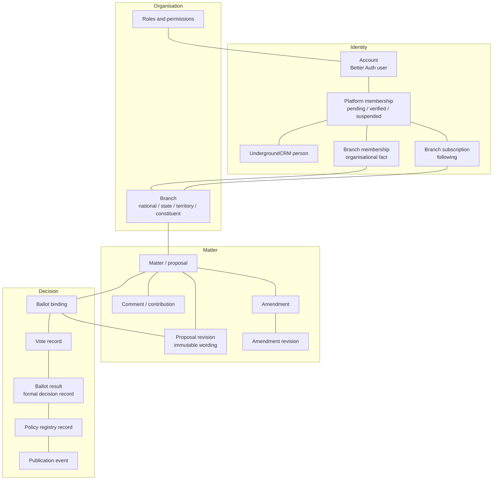
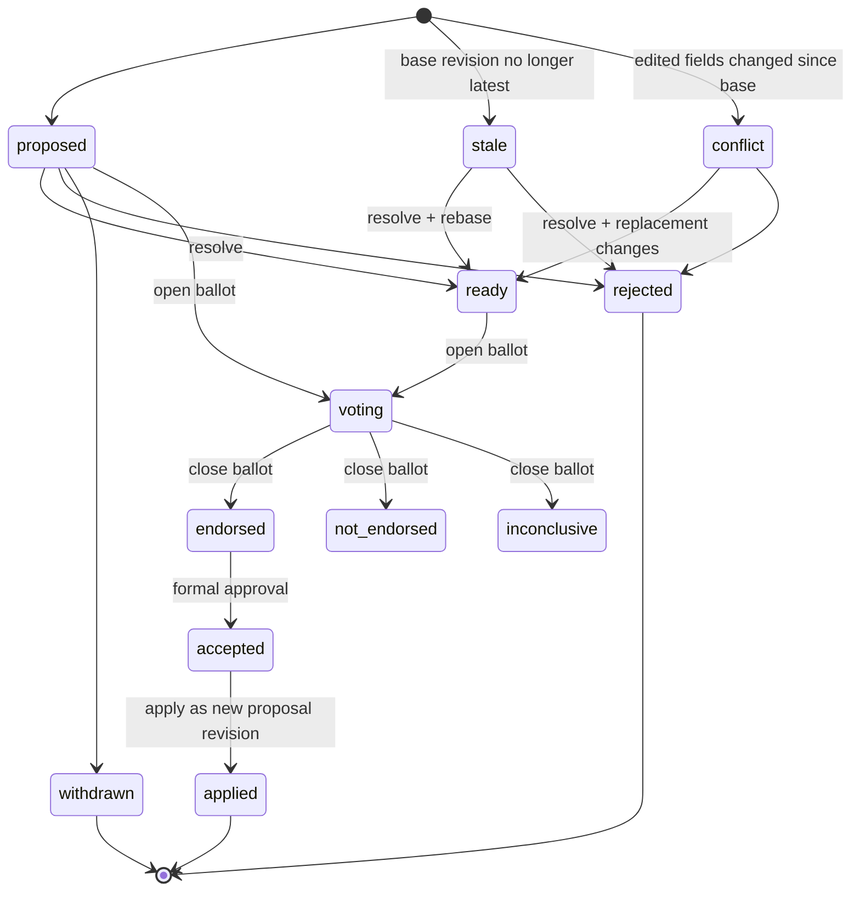

# Domain model

**Status:** Current · **Verified:** 13 November 2026

This page defines the concepts an engineer or agent must understand before changing behaviour. It describes the model the code actually implements. Where the model is incomplete, that is stated.

## Concept map



## Identity and membership

### Account

An account is the Better Auth `user` document. Its `_id` is the `memberId` used everywhere else. There is no separate profile collection.

An account can be disabled. A disabled account cannot obtain or retain a session. Disabling is not a membership status.

### Platform membership

`memberships` records whether the person may participate in Engage:

| Status | Meaning | `canParticipate` |
|---|---|---|
| `pending` | Signed up, not yet verified. May read and save a vote preference. | No |
| `verified` | Confirmed as an eligible Fusion member. | Yes |
| `suspended` | Participation withdrawn. May still sign in and read. | No |

There is deliberately **no `rejected` status**. Rejection is not modelled. Do not describe suspension as rejection.

Verification provenance is stored (`verificationSource`, `verifiedAt`, `verifiedBy`, `externalPersonId`). A member may be verified manually by an officer or automatically from the CRM.

### Organisational membership

Party membership belongs to UndergroundCRM, not Engage. Engage stores the verification outcome and may store branch memberships. It must not become a second CRM.

### Branch

A branch is an organisational unit:

| Kind | Examples | Role |
|---|---|---|
| `national` | Fusion National (`branch-nat`) | National jurisdiction and default authority |
| `state` | New South Wales, Victoria, … | Geographic participation and state authority |
| `territory` | ACT, Northern Territory | Geographic participation |
| `constituent` | Created by administrators | Intra-state or affinity grouping |

Branches have a parent relationship: state/territory under national; constituent under a state or territory. Cycles and invalid parents are rejected.

Nine standard branches are seeded. No constituent branches are seeded.

### Following versus branch membership

This is the most commonly confused distinction in the product.

| Fact | Collection | Created by | Grants |
|---|---|---|---|
| **Following** | `branch_subscriptions` | The member | Discovery and updates only |
| **Branch membership** | `branch_memberships` | Branch authority, CRM, or self-service join | Eligibility to vote in that branch's ballots |

Fusion National is implicitly followed and cannot be unfollowed. A national subscription is **not** a membership fact.

Branch membership records carry a source:

- `engage-local` — officer verification or member self-service;
- `engage-legacy` — migration annotation;
- `underground-crm` — externally authoritative and not locally editable.

Only a national administrator may grant or revoke the branch administrator attribute. Ordinary branch membership is administered within the branch.

### Roles and permissions

There are three **system roles** (Member, Moderator, National Administrator) and a configurable role system:

- `application_roles` supplies legacy platform roles;
- `branch_memberships.branchRole` supplies branch administrator status;
- `rbac_assignments` joins members to `rbac_roles`, which carry explicit permission keys at national or branch scope.

Effective permissions are the union of these sources. National grants satisfy branch checks; branch grants never satisfy national checks. Permissions are operational; they are not voting eligibility or governance authority.

## Matter and wording

### Matter

A **matter** is the generic governance item. In the data model it is a `proposals` document. `ProposalRecord` is the storage type; "matter" is the extensible domain concept.

A matter has:

- identity: `proposalId` (`PROP-*` for seeded/generated proposals, `GOV-*` for governance resolutions), `slug`;
- content: `title`, `summary`, `outcomes`, `details`, attachment, provenance;
- type: `kind` — `policy` or `resolution`;
- stage: `propose`, `deliberate`, `decide`, `implement`, `archived`;
- governance coordinates: `originatingBranchId`, `governanceAuthorityBranchId`, `jurisdictionBranchId`, `scope`, `publicationScope`;
- ballot binding: `ballotRevisionId`, `ballotClosesAt`;
- history: `supersededByProposalId`, implementation note.

`scope` is a canonical geographic key for discovery. It is not a branch identity. `publicationScope` is `private`, `branch` or `national`.

### Matter type and capability

The matter registry (`src/lib/matters.ts`) declares what a type can do:

| Capability | Policy | Resolution |
|---|---|---|
| Deliberation | Yes | Yes |
| Amendments | Yes | Yes |
| Ballots | Yes | Yes |
| Ratification | Yes | **No** |
| Policy publication | Yes | **No** |
| Supersession | Yes | Yes |

Both types share the five stages and the standard transition table. A resolution can be deliberated, amended, voted and implemented, but it can never enter the Policy Registry. This is the core distinction between **policy proposals** and **governance resolutions**.

Legacy data is normalised at trust boundaries: missing or `proposal` type falls back to `resolution` for `GOV-*` IDs, otherwise `policy`; the alias `governance` maps to `resolution`; unknown non-empty types are rejected.

### Revision

A revision is an immutable snapshot of the four substantive wording fields:

```ts
{ title, summary, outcomes, details }
```

The content hash is SHA-256 over the JSON snapshot in fixed key order. A revision has a `parentRevisionId`, forming a chain. A new revision is appended only when the hash changes.

Not every field is part of wording. `attachmentUrl`, `kind`, `space` and `provenance` are not hashed and do not create a revision. Once a ballot is open or any vote exists, substantive changes are blocked rather than silently revisioned.

A **ballot revision** is the exact revision a ballot is bound to. A **composite ratified revision** may be created at ratification to combine a successful proposal revision with formally accepted amendment revisions.

Member-facing labels are ordinal and date-based ("Revision 2 · 12 Nov 2026"); raw IDs belong in audit views.

### Provenance

Two different things are called provenance:

- **Policy provenance** (`PolicyProvenance`) describes where a seeded policy came from: existing, revised, new, draft-derived, lineage links, evidence basis, uncertainty.
- **Governance provenance** is the audit chain of events and relationships: revisions, bindings, decisions, ratification, publication, supersession.

Do not use one to mean the other.

## Deliberation

### Contribution

A comment is the unit of deliberation. It has:

- an author, body (5–5,000 characters) and timestamp;
- a **stance**: `support`, `concern`, `amendment` or `comment`;
- endorsements (`upvotes` plus event history);
- optional structured **contribution feedback**.

A stance is a label. `amendment` as a stance does **not** create an amendment record. Real amendments are separate.

### Endorsement

An endorsement is a member adding or removing themselves from a comment's `upvotes`. It is display-only. It never counts toward a ballot, threshold or promotion.

### Contribution feedback

Officers can record how a contribution was handled:

- `incorporated`
- `considered`
- `deferred`
- `declined`

Each update may cite evidence — an amendment, revision, decision or published policy — and appends to an append-only history. This closes the loop between "people commented" and "here is what changed".

### Amendment

An amendment is a proposed change to a matter's wording. It has its own immutable revision chain and lifecycle.



Key rules:

- An amendment may be created only while the matter is in Propose or Deliberate.
- It must name a base revision of that matter.
- `stale` means the base is no longer latest; `conflict` means an edited field has since changed.
- Resolution rebases onto the latest revision and records a new amendment revision.
- An amendment ballot can be opened only while the matter ballot is in Decide and the amendment's base equals the matter's ballot revision.
- The amendment ballot result is `endorsed`, `not-endorsed` or `inconclusive`. It is supplied by an officer, not computed from the tally.
- Formal acceptance (`accepted`) is a separate act from endorsement.
- Applying an accepted amendment creates a new proposal revision and requires the proposal to still be in Propose or Deliberate.

## Decision records

### Ballot

A ballot is the formal voting container. It records:

- a ballot ID (`proposal:<proposalId>` or `amendment:<amendmentId>`);
- matter and matter type;
- purpose (`matter_adoption`, `amendment`, `consultation`);
- the bound revision (and amendment revision where applicable);
- electorate (`national` or `branch` with a branch ID);
- governance authority and jurisdiction;
- status (`open`, `closed`, `certified`, `cancelled`);
- closing time.

The `ballots` collection is partly a projection. Records may be synthesised for proposals and amendments that do not have one. The authoritative facts are the matter, its binding, the votes and the result.

### Vote

A vote is one member's current choice on one ballot: `approve`, `abstain` or `reject`, with an optional reason and timestamp. A member may change their vote while the ballot is open. Legacy `do-not-approve` is read as `reject`.

Votes are stored in `proposal_votes`. Depending on configuration they are plaintext or AES-256-GCM encrypted with a blind index. Abstain is recorded and displayed; it has no computed effect because no threshold model exists.

An unverified member may save a **pending vote preference**, promoted after verification only if the bound revision still matches.

### Ballot result / formal decision

A ballot result is an immutable record that a named officer recorded an outcome for a specific ballot revision, citing an external `decisionEventId`. The result vocabulary is `successful`, `unsuccessful` or `inconclusive`.

The result is **not derived from the tally**. Thresholds, quorum, turnout, tie-breaking and non-voter treatment are not implemented because Fusion has not supplied them.

Recording a result certifies the ballot. It does not publish policy and does not move the matter by itself.

### Policy registry record

A policy registry record is created by **ratification** of a successful policy proposal. It records:

- the policy ID and ratified revision(s);
- adopted status and publication status (`unpublished`, `published`, `withdrawn`, `superseded`);
- ratifying authority, decision event and optional effective date;
- adopted amendment IDs where relevant.

Only a `published` record is authoritative public policy. Resolutions can never create one.

### Publication event

Publication, withdrawal and supersession are recorded as durable events and then reflected in the registry record. Publication is idempotent by `Idempotency-Key`. Supersession records a successor relationship and detects cycles.

### Governance event

`governance_events` and `governance_relationships` provide the audit trail: ballot bound, decision recorded, policy published, relationships between matters. Events are append-only.

## Notifications and preferences

Notification preferences are per topic and per channel. Topics are new ballots, closing deadlines, contribution responses, governance outcomes and account/membership. Channels are email, in-app and Web Push.

Channel consent is independent: push defaults off and is never inferred from email consent. Bounced or complained email addresses are suppressed and cannot be re-enabled by the member.

## Member-facing versus internal terminology

| Member-facing | Internal / code | Note |
|---|---|---|
| Proposal | Matter, `ProposalRecord`, `proposals` | "Matter" is the extensible domain term |
| Policy proposal | `kind: "policy"` | Can be ratified and published |
| Governance resolution | `kind: "resolution"` | Cannot be ratified or published |
| Stage: Propose, Deliberate, Decide, Implement | `propose`, `deliberate`, `decide`, `implement` | `archived` is also a stage |
| Revision | `proposal_revisions`, `revisionId` | Never call a raw ID a revision in UI |
| Vote | `proposal_votes`, `VoteRecord` | Formal ballot only |
| Comment / stance | `comments`, `CommentRecord` | Not a vote |
| Endorse | `upvotes`, `upvoteEvents` | Display-only support |
| Wording change | Amendment, `amendments` | A first-class record with its own ballot |
| Ballot outcome | `ballot_results`, `result` | Officer-recorded, not computed |
| Official policy | `policy_registry` with `publicationStatus: "published"` | Not a proposal, not a ballot result |
| Withdrawn / replaced | `withdrawn`, `superseded` | History is retained |
| Verify a member | `memberships.status = "verified"` | Not the same as a role |
| Join a branch | `branch_memberships` | Not the same as following |

## Invariants

- A ballot never silently changes its bound wording.
- A vote is never reinterpreted after an edit; an edit either requires a new revision or is blocked.
- Eligibility is checked on the server at the moment of voting.
- Administration does not create voting rights.
- Branch authority never crosses branches.
- A resolution never becomes policy.
- A recorded result, ratification and publication event are not mutated; later states are new records.
- Archived records and identifiable ballots remain restricted to their authorised boundary.
- Disabling an account is not the same as suspending membership.
