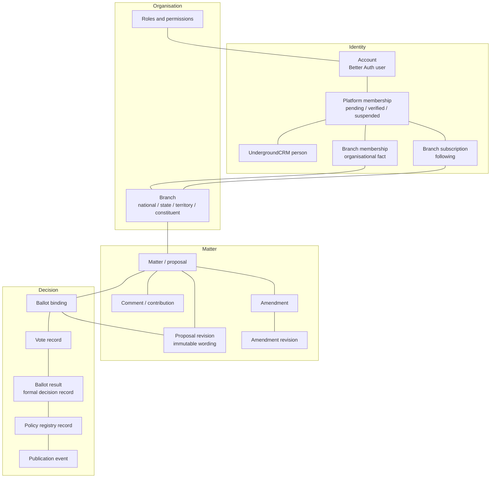
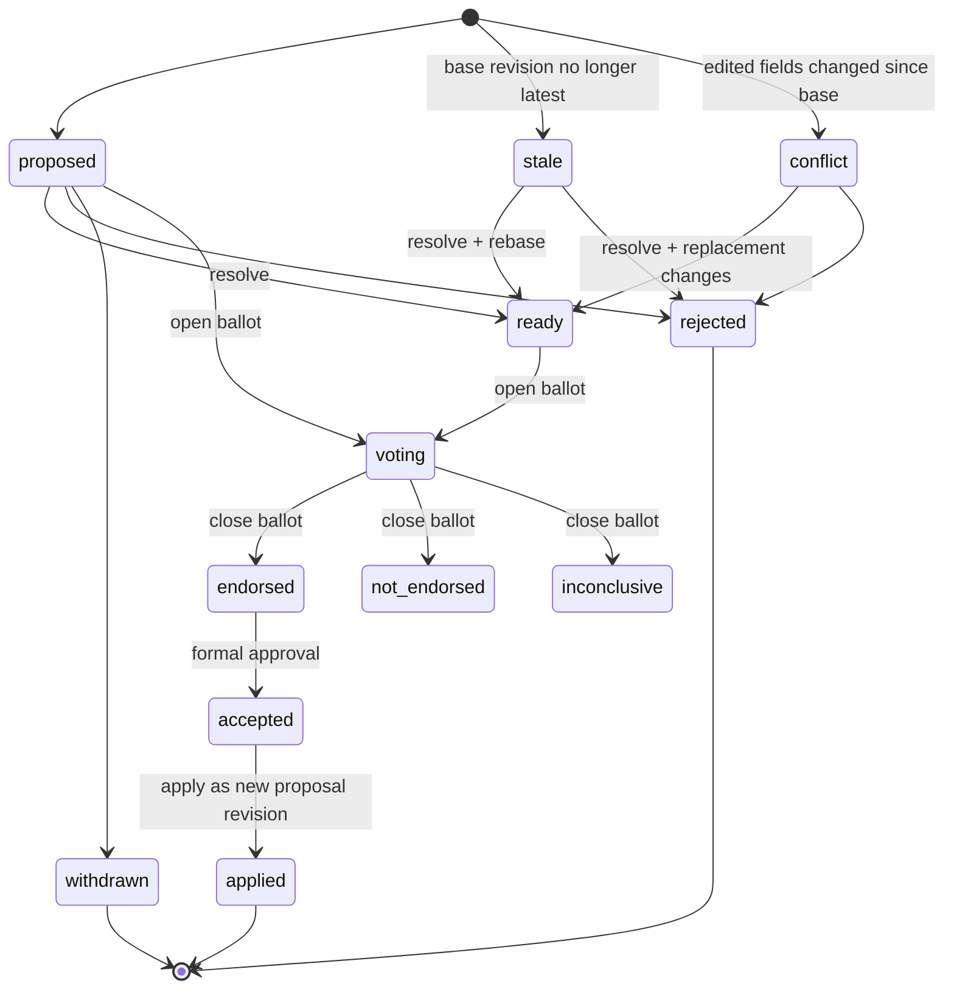

# Domain model

**Status:** Current · **Verified:** 16 November 2026

This page defines the concepts an engineer or agent must understand before changing behaviour. It describes the model the code actually implements. Where the model is incomplete, that is stated.

## Concept map



## Identity and membership

### Account

An account is the Better Auth `user` document. Its `_id` is the `memberId` used everywhere else. There is no separate profile collection.

An account can be disabled. A disabled account cannot obtain or retain a session. Disabling is not a membership status.

### Public profile

A public profile is a read model over the account and its existing contributions, at `/members/<memberId>/`. By default the identifier is the Better Auth `user._id`: opaque, stable and already stored on comments, proposals and amendments. It is not an email address. A future CRM seam is available but off by default: with `ENGAGE_PROFILE_CRM_IDENTIFIERS=on`, an active `crm_identity_links` record supplies the CRM person id as the canonical path and legacy member-id paths redirect with 301. A profile request reads the link locally and never calls the CRM.

The account supplies the display name, an optional plain-text biography (`user.bio`, at most 500 characters) and the profile visibility switch, edited by the owner at `/api/member/profile`. Everything else is derived on read from existing records:

- comment, proposal and amendment counts;
- comment score: the sum of net scores (`upvotes - downvotes`) across visible, non-deleted comments;
- geographic affiliation from active `branch_memberships` (national, state or territory; constituent branches are not published).

There is still no separate profile collection. Nothing is duplicated from `comments`, `proposals`, `amendments` or ballots.

Visibility is viewer-relative. A contribution appears only if the viewer could already open its proposal through `canViewProposal`; archived proposals follow the same reviewer rule as the proposal page. Deleted comments and withdrawn amendments are excluded from history and comment score. Private or branch-scoped contributions therefore never leak through counts, titles, excerpts or the profile itself. If the account document is gone but a visible contribution remains, the display name comes from the author name stored on that contribution; a name that exists only on a private proposal does not create a profile.

The owner may hide the profile. A hidden profile returns 404 to everyone else and its author links are suppressed; the owner can still preview it from My Engage. A disabled account behaves the same way. There is no self-service account deletion, so historic comments remain in their discussions.

The comment score is display-only. It never affects eligibility, permissions, ballot weight or proposal authority. There is no leaderboard or reputation tier.

### Platform membership

`memberships` records whether the person may participate in Engage:

| Status | Meaning | `canParticipate` |
|---|---|---|
| `pending` | Signed up, not yet verified. May read and save a vote preference. | No |
| `verified` | Confirmed as an eligible Fusion member. | Yes |
| `suspended` | Participation withdrawn. May still sign in and read. | No |

There is deliberately **no `rejected` status**. Rejection is not modelled. Do not describe suspension as rejection.

Verification provenance is stored (`verificationSource`, `verifiedAt`, `verifiedBy`, `externalPersonId`). A member may be verified manually by an officer or automatically from the CRM.

### Organisational membership

Party membership belongs to UndergroundCRM, not Engage. Engage stores the verification outcome and may store branch memberships. It must not become a second CRM.

### Branch

A branch is an organisational unit:

| Kind | Examples | Role |
|---|---|---|
| `national` | Fusion National (`branch-nat`) | National jurisdiction and default authority |
| `state` | New South Wales, Victoria, … | Geographic participation and state authority |
| `territory` | ACT, Northern Territory | Geographic participation |
| `constituent` | Created by administrators | Intra-state or affinity grouping |

Branches have a parent relationship: state/territory under national; constituent under a state or territory. Cycles and invalid parents are rejected.

Nine standard branches are seeded. No constituent branches are seeded.

### Following versus branch membership

This is the most commonly confused distinction in the product.

| Fact | Collection | Created by | Grants |
|---|---|---|---|
| **Following** | `branch_subscriptions` | The member | Discovery and updates only |
| **Branch membership** | `branch_memberships` | Branch authority, CRM, or self-service join | Eligibility to vote in that branch's ballots |

Fusion National is implicitly followed and cannot be unfollowed. A national subscription is **not** a membership fact.

Branch membership records carry a source:

- `engage-local` — officer verification or member self-service;
- `engage-legacy` — migration annotation;
- `underground-crm` — externally authoritative and not locally editable.

Only a national administrator may grant or revoke the branch administrator attribute. Ordinary branch membership is administered within the branch.

### Roles and permissions

There are three **system roles** (Member, Moderator, National Administrator) and a configurable role system:

- `application_roles` supplies legacy platform roles;
- `branch_memberships.branchRole` supplies branch administrator status;
- `rbac_assignments` joins members to `rbac_roles`, which carry explicit permission keys at national or branch scope.

Effective permissions are the union of these sources. National grants satisfy branch checks; branch grants never satisfy national checks. Permissions are operational; they are not voting eligibility or governance authority.

## Matter and wording

### Matter

A **matter** is the generic governance item. In the data model it is a `proposals` document. `ProposalRecord` is the storage type; "matter" is the extensible domain concept.

A matter has:

- identity: `proposalId` (`PROP-*` for seeded/generated proposals, `GOV-*` for governance resolutions), `slug`;
- content: `title`, `summary`, `outcomes`, `details`, attachment, provenance;
- type: `kind` — `policy` or `resolution`;
- stage: `propose`, `deliberate`, `decide`, `implement`, `archived`;
- governance coordinates: `originatingBranchId`, `governanceAuthorityBranchId`, `jurisdictionBranchId`, `scope`, `publicationScope`;
- ballot binding: `ballotRevisionId`, `ballotClosesAt`;
- history: `supersededByProposalId`, implementation note.

`scope` is a canonical geographic key for discovery. It is not a branch identity. `publicationScope` is `private`, `branch` or `national`.

### Matter type and capability

The matter registry (`src/lib/matters.ts`) declares what a type can do:

| Capability | Policy | Resolution |
|---|---|---|
| Deliberation | Yes | Yes |
| Amendments | Yes | Yes |
| Ballots | Yes | Yes |
| Ratification | Yes | **No** |
| Policy publication | Yes | **No** |
| Supersession | Yes | Yes |

Both types share the five stages and the standard transition table. A resolution can be deliberated, amended, voted and implemented, but it can never enter the Policy Registry. This is the core distinction between **policy proposals** and **governance resolutions**.

Legacy data is normalised at trust boundaries: missing or `proposal` type falls back to `resolution` for `GOV-*` IDs, otherwise `policy`; the alias `governance` maps to `resolution`; unknown non-empty types are rejected.

### Revision

A revision is an immutable snapshot of the four substantive wording fields:

```ts
{ title, summary, outcomes, details }
```

The content hash is SHA-256 over the JSON snapshot in fixed key order. A revision has a `parentRevisionId`, forming a chain. A new revision is appended only when the hash changes.

Not every field is part of wording. `attachmentUrl`, `kind`, `space` and `provenance` are not hashed and do not create a revision. Once a ballot is open or any vote exists, substantive changes are blocked rather than silently revisioned.

A **ballot revision** is the exact revision a ballot is bound to. A **composite ratified revision** may be created at ratification to combine a successful proposal revision with formally accepted amendment revisions.

Member-facing labels are ordinal and date-based ("Revision 2 · 12 Nov 2026"); raw IDs belong in audit views.

### Provenance

Two different things are called provenance:

- **Policy provenance** (`PolicyProvenance`) describes where a seeded policy came from: existing, revised, new, draft-derived, lineage links, evidence basis, uncertainty.
- **Governance provenance** is the audit chain of events and relationships: revisions, bindings, decisions, ratification, publication, supersession.

Do not use one to mean the other.

## Deliberation

### Contribution

A comment is the unit of deliberation. It has:

- an author, body (5–5,000 characters) and timestamp;
- a **stance**: `support`, `concern`, `amendment` or `comment`;
- **comment votes**: `upvotes` and `downvotes` store one choice per member. A member has at most one active vote per comment; voting the other way switches the vote, and voting the same way again clears it. Readers see the net score and upvote percentage, never the identity or individual choice of another voter. Comment votes are display-only and are not ballots;
- optional structured **contribution feedback**;
- an optional **parent comment** (`parentCommentId`) and stored `depth`. A reply is a comment whose parent is another comment in the same proposal. Replies are rendered underneath their parent; they are never flattened into the top-level list or reordered by the top-level sort;
- a **deletion placeholder**. When a comment with replies is deleted, its body is cleared, `deletedAt` is set and the record is retained so surviving replies keep their context. A comment with no replies is deleted outright.

A stance is a label. `amendment` as a stance does **not** create an amendment record. Real amendments are separate. A reply chooses its own stance; it does not inherit the parent's.

### Comment ranking

The default **Best** order applies to each sibling group. It uses the Wilson score lower bound over upvotes and downvotes, so a comment with one upvote and no downvotes does not outrank a comment with broad support. Ties fall back to net score, then older first, then `commentId`. **Top score** orders by net score, then confidence. **Newest** and **Oldest** are chronological. A parent is always followed by its own descendants; sorting never flattens a thread.

### Comment vote

A comment vote is an upvote or downvote on a contribution. A member has at most one active vote per comment; voting the other way switches it, and voting the same way again clears it. The net score and upvote percentage are display-only and never count toward a ballot, threshold, promotion or quorum. Voter identities stay server-side and are never returned to another member.

### Contribution feedback

Officers can record how a contribution was handled:

- `incorporated`
- `considered`
- `deferred`
- `declined`

Each update may cite evidence — an amendment, revision, decision or published policy — and appends to an append-only history. This closes the loop between "people commented" and "here is what changed".

### Amendment

An amendment is a proposed change to a matter's wording. It has its own immutable revision chain and lifecycle.



Key rules:

- An amendment may be created only while the matter is in Propose or Deliberate.
- It must name a base revision of that matter.
- A member may submit whole-field replacements or block-anchored suggestions. A suggestion quotes the exact title, summary paragraph, commitment or rationale paragraph it changes; the server reconstructs the whole-field `changes` used by resolution, the ballot and apply. Block anchors improve reconciliation and inline display but never change the ballot binding or adoption rules.
- `stale` means the base is no longer latest; `conflict` means an edited field has since changed.
- Resolution rebases onto the latest revision and records a new amendment revision.
- An amendment ballot can be opened only while the matter ballot is in Decide and the amendment's base equals the matter's ballot revision.
- The amendment ballot result is `endorsed`, `not-endorsed` or `inconclusive`. It is supplied by an officer, not computed from the tally.
- Formal acceptance (`accepted`) is a separate act from endorsement.
- Applying an accepted amendment creates a new proposal revision and requires the proposal to still be in Propose or Deliberate.

## Decision records

### Ballot

A ballot is the formal voting container. It records:

- a ballot ID (`proposal:<proposalId>` or `amendment:<amendmentId>`);
- matter and matter type;
- purpose (`matter_adoption`, `amendment`, `consultation`);
- the bound revision (and amendment revision where applicable);
- electorate (`national` or `branch` with a branch ID);
- governance authority and jurisdiction;
- status (`open`, `closed`, `certified`, `cancelled`);
- closing time.

The `ballots` collection is partly a projection. Records may be synthesised for proposals and amendments that do not have one. The authoritative facts are the matter, its binding, the votes and the result.

### Vote

A vote is one member's current choice on one ballot: `approve`, `abstain` or `reject`, with an optional reason and timestamp. A member may change their vote while the ballot is open. Legacy `do-not-approve` is read as `reject`.

Votes are stored in `proposal_votes`. Depending on configuration they are plaintext or AES-256-GCM encrypted with a blind index. Abstain is recorded and displayed. It counts towards quorum participation but has no effect on the Yes-versus-No approval comparison, because no abstention denominator has been decided (D10/O1).

An unverified member may save a **pending vote preference**, promoted after verification only if the bound revision still matches.

### Ballot result / formal decision

A ballot result is an immutable record that a named officer recorded an outcome for a specific ballot revision, citing an external `decisionEventId`. The result vocabulary is `successful`, `unsuccessful` or `inconclusive`.

For ballots closing on or after 16 November 2026, the result is tested against the tally and the two-tier quorum. The computed result is `successful` when quorum is met and Yes is greater than No, `unsuccessful` when quorum is met and Yes does not exceed No, and `inconclusive` when either quorum test fails. An officer may override the approval comparison with a written reason, but cannot override a quorum failure into approval or rejection. Ballots closed earlier keep the approval-only rule. The full calculation is in [../governance/ballot-quorum.md](../governance/ballot-quorum.md).

Recording a result certifies the ballot. It does not publish policy and does not move the matter by itself. An inconclusive result leaves the matter open to an explicit return to Deliberate; it does not automatically retry.

### Policy registry record

A policy registry record is created by **ratification** of a successful policy proposal. It records:

- the policy ID and ratified revision(s);
- adopted status and publication status (`unpublished`, `published`, `withdrawn`, `superseded`);
- ratifying authority, decision event and optional effective date;
- adopted amendment IDs where relevant.

Only a `published` record is authoritative public policy. Resolutions can never create one.

### Publication event

Publication, withdrawal and supersession are recorded as durable events and then reflected in the registry record. Publication is idempotent by `Idempotency-Key`. Supersession records a successor relationship and detects cycles.

### Governance event

`governance_events` and `governance_relationships` provide the audit trail: ballot bound, decision recorded, policy published, relationships between matters. Events are append-only.

## Notifications and preferences

Notification preferences are per topic and per channel. Topics are new ballots, closing deadlines, contribution responses, governance outcomes and account/membership. Channels are email, in-app and Web Push.

Channel consent is independent: push defaults off and is never inferred from email consent. Bounced or complained email addresses are suppressed and cannot be re-enabled by the member.

## Member-facing versus internal terminology

| Member-facing | Internal / code | Note |
|---|---|---|
| Proposal | Matter, `ProposalRecord`, `proposals` | "Matter" is the extensible domain term |
| Policy proposal | `kind: "policy"` | Can be ratified and published |
| Governance resolution | `kind: "resolution"` | Cannot be ratified or published |
| Stage: Propose, Deliberate, Decide, Implement | `propose`, `deliberate`, `decide`, `implement` | `archived` is also a stage |
| Revision | `proposal_revisions`, `revisionId` | Never call a raw ID a revision in UI |
| Vote | `proposal_votes`, `VoteRecord` | Formal ballot only |
| Comment / stance | `comments`, `CommentRecord` | Not a vote |
| Comment vote | `upvotes`, `downvotes`, `upvoteEvents` | Display-only; aggregate score and percentage only |
| Wording change | Amendment, `amendments` | A first-class record with its own ballot |
| Ballot outcome | `ballot_results`, `result` | Recorded against a computed approval and quorum check |
| Quorum at closure | `ballot_quorum_records` | Immutable closure snapshot; rule version `two-tier-quorum-v1` |
| Official policy | `policy_registry` with `publicationStatus: "published"` | Not a proposal, not a ballot result |
| Withdrawn / replaced | `withdrawn`, `superseded` | History is retained |
| Verify a member | `memberships.status = "verified"` | Not the same as a role |
| Join a branch | `branch_memberships` | Not the same as following |

## Invariants

- A ballot never silently changes its bound wording.
- A vote is never reinterpreted after an edit; an edit either requires a new revision or is blocked.
- Eligibility is checked on the server at the moment of voting.
- Administration does not create voting rights.
- Branch authority never crosses branches.
- A resolution never becomes policy.
- A recorded result, ratification and publication event are not mutated; later states are new records.
- Archived records and identifiable ballots remain restricted to their authorised boundary.
- Disabling an account is not the same as suspending membership.
