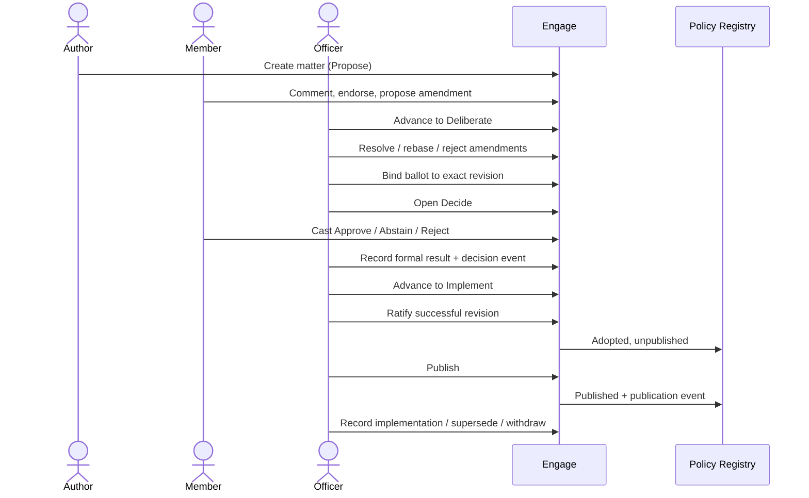

# Governance lifecycle

**Status:** Current · **Verified:** 13 November 2026

This page traces a matter from an idea to an authoritative outcome, and separates **operational workflow states** from **protected governance acts**.

## End-to-end path



## Stages

| Stage | Member-facing meaning | What is expected | Substantive edits |
|---|---|---|---|
| `propose` | **Propose** | The idea is being written and shaped. | Author or officer |
| `deliberate` | **Deliberate** | Members discuss, endorse and propose amendments. | Officer; wording may change into a new revision |
| `decide` | **Decide** | A formal ballot is open on a fixed revision. | Locked |
| `implement` | **Implement** | The outcome is recorded and being carried out. | Locked |
| `archived` | **Archived** | Closed without further active work. | Restricted to authorised viewers |

`archived` is a real lifecycle stage, not a deleted record. Archived matters and their revisions remain auditable.

The four member-facing stages are Propose, Deliberate, Decide and Implement. "Archived" is administrative terminology and should not dominate a member's reading path.

## Valid transitions

The matter registry defines 16 edges. Every edge declares `requiredPermission: "proposals.edit"` and an `authorityKind`.

| From | To | Authority kind | Notes |
|---|---|---|---|
| propose | deliberate | workflow | Normal progression |
| propose | archived | workflow | Abandon a draft |
| deliberate | propose | workflow | Return for rewriting |
| **deliberate** | **decide** | **governance** | Opens the formal ballot. Requires a revision. |
| deliberate | archived | workflow | Abandon after discussion |
| decide | deliberate | workflow | Withdraw the ballot before a result |
| **decide** | **implement** | **governance** | Requires a successful result for the bound revision |
| decide | archived | workflow | Close without implementation |
| implement | deliberate | workflow | Reopen discussion |
| implement | propose | workflow | Return to drafting |
| **implement** | **decide** | **governance** | Reopen the decision |
| implement | archived | workflow | Close completed work |
| archived | propose | workflow | Restore |
| archived | deliberate | workflow | Restore |
| **archived** | **decide** | **governance** | Restore into a ballot |
| archived | implement | workflow | Restore as implemented |

### Invalid transitions

These are rejected regardless of who asks:

- `propose → decide` — a draft must be deliberated first.
- `propose → implement` — a draft cannot skip both deliberation and decision.
- `deliberate → implement` — a matter must be voted on in Decide first.
- Any edge not in the table above.
- Any transition into a stage the matter type does not allow.

A no-op transition (same stage to same stage) is treated as valid.

### What actually gates a transition

The declared `requiredPermission` is **descriptive metadata, not enforced**. The real gate in `saveProposal` is:

- a national administrator or moderator (`isStaff`), or
- a branch administrator of the matter's `originatingBranchId`, or
- the author, only while the matter is in `propose` — and the author cannot change the stage.

Additional governance guards:

- Entering `decide` requires at least one proposal revision. If no ballot revision is set, the latest revision is bound automatically.
- A branch actor entering `decide` must have `governanceAuthorityBranchId` in their branches **and** `jurisdictionBranchId` equal to it. National administrators and moderators are not subject to this check.
- `decide → implement` requires a `ballot_results` record for the matter and the **exact** `ballotRevisionId` with `result: "successful"`.
- Once in `decide`, or once any vote exists, substantive fields are locked: title, summary, details, outcomes, attachment, kind, governance authority, jurisdiction and publication scope.
- `space`, `provenance` and `implementationNote` remain editable.

These guards are the current implementation. They are not a complete constitutional model, and some are weaker than the UI suggests (see [status/known-gaps.md](../status/known-gaps.md)).

## Phase-by-phase

### 1. Matter creation

A verified member (or staff) creates a matter. It starts in `propose`. The author supplies title, summary, outcomes, details, origin branch, optional attachment and provenance. A national administrator may set authority, jurisdiction and publication scope.

Records written: `proposals`, first `proposal_revisions`, a lifecycle event.

### 2. Initial proposal state

The author may edit while in `propose`. Every substantive save appends a revision when the wording hash changes. The author sees the current wording and revision history; other members may read a public proposal but cannot edit it.

### 3. Deliberation

An officer advances the matter to `deliberate`. Comments, endorsements and amendments become the substantive input. Deliberation can continue in `decide` and `implement` as discussion, but it can no longer change the ballot wording.

### 4. Contributions and amendments

A member may submit an amendment against a base revision while the matter is in Propose or Deliberate. The amendment is classified `proposed`, `stale` or `conflict`. An officer resolves it to `ready`, `rejected` or `withdrawn`, optionally rebasing it onto the latest revision.

### 5. Revision creation

Amendments do not edit the proposal directly. Applying an accepted amendment calls the normal proposal save path, which appends a new revision. The previous revision remains immutable.

### 6. Ballot preparation and wording binding

Entering `decide` binds a revision. An officer may also bind explicitly through `POST /api/admin/ballots/bind`, which requires `ballots.bind` and matching authority/jurisdiction. Binding:

- refuses if the matter is not in `decide`;
- refuses if the revision does not belong to the matter;
- refuses to rebind when a different revision is already recorded or any vote names a different revision;
- attaches only unbound votes;
- writes a `ballot_binding_events` record and a `governance_events` `ballot.bound` event.

If binding is inconsistent, new votes are refused.

### 7. Eligibility and voting

Eligibility is resolved at vote time:

- national ballot — any verified member;
- branch ballot — verified member with active membership of the exact branch;
- follower — not eligible;
- pending member — preference only;
- suspended member — no vote and no preference.

Votes are `approve`, `abstain` or `reject`. A member may change their vote while the ballot is open. Unique partial indexes prevent duplicate votes, including encrypted votes via a blind index.

### 8. Ballot closure

There is **no proposal-ballot close endpoint and no scheduler**. A ballot stops accepting votes when `ballotClosesAt` passes; a missing deadline leaves it open, while a malformed value counts as expired. No API sets a deadline for a newly opened ballot; only a migrated ballot has the one-off 2027-01-14 deadline.

Amendment ballots have an explicit close action.

### 9. Result recording

An officer records a result through `POST /api/admin/ballots/result`. Requirements:

- matter in `decide`;
- a bound revision;
- `ballots.record_result` at the authority branch;
- matching governance authority and jurisdiction;
- result `successful`, `unsuccessful` or `inconclusive`;
- an external `decisionEventId`.

The record is immutable, one per ballot, and certifies the ballot. The tally is available for display but is **not** compared with the result.

### 10. Formal decision processing

The formal decision is the ballot result. It creates a `governance_events` `decision.recorded` entry. Moving to Implement is a separate workflow transition that checks for a successful result on the exact revision.

### 11. Ratification

For a **policy** matter only, a national officer may ratify:

- matter must be in `implement`;
- a `ballot_results` record must exist for the exact revision with `successful`;
- the supplied `decisionEventId` must match the recorded one;
- the authority must be a recognised branch;
- an `Idempotency-Key` is required;
- optional adopted amendment IDs must each be `accepted` with matching base and approval revisions;
- a resolution is rejected with 409.

Ratification writes a `policy_registry` record with `status: "adopted"` and `publicationStatus: "unpublished"`. It may create a composite ratified revision containing adopted amendments.

### 12. Publication

Publication requires a ratified record, a revision, a ratification decision event and `policies.publish`. It writes a `publication_events` row and marks the registry record `published`. Only published records appear on `/policies/` and `/api/v1/`.

### 13. Implementation tracking

The `implement` stage and `implementationNote` record what happened. Implementation is descriptive; it does not create a separate policy record.

### 14. Archival and supersession

Archiving preserves the record. Supersession links a published policy to a successor. Withdrawal removes a policy from current authority while retaining history.

- Supersession requires a published source and an **adopted** successor (not necessarily published), and detects cycles.
- Withdrawal requires a published policy, a reason and an idempotency key.
- Neither deletes the registry record or its events.

## Variants

### Policy proposal

```
Propose → Deliberate → Decide → Implement → (ratify) → (publish)
                                      └→ supersede / withdraw later
```

A policy can be ratified and published. It can adopt formally accepted amendments into a composite revision. It is the only type that enters the Policy Registry.

### Governance resolution

```
Propose → Deliberate → Decide → Implement → archived
```

A resolution has deliberation, amendments and ballots, but no ratification and no publication. Its outcome is recorded on the matter and in governance events. Attempting to ratify returns 409.

### Amendment ballot

```
proposed/stale/conflict → ready/rejected/withdrawn
ready → voting → endorsed/not-endorsed/inconclusive
endorsed → accepted → applied
```

An amendment ballot runs only while the parent matter is in `decide` and the amendment's base equals the matter's ballot revision. It shares the matter's deadline. The result is an endorsement decision, not adoption: formal acceptance and application are separate acts.

### Consultation

The ballot model reserves a `consultation` purpose, but no production consultation workflow is implemented. Do not describe one as available.

## Protected acts versus workflow states

| Act | Type | Who | Record |
|---|---|---|---|
| Create matter | Participation | Verified member | Proposal + revision |
| Comment / endorse | Participation | Verified member | Comment record / upvote event |
| Submit amendment | Participation | Verified member | Amendment + amendment revision |
| Advance to Deliberate | Workflow | Staff or origin branch admin | Stage change, lifecycle event |
| Resolve amendment | Workflow | Branch/national administrator | Amendment revision + decision |
| **Bind ballot wording** | **Governance** | `ballots.bind` + matching authority | Binding event |
| **Open Decide** | **Governance** | Staff/origin branch admin with guards | Stage change |
| Cast vote | Formal participation | Eligible verified voter | Vote record |
| **Record result** | **Governance** | `ballots.record_result` + matching authority | Immutable ballot result + event |
| **Advance to Implement** | **Governance** | Staff/origin branch admin, successful result required | Stage change |
| **Ratify** | **Governance** | `policies.ratify` (national) | Registry record |
| **Publish / withdraw / supersede** | **Governance** | `policies.publish` (national) | Publication event + registry state |
| Archive | Workflow | Staff/origin branch admin | Stage change |

A workflow state can be reversed. A protected act cannot: later corrections are new records.

## Failure and exception paths

| Situation | Current behaviour |
|---|---|
| No revision exists when entering Decide | Transition refused; create/save the proposal first |
| Branch actor's authority and jurisdiction differ | Transition to Decide refused |
| Ballot has no deadline | It remains open; no API sets one for new ballots |
| Ballot deadline passes | Votes refused; no automatic close record |
| Result recorded without a tally | Allowed; result is officer-supplied |
| Matter returned to Deliberate after a ballot, wording edited, then returned to Decide | Existing `ballotRevisionId` is retained; the ballot is **not** rebound to the new revision |
| Amendment base no longer latest | Amendment becomes `stale`; applying requires a current base |
| Two amendments change the same field | Both can be `ready`; no inter-amendment conflict detection |
| Ratifying authority differs from the ballot result's authority | Not cross-checked |
| Superseded policy's successor is unpublished | Public page may link to a policy that is not visible |
| CRM unavailable during verification | Retryable failure; membership not revoked |

## What is deliberately missing

- Thresholds, quorum, turnout, tie-breaking, abstention and non-voter rules.
- Notice periods, campaign windows, scheduled opening and automatic closure.
- Eligibility snapshots at ballot open.
- Seconding.
- Confirmation ballots or multiple ballot instances per matter.
- Automatic ratification.
- Preferential amendment resolution.
- A proposal-ballot "close" operation independent of the deadline.
- Re-binding after wording changes on a re-opened ballot.

These are not bugs to be quietly "fixed" with a guessed rule. Each requires a governance decision. See [status/known-gaps.md](../status/known-gaps.md) and `docs/engage-product-direction-governance-audit-2026-11-07.md` (G1–G21).
