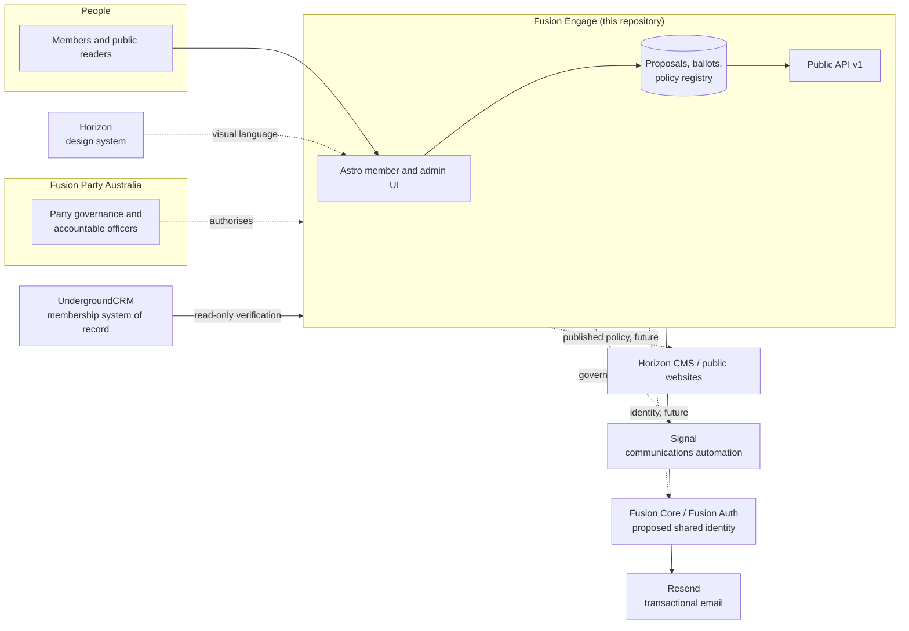

# Fusion ecosystem and integration boundaries

**Status:** Current · **Verified:** 13 November 2026

Engage is one system in a wider Fusion ecosystem. Most integration pain comes from assuming two systems are connected because they appear in the same strategy document. This page separates what exists from what is proposed.

## Ecosystem map

Solid arrows are implemented. Dashed arrows are organisational relationships or proposals, not deployed integrations.

## Fusion

**What it is.** Fusion Party Australia is the political party, the public brand and the accountable body. It supplies the governance rules, appoints officers and owns the policy record.

**Relationship to Engage.** Fusion authorises Engage to run participation and record outcomes. Engage does not create Fusion's constitution, branches or authority; it encodes a subset of them and records acts performed by people Fusion has authorised.

**Boundary.** Organisation policy, constitutional interpretation and decisions about thresholds or ratifying authority belong to Fusion's governance bodies. When those rules are not supplied, Engage must present an explicit gap rather than infer a rule from interface behaviour.

## Horizon

**What it is.** Fusion's shared design system: typography, colour, spacing, components, brand grammar. It is analogous to Shopify Polaris or Uber Base. It is **not** a standalone product, service or organisation, and it has no runtime API in this repository.

**Relationship to Engage.** Horizon supplies the visual language. In code it appears as:

- CSS custom properties (`--horizon-*`) and base styles in `src/styles/global.css`;
- shadcn-compatible primitives in `src/components/ui` whose variants use those tokens;
- the implementation contract in `DESIGN.md`;
- Fusion identity assets under `public/`.

**Boundary.** Horizon owns appearance and interaction conventions, not governance. A Horizon change must not alter eligibility, authority, ballot semantics or record structure. Engage must not fork a parallel visual system; see `AGENTS.md` §4.

## UndergroundCRM

**What it is.** Fusion's existing membership CRM and the authoritative source for person records, party membership and electorate fields.

**Relationship to Engage — implemented, read-only, feature-gated.**

| Concern | Authority |
|---|---|
| Person identity, contact details, party membership type/status, electorate | UndergroundCRM |
| Account identity, platform membership status, branch following/membership, roles, ballots, votes, policy records | Engage |

The integration lives in `src/lib/underground-crm.ts` and `src/lib/membership-verification.ts`, with operational detail in [integrations/underground-crm.md](../integrations/underground-crm.md).

Implemented behaviour:

- Engage calls the CRM over HTTPS with a read-scoped API credential. It never writes to the CRM.
- A member is verified only when the account email is verified, exactly one CRM person matches, that person is active and living, and an active configured Fusion membership type exists.
- The CRM person UUID is stored in `crm_identity_links`; the email is not duplicated as a key.
- A resolved state/territory electorate may create a branch membership automatically, but only when the member has no existing active branch membership. A disagreement opens a `branch_conflict` review rather than overwriting.
- CRM-sourced branch memberships cannot be revoked or edited by local branch administrators.
- CRM outages are retryable operational failures. They do not suspend or downgrade a member.
- Verification runs from a bearer-secret cron endpoint and from a sign-up queue. It is disabled unless the `ENGAGE_CRM_*` configuration is present and enabled.

**Boundary and assumptions.**

- The integration contract is a read-only adapter with configured endpoints and field mappings. Do not add write-back, webhooks or new CRM fields without an agreed contract.
- Engage does not become a second membership database. It stores the verification outcome, provenance and its own participation facts.
- If the CRM is unavailable, existing verified members retain their status. New verification waits.

## Fusion Core / Fusion Auth

**Status: proposal only. Not implemented.**

There is no Fusion Core or Fusion Auth service in this repository, no OIDC client, no SSO configuration and no package dependency. Authentication is local Better Auth: email magic link through Resend, optional Google OAuth, and passkeys.

**Relationship to Engage (future).** A shared identity service could become the account authority for Fusion products. If that happens, Engage would need an explicit migration: account linking, session issuance, role and membership mapping, and a dual-running period. None of that is designed here.

**Rule.** Do not describe Engage as using Fusion Auth today, and do not add an assumed token contract. Treat any such work as a new integration with its own decision record.

## Signal

**What it is.** Fusion's communications and publishing automation platform. It is a separate product with different responsibilities: campaign messaging, publishing workflows and audience communications.

**Relationship to Engage.** None at runtime. `src/lib/integrations.ts` contains only the CRM adapter seam and an idempotency helper. Signal is named in `PRODUCT.md` and ADR 0003 as outside the current product goal and deferred.

**Boundary.** Engage owns governance notifications to its own members (ballot openings, deadlines, outcomes, membership decisions). It should not become a general campaign send engine, and Signal should not become the system of record for a ballot. A future integration would consume approved governance events; it must not publish a decision before Engage has recorded it.

## Horizon CMS and public websites

**What it is.** Fusion's public content management and web presence. The repository contains a read-only national website corpus (`national-neon-site/`) and Reclaim policy corpus (`corpus/`), but these are source material, not a live CMS integration.

**Relationship to Engage.** Currently one-way and manual: published policy is visible on Engage and through `/api/v1/`. A future CMS could consume the public API to present adopted policy on the main website.

**Boundary.** Engage publishes governance records, not marketing pages. The public API exposes only `published` registry revisions, with stable IDs, versions, provenance and authority. A consumer must not treat proposals, ballot results or unpublished drafts as official policy. No CMS integration is deployed.

## Data sources and historical programmes

| Source | Role | Live integration? |
|---|---|---|
| Reclaim policy corpus (76 policies, 2 governance resolutions) | Seeded as **proposals**, not adopted registry policy | No — static seed in `src/data/policies.json` |
| National website corpus (`national-neon-site/`) | Reference material for a future baseline import | No |
| `corpus/reconciliation/` | Mapping and reconciliation analysis for Reclaim ↔ national policy | No — offline artefacts |
| `workers/reclaim-redirect/` | Unrelated redirect worker | No |

This distinction is critical: a fresh Engage deployment shows 78 seeded proposals at `/proposals/`, and an **empty** `/policies/` registry. Seeded content is not official policy.

## Ownership boundaries

| Decision | Owner | System of record |
|---|---|---|
| Who is a party member | Fusion / UndergroundCRM | CRM |
| Who may sign in to Engage | Engage | Better Auth `user` |
| Who is verified to participate | Engage, using CRM or officer decision | `memberships` |
| Which branch a person belongs to | Branch authority or CRM | `branch_memberships` |
| Which branch a person follows | The member | `branch_subscriptions` |
| Who may administer what | Engage RBAC | `application_roles`, `branch_memberships`, `rbac_assignments` |
| Which body has governance authority | Recorded on the matter by an authorised officer | `proposals.governanceAuthorityBranchId` |
| What was voted on | Engage | `proposal_revisions`, ballot binding |
| What the outcome was | Authorised officer, citing a decision event | `ballot_results` |
| Whether policy is official | National ratification and publication | `policy_registry`, `publication_events` |
| How it looks | Horizon | `DESIGN.md`, `src/styles/global.css` |
| What members are told | Engage notification preferences and Signal (separate) | `engagement_*`, `member_notifications` |

## Integration failure assumptions

- **CRM unavailable:** verification attempts fail retryably; no membership is revoked. Administrators see review items.
- **Resend unavailable:** sign-in and digest email fail. In-app records may still exist, but the user cannot receive a magic link. Operators must treat email as a dependency.
- **Public API consumer unavailable:** no effect on governance. The API is read-only.
- **Horizon visual change:** no effect on records. A design change must not alter governance behaviour.
- **No shared identity:** a Fusion-wide logout or account change does not propagate. Each Engage account is local.

## What not to assume

- Do not assume a Fusion Core token exists or that Google is the Fusion identity provider.
- Do not assume Signal receives governance outcomes.
- Do not assume the public website reads Engage policy.
- Do not assume CRM membership alone grants Engage participation; platform verification and branch membership are separate.
- Do not assume a branch administrator speaks for the national party.
- Do not assume the Reclaim seed is adopted policy.
