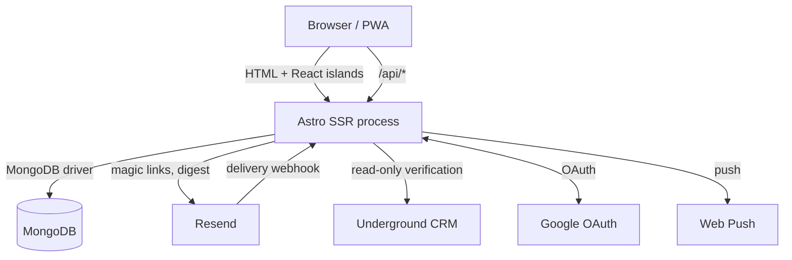
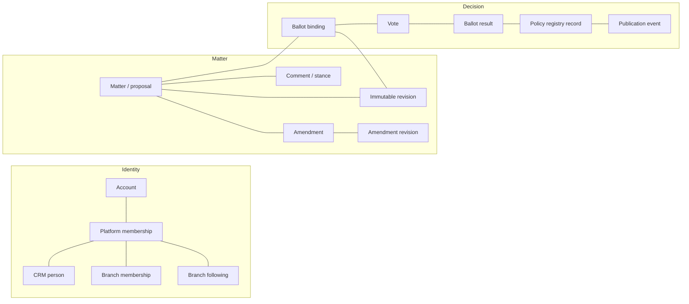
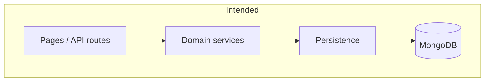
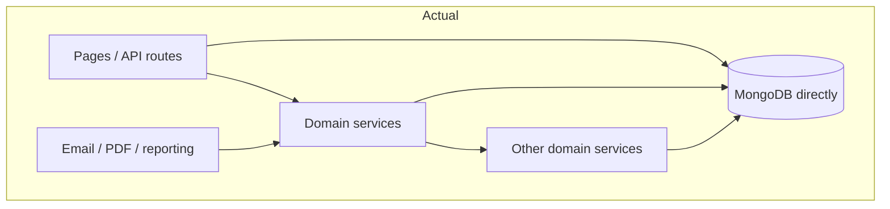
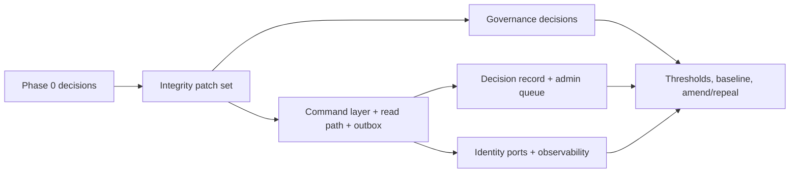

# RFC 0001 — From working governance prototype to durable participation platform

| Field | Value |
|---|---|
| **Status** | Proposed |
| **Date** | 14 November 2026 |
| **Author** | Engineering research pass commissioned by the maintainer |
| **Decision owner** | Engage maintainer |
| **Scope** | Product direction, domain architecture, technical architecture, governance integrity, operations and UX |
| **Implementation** | Not authorised by this document. Each recommendation needs a separate decision and scoped change. |
| **Repository baseline** | `main` at `52ffaf6` (14 November 2026) |
| **Companion** | [Evidence register](0001-evidence-register.md) |

> **This is a proposal, not an approved plan.** Recommendations are labelled and prioritised. Governance rules that Fusion has not supplied are recorded as open questions, not invented.

---

## 1. Maintainer summary

### The verdict

Engage's domain model is stronger than most systems studied for this review. The separation of five authorities, immutable revisions, revision-bound ballots, officer-recorded results, and separate ratification and publication are the right foundations. Preserve them.

The main problem is that **the product sometimes promises more than the code guarantees**. A ballot can open without a close date. Notifications are designed but not sent. Nine permission keys are declared but not enforced. A re-opened ballot can stay bound to superseded wording. A formal result and its audit event are written separately. A matter can be hard-deleted after a vote. CRM branch assignment conflicts with a national row created during ordinary sign-in.

The second problem is concentration. `store.ts` is 2,944 lines and mixes authorisation, validation, persistence, revisioning, voting and member administration. The proposal page is 4,035 lines with roughly 2,400 lines of inline client script. Thirty-one page and API files query MongoDB directly. There is no central route guard. This makes every change slower and harder to verify.

### What already works and should not be redesigned

- Five separate authorities, with no inference from one to another.
- Immutable revisions and a ballot bound to an exact revision.
- A recorded result that is not derived from a tally.
- Ratification and publication as distinct acts with durable events.
- DTO allowlists and server-side re-checks on consequential acts.
- Following versus branch membership, kept deliberately separate.
- A read-only, feature-gated CRM adapter that cannot write to the CRM.
- A next-action member experience that is stronger than most of the reference products.
- A real-MongoDB CI path, 291 tests passing and 0 type errors at the baseline.

### The seven changes that matter most

1. **Make every promise true before adding capability.** Fix the integrity patch set: deadlines, atomic result and audit writes, lifecycle events for every protected act, explicit rebinding, catalogue-enforced permissions, no hard deletion of voted matters, and the CRM national-row conflict.
2. **Introduce a governance command layer.** One server-side command per protected act, with authorisation, invariants, persistence and audit together. Routes become thin adapters. This is a strangler refactor, not a rewrite.
3. **Make the record readable.** One decision record per matter: exact wording, revision hash, amendments, ballot, result, ratification, publication and successor. This is the product's strongest differentiator and it is currently assembled by the reader from scattered sections.
4. **Fix the read path before it becomes a scaling problem.** `listProposals` loads every proposal, every comment and every vote, then decrypts every vote, on ordinary list pages. Replace it with database-side counts and a tally projection.
5. **Wire essential notifications through a durable outbox.** Ballot opened, closing soon, result recorded, policy published and contribution response. Respect channel consent and dedupe. Do not build a campaign engine.
6. **Give administrators a responsibility queue, not a dashboard.** Keep the attention groups, add operational ownership, age, saved views and one primary action. Assignment must never grant authority.
7. **Protect the CRM and identity boundary.** Keep Engage's local identity and governance facts. Define ports for membership verification and future OIDC. Do not build Fusion Auth now, and do not let CRM availability enter a member request path.

### What not to do

Do not rewrite the application. Do not adopt a relationship-authorisation engine, event sourcing, a microservice split, a generic workflow builder, blockchain, gamification or AI-authored official summaries. Engage's scale does not justify them, and several would weaken the governance boundary. See [section 11](#11-explicit-non-goals).

### Decisions requested from the maintainer

Many recommendations are already captured in the open issue register (#26–#44). This RFC sequences them and identifies ten new findings that need an issue before implementation. See [section 9.8](#98-alignment-with-open-issues).

Fourteen questions are recorded in [section 13](#13-open-questions-requiring-maintainer-decisions). The most urgent:

- Is a closing date mandatory for every ballot, and what notice period applies?
- Is eligibility snapshotted at ballot open or checked at vote time?
- May a moderator open Decide, or only a ballot officer?
- Must the ratifying authority equal the result authority?
- Is the national policy baseline to be imported, and who authorises it?
- Should vote encryption become the default, and who holds the keys?
- Is Fusion Core or shared OIDC planned within twelve months?

Until those are answered, engineering can harden what exists without inventing a constitutional rule.

### Expected outcome

A member should be able to find what needs them, read one page that proves what was voted on, trust that a ballot cannot silently change wording or run forever, receive the notifications the product promises, and see roles described in outcomes. An officer should be able to complete a governance act without understanding MongoDB. An auditor should be able to reconstruct authority, wording, eligibility, outcome and publication from durable records.

---

## 2. Problem statement and goals

### 2.1 The problem

Engage has moved quickly from a Reclaim policy review prototype to a general participation platform. The domain model has matured faster than the enforcement surface around it. The result is a set of specific asymmetries:

| Area | What the product implies | What the code currently guarantees |
|---|---|---|
| Ballot timing | A ballot opens and closes | A new ballot has no closing date; only migrated ballots do |
| Notifications | Members are told when a ballot opens or a result is recorded | The fan-out function exists but has no production caller |
| Permissions | A delegated role can do what its description says | Several keys are declared but unused; some acts still check `isAdmin` or `isStaff` |
| Ballot wording | A ballot is frozen to one revision | A re-opened ballot keeps its old binding and is not rebound |
| Audit | Every governance act is recorded | Stage transitions, amendment ballot opening and closing, and some result writes have no governance event |
| Deletion | History is retained | An administrator can hard-delete a matter after votes exist |
| CRM branch assignment | The CRM supplies the geographic branch | A national membership row created on sign-in causes a recurring conflict review |
| Administration | Roles are understandable and safe | The role editor shows raw keys and uses `window.prompt` for revocation |

This is the central problem: **Engage is a trust product whose guarantees are unevenly enforced.** Adding features before closing that gap increases the number of places where the interface can be wrong.

### 2.2 Why this matters more than feature breadth

A participatory governance platform is judged on whether people believe the record. If a ballot can run without a deadline, a result can be recorded without an event, or a matter can disappear after a vote, the product's strongest claim is damaged. Members do not need every possible governance rule. They need the rules that exist to be true, visible and consistently applied.

### 2.3 Goals

1. **Make the existing governance model truthful.** Every protected act is authorised, validated, persisted and audited in one place.
2. **Make the record legible.** A member or auditor can reconstruct the path from idea to published policy without assembling it from separate screens.
3. **Reduce architectural concentration.** Separate domain commands from HTTP and Astro, so a change to one governance act does not risk unrelated send paths.
4. **Make the system observable and operable.** Jobs run, failures are visible, backups are tested, and a deployment can be rolled back safely.
5. **Preserve what works.** Do not replace the five authorities, immutable revisions, revision binding, recorded results, separate ratification or branch-scoped permissions.
6. **Keep the product small.** Prefer deletion, consolidation and clear defaults over new modules, settings and abstractions.

### 2.4 Success criteria

The RFC is successful when the following are demonstrably true:

- A new ballot cannot enter Decide without a future closing date, and expiry is enforced server-side.
- Every stage transition, ballot binding, result, ratification and publication writes exactly one durable audit event in the same transaction as the state change.
- A hard delete cannot remove a matter that has a revision beyond its initial draft, a vote, a result or a registry record.
- Every declared permission key is either enforced by at least one route and service path, or removed from the catalogue.
- A member with a custom role that grants `proposals.edit` can edit a proposal in scope, and a member without it cannot.
- A re-opened ballot is either explicitly rebound with an event or refused until an officer chooses.
- Opening a ballot or recording a result produces at most one in-app notification and one email per eligible member per event, respecting consent.
- The proposal list page does not read or decrypt individual votes.
- Session resolution performs no writes; any remaining write on an authenticated GET is an explicit lifecycle event with a documented purpose.
- Every governance event needed for an audit can be queried by matter or actor and rendered in human language.
- A restore from backup has been rehearsed and timed.

### 2.5 Non-goals of the immediate work

The RFC does not attempt to settle thresholds, quorum, notice periods, seconding, branch ratification, confirmation ballots, automatic ratification or the legal status of legacy policy. Those require Fusion decisions.

---

## 3. Existing application architecture

### 3.1 Stack and runtime

| Concern | Current choice |
|---|---|
| Framework | Astro 7, `output: "server"`, Node standalone adapter |
| UI | Astro components plus React 19 islands, `client:load` |
| Styling | Tailwind CSS 4, Horizon tokens in `src/styles/global.css`, shadcn-compatible primitives |
| Language | TypeScript, Node 22+ declared, Node 24 in the container |
| Database | MongoDB 6 driver, single-node replica set in Compose, in-memory fallback in development |
| Authentication | Better Auth 1.7: email magic link, Google OAuth, passkeys, MongoDB adapter |
| Email | Resend REST API |
| Push | `web-push` with VAPID |
| Jobs | HTTP cron endpoints called by an external scheduler; no in-process timer |
| Tests | `node --test` with TypeScript stripping; Playwright journey in CI |
| Deployment | Docker image, Coolify or NUC, Cloudflare Tunnel |

There is no ORM, no schema validation library, no job queue, no middleware and no separate backend service. One Node process serves SSR pages and API routes. This simplicity is appropriate for the current scale and should be retained unless evidence demands otherwise.



### 3.2 Domain model

The domain model is documented in [`docs/domain/domain-model.md`](../domain/domain-model.md) and is stronger than the implementation surface in several respects.



The five authorities are the most important design decision in the product:

| Authority | Record | What it must never grant |
|---|---|---|
| Participation eligibility | `memberships.status` plus branch membership | Administrative permission, governance authority |
| Organisational membership | CRM facts plus `branch_memberships` | Engage account verification by itself |
| Administrative permission | `application_roles`, `branchRole`, `rbac_assignments` | Voting eligibility, governance authority |
| Governance authority | `governanceAuthorityBranchId`, `jurisdictionBranchId` | Publication authority, ballot eligibility |
| Publication authority | `policies.ratify`, `policies.publish`, registry state | Ballot eligibility, the right to decide |

This separation is correct and should be preserved. The review found no case where the design intended to collapse these authorities. The defects are enforcement gaps, not conceptual confusion.

### 3.3 Request lifecycle

A page request:

1. Astro runs the page frontmatter on the server.
2. The layout resolves the database and session.
3. `getSessionUser` loads the account, platform membership, roles, every active branch membership, every branch subscription and the effective permission snapshot.
4. For a verified member, `ensureNationalMembership` performs an upsert.
5. The page queries services or MongoDB directly and renders HTML.
6. React islands hydrate with `client:load`.
7. Authenticated responses set `cache-control: private, no-store`.

An API request:

1. `runtimeEnv(locals)` resolves configuration.
2. `getSessionUser` resolves the session.
3. The route checks authentication and, sometimes, a permission.
4. Input is parsed by hand.
5. A domain service performs the action and re-checks some permissions.
6. The route maps the result through a DTO allowlist.
7. Domain errors become 400/403/404/409/503 responses.

There is no `src/middleware.ts` and no route manifest. A new route inherits nothing by default. The architecture documentation names this as a known weakness, and the review confirms it: about 31 page and API files call `db.collection(...)` directly.

### 3.4 Layering: intended versus actual





Confirmed structural findings:

| Finding | Evidence | Consequence |
|---|---|---|
| **God module** | `src/lib/store.ts` is 2,944 lines and spans proposals, comments, votes, ballots, members, revisions and RBAC checks. | A proposal change can affect email, PDF, reporting and verification paths. |
| **Pages query the database** | 31 files under `src/pages` call `db.collection`, 92 occurrences. | Document shape leaks into views; DTO allowlists are bypassed; changes are hard to trace. |
| **Giant page with inline logic** | `src/pages/proposals/[slug].astro` is 4,035 lines; the inline `<script>` is roughly 2,400 lines. | Stage controls, voting feedback, evidence UI and analytics are untestable and coupled to markup. |
| **Service-to-infrastructure inversion** | `engagement-email.ts` imports `store.ts` for member and proposal lists. | Digest sending is sensitive to unrelated domain changes. |
| **Auth cycle broken by dynamic imports** | `branch-participation.ts` imports `canAdministerBranch`; `auth.ts` and `store.ts` use dynamic imports to break cycles. | Correctness depends on the imports staying lazy. |
| **No central guard** | No middleware; routes hand-roll authentication and authorisation. | A new endpoint can be added without any policy. |
| **In-memory database is not faithful** | Projections and indexes are no-ops; no transactions. | Development and some tests can pass where production would behave differently. |

### 3.5 Persistence and integrity

The data model uses current-state documents plus append-only event collections. That is a sound choice. Key facts:

- `proposal_revisions` are immutable snapshots of `{title, summary, outcomes, details}` with SHA-256 hashes and a parent chain.
- A new revision is appended only when the hash changes.
- Votes are current-state records in `proposal_votes`, optionally AES-256-GCM encrypted with a blind index.
- `ballot_results` is intended to be immutable and one per ballot.
- `governance_events` and `governance_relationships` are append-only audit collections.
- `policy_registry` and `publication_events` record ratification and publication.
- Transactions are used for proposal writes and revision append, and in migration scripts.

Confirmed integrity gaps:

1. **`recordFormalDecision` is not atomic with its audit event.** The service inserts the result, then updates the ballot status. The route writes the governance event afterwards. A crash between these steps leaves a certified result without its event, or a result with an uncertified ballot.
2. **Stage transitions do not write governance events.** `saveProposal` updates the stage and timestamp but never calls `recordGovernanceEvent`. Moving into Decide or Implement is a protected act with no event record.
3. **Amendment ballot opening and closing do not write governance events.** `open-ballot.ts` and `close-ballot.ts` update the amendment only.
4. **Hard deletion exists.** `deleteProposal` deletes the proposal and all comments. An administrator can do this at any stage. Revisions, votes and results may remain orphaned, or the matter simply disappears.
5. **`ballot_results` has a unique index on `proposalId` only.** The ballot projection supports a one-to-many matter-to-ballot relationship, but the result store enforces one result per matter. The 1-to-many transition is incomplete.
6. **A re-opened ballot is not rebound.** `ballotRevisionId` is set only when absent and is never cleared. Returning to Deliberate, editing when no votes exist, then returning to Decide leaves the ballot on the old revision.
7. **No vote transaction.** Despite ADR 0003 describing a transactional admission protocol, `castVote` performs eligibility checks and an upsert without a session transaction. The unique index prevents duplicate votes, but eligibility and closure are not serialised with the write.
8. **Vote tallies are computed by reading every vote.** `upsertStoredVote` and `listProposals` read all votes for the ballot or for the whole collection and decode each one. This is O(votes) per request and requires the keyring on list pages.

### 3.6 Authentication and authorisation

Authentication is local Better Auth. Sessions are re-resolved on every request (`cookieCache` disabled), so role revocation takes effect immediately. Disabled accounts cannot obtain or retain a session. The development cookie is mode-gated and fails closed.

Authorisation has a sound permission catalogue of 24 keys, national and branch scopes, system role bundles and anti-escalation guards in `roles-store.ts`. The implementation does not consistently use it:

| Permission key | Declared | Enforced by route or service |
|---|---|---|
| `proposals.view_archived` | Yes | No |
| `proposals.edit` | Yes | Partly; `saveProposal` checks `isStaff` or branch administrator, not the key |
| `proposals.manage_supersession` | Yes | No |
| `proposals.delete` | Yes | No; `deleteProposal` checks `isAdmin` |
| `comments.moderate` | Yes | No; comment deletion checks `isStaff` |
| `contributions.respond` | Yes | Yes |
| `amendments.resolve` | Yes | No; route checks `isAdmin` or branch administrator |
| `amendments.apply` | Yes | No; same |
| `amendments.manage_ballot` | Yes | Yes |
| `ballots.bind` | Yes | Yes |
| `ballots.record_result` | Yes | Yes |
| `ballots.view_identifiable` | Yes | Yes |
| `policies.ratify` | Yes | Yes |
| `policies.publish` | Yes | Yes |
| `members.view` | Yes | Yes |
| `members.verify` | Yes | Yes |
| `branches.manage` | Yes | No |
| `branches.verify_members` | Yes | Yes |
| `branches.refer_proposals` | Yes | No; referral route checks `isAdmin` |
| `sense_box.review` | Yes | No |
| `reports.export` | Yes | Yes |
| `engagement.manage` | Yes | Yes |
| `settings.manage` | Yes | Yes |
| `roles.manage` | Yes | Yes |

Nine keys are effectively decorative. A custom role that grants `proposals.edit` may still be unable to edit because the service checks branch-administrator status. This is a confirmed delegation defect, not a documentation issue.

There is a second, subtler issue. `canManageBranchBallot` returns true if the user holds *any* of `ballots.bind`, `ballots.record_result` or `amendments.manage_ballot` nationally. Current routes pre-check the specific key, so the review found no exploit. But the helper's contract is broader than its name, and a future caller could rely on it incorrectly.

### 3.7 Jobs, notifications and integrations

- There is no in-process scheduler. Digest and CRM verification are HTTP endpoints with bearer secrets.
- Coolify production has no enabled scheduled tasks at the baseline.
- `dispatchMemberNotification` is fully implemented and tested but has no production caller. Only membership verification creates in-app notices.
- Web Push is optional and defaults off. Email and push consent are independent.
- Bounce and complaint suppression is enforced server-side.
- The CRM adapter is read-only and feature-flagged. It links by durable CRM UUID, records provenance and opens review items for ambiguity.
- The CRM boundary is well designed in principle: Engage stores the verification outcome and its own participation facts, not a second membership database.

However, two implementation details undermine it:

1. **`ensureNationalMembership` writes on every verified session.** It upserts an active `branch-nat` membership during `getSessionUser`. This turns a read path into a write path and creates a branch fact that CRM reconciliation treats as a conflict.
2. **Self-service branch switching bypasses the CRM source guard.** `chooseBranchMembership` revokes any active membership in the same group, including one with `source: "underground-crm"`. The administrative paths explicitly forbid this; the member path does not.

### 3.8 Testing, build and deployment

At the baseline:

- `pnpm check`: 0 errors, 0 warnings, 35 hints across 288 files.
- `pnpm test`: 291 tests, 275 passed, 16 skipped, 0 failed.
- The skipped suites are the real-MongoDB persistence tests, which CI runs against a single-node replica set.
- CI also builds the server and runs one Playwright member lifecycle journey.
- `deploy-nuc.sh` pulls an image, switches a release symlink, starts the app, polls health and rolls back on failure.
- The production container is limited to 256 MB memory and 0.75 CPU, with a single-node MongoDB.

The build and deployment path is more mature than the application's internal structure. The main gaps are observability, scheduler configuration, backup rehearsal and browser coverage beyond one journey.

### 3.9 Architecture assessment

| Dimension | Assessment | Basis |
|---|---|---|
| Domain correctness | **Strong, with specific gaps** | Five authorities, revisions, binding, recorded results, registry separation |
| Enforcement consistency | **Weak** | Nine unused permission keys; service checks diverge from routes |
| Audit completeness | **Partial** | Binding, results and publication are recorded; stage transitions and amendment ballots are not |
| Transactional integrity | **Partial** | Proposal writes use transactions; vote admission and result+event do not |
| Read scalability | **Weak** | Full collection scans and per-vote decryption on list pages |
| Maintainability | **Weak** | 2,944-line service, 4,035-line page, direct database access in views |
| Security posture | **Moderate** | Good DTOs and session handling; perimeter headers and general rate limiting absent |
| Observability | **Weak** | Logs and a health probe only; no metrics, traces or alerting |
| UX coherence | **Strong foundation, uneven execution** | Next-action hero and eligibility clarity are good; admin and lineage surfaces are fragmented |
| Deployment | **Good** | Non-root container, health check, rollback; scheduler and backup verification incomplete |
| Test coverage | **Good for domain logic, thin for UI and scale** | 291 tests; one browser journey; no load or accessibility audit |

---

## 4. Research methodology

### 4.1 Questions

The review asked:

1. What does Engage actually do, as distinct from what its documentation says?
2. Where are the highest-risk gaps between the governance model and its enforcement?
3. Which mature products solve adjacent problems in ways that transfer as principles rather than interfaces?
4. Which improvements deliver the most benefit relative to complexity, cost and maintenance burden?
5. What should Engage deliberately not build?

### 4.2 Sources

Three source types were used:

1. **Repository evidence.** Application code, documentation, schemas, tests, CI, deployment configuration and migration scripts. This is primary evidence for current behaviour.
2. **Official product documentation.** OpenFGA, Keycloak, Authentik, Supabase, Stripe, Modern Treasury, Temporal, GitHub, Wagtail, Sanity and Decidim. This is evidence of documented behaviour, not proof that every deployment or plan behaves identically.
3. **Existing Engage research.** The twelve-platform cross-industry register and the Decidim/CONSUL/Loomio comparison already in `docs/research/`. This RFC does not re-derive their UX findings; it uses them as secondary evidence and focuses on the architecture and governance gaps they did not cover.

### 4.3 Method

- Read the canonical documentation set first, then verify each material claim against code.
- Use `rg` to enumerate permission keys, database access, transaction usage, deadline writers and notification callers.
- Run `pnpm check` and `pnpm test` at the baseline.
- Review the deployment and CI paths.
- For each external pattern, record the problem, the reference approach, the evidence, the Engage equivalent, transferability, required change, benefit, complexity and risks.
- Separate observation, external evidence, assumption and recommendation.
- Prefer the smallest change that closes a real gap.

### 4.4 Evidence vocabulary

| Label | Meaning |
|---|---|
| **Observed** | Directly visible in the repository or a command output at the baseline. |
| **Documented** | Stated by an official product or standards source. |
| **Inferred** | A reasoned interpretation that was not directly tested. |
| **Recommendation** | A proposed direction, not current behaviour. |
| **Unverified** | Plausible but not established by this review. |

### 4.5 Limitations

No application code, data model, database migration, permission, deployment configuration or production record was changed during this review. The only repository changes are documentation.

- No member or administrator usability test was run.
- No production analytics, support tickets, CRM data or ballot data were inspected.
- No load test was run. The performance findings are structural, based on query shape, not measured latency.
- No screen-reader or automated WCAG audit was run.
- No legal or constitutional review was performed.
- Authenticated surfaces of several commercial products could not be inspected; their patterns are assessed from documentation.
- The review did not use REA or reverse-engineer proprietary code. Open-source and public documentation only.
- Line references can drift. File paths and symbol names are the durable evidence.

### 4.6 Baseline verification log

| Check | Result |
|---|---|
| `git rev-parse --short HEAD` | `52ffaf6` on `main` |
| `pnpm check` | 0 errors, 0 warnings, 35 hints, 288 files |
| `pnpm test` | 291 tests, 275 pass, 16 skip, 0 fail |
| Real MongoDB suites | Skipped locally; configured in CI |
| Browser journeys | One member lifecycle journey in CI; not run locally |
| Load test | Not run |
| Accessibility audit | Not run |

---

## 5. Cross-industry comparative findings

The objective is to transfer principles, not copy interfaces or architectures. Each pattern below states the problem, the reference approach, the evidence, the Engage equivalent, whether it transfers, what would change, the expected benefit, complexity and risks.

### 5.1 At a glance

| # | Pattern | Best references | Transfer to Engage | Verdict |
|---|---|---|---|---|
| 1 | Relationship-based authorisation | OpenFGA / Zanzibar | Partly | Keep scoped RBAC; borrow the decision model, not the engine |
| 2 | Identity realms and session revocation | Keycloak, Authentik | Yes | Keep local auth; define an OIDC seam |
| 3 | Defence-in-depth policy enforcement | Supabase RLS | Yes | Central guard plus service checks, not database RLS |
| 4 | Protected transitions and stale approval | GitHub, Wagtail | Yes | Make transitions commands with prerequisites and event records |
| 5 | Atomic publication and releases | Sanity, Modern Treasury | Yes | Bind ballot, result, ratification and publication to exact versions |
| 6 | Idempotency and durable execution | Stripe, Temporal, outbox | Yes | Outbox + idempotent handlers; no Temporal |
| 7 | Append-only ledger integrity | Modern Treasury, Decidim | Yes | Event log and content fingerprints; no blockchain |
| 8 | Revision history and review | Decidim, GitHub, Wikipedia | Yes | Human revision summaries and exact-version review |
| 9 | Notification relevance | Discourse, Linear | Yes | Per-matter follow and reasons; no engagement scoring |
| 10 | Operational responsibility | Wagtail, Linear, Zendesk | Yes | Steward and queue, separate from authority |

### 5.2 Pattern 1 — Relationship-based authorisation

**Problem.** As objects and scopes multiply, role checks scattered through handlers become inconsistent. The system cannot answer "who may act on this object, and why?" from one place.

**Reference approach.** OpenFGA models authorisation as relationship tuples `(user, relation, object)` checked against a type definition and an authorization model. It supports direct, implied and contextual relationships, conditions, and `Check`, `ListObjects` and `ListUsers` queries. Zanzibar is the originating design.

**Evidence.** OpenFGA's official concepts documentation describes types, relations, tuples, conditions, contextual tuples and check requests. The model separates the *policy definition* from the *relationship data*, so a decision can be evaluated consistently and explained.

**Engage today.** Engage has a role-and-scope model, not a relationship graph. It already separates governance authority and eligibility from administrative permission, which is more important than the evaluation engine. What it lacks is a single decision point: routes, services and helpers each check different facts.

**Transferable?** The *decision model* is transferable. The *engine* is not justified. Engage has tens of branches and a small object graph. A relationship store would add a service, a consistency problem and a new failure mode without improving the governance boundary.

**What would change.** Introduce a small policy-decision module with explicit decisions such as `canEditMatter(user, matter)`, `canBindBallot(user, matter)`, `canRecordResult(user, matter)`, `canViewIdentifiableBallots(user, matter)`. Each decision returns allow/deny plus reasons and the facts used. Routes and services call it; the UI can render the reasons. Keep the existing add-only RBAC and branch scope.

**Benefit.** One place to test allow and deny, one explanation for the interface, and no drift between a route check and a service check.

**Complexity.** Medium. It is a refactor of checks, not a new service.

**Risks and alternatives.** A full ReBAC engine would weaken the constitutional boundary by making authority look configurable. A pure role check without object context would repeat today's drift. The recommended middle path is a typed decision function over existing facts.

### 5.3 Pattern 2 — Identity realms, sessions and delegation

**Problem.** Authentication, account lifecycle, role mapping and session revocation become tangled when each application implements them differently.

**Reference approach.** Keycloak isolates users, roles and clients in realms; roles can be composite; groups carry attributes and role mappings; sessions can be revoked; identity brokering delegates authentication to external providers. Authentik models authentication and authorisation as flows of stages guarded by policies, with separate designations for authentication, authorisation, enrolment, recovery and invalidation.

**Evidence.** Keycloak's server administration guide documents realms, roles, composite roles, groups, identity brokering, session management and admin audit events. Authentik's flow documentation describes stages, policy binding and flow designations.

**Engage today.** Local Better Auth with email magic link, Google and passkeys. Sessions are re-resolved per request, so revocation is immediate. There is no shared identity, no SSO and no OIDC client. The CRM is a membership source, not an identity provider.

**Transferable?** The separation of concerns is transferable; the product is not. Engage does not need Keycloak or Authentik to run one application. It does need a clean identity port so a future Fusion-wide identity can be added without rewriting session handling.

**What would change.** Define an `IdentityProvider` boundary around session resolution and account lifecycle. Keep Better Auth as the current adapter. If Fusion Core or shared OIDC arrives, add an adapter and a dual-running migration; do not make CRM membership the login authority.

**Benefit.** Future SSO without a rewrite; clear account-versus-membership boundary; preserved immediate revocation.

**Complexity.** Low now, high if deferred until a second product needs SSO.

**Risks and alternatives.** Building a shared identity service now would add operational burden and couple Engage to an unbuilt platform. Treating CRM as an IdP would conflate organisational membership with account identity.

### 5.4 Pattern 3 — Defence in depth for policy enforcement

**Problem.** A single authorisation check in a handler is easy to bypass when another caller, script or route reaches the same data.

**Reference approach.** Supabase Row Level Security attaches policies to tables, so every query is filtered inside the database. The documentation explicitly frames this as defence in depth and requires allow/deny tests for each operation and role.

**Evidence.** Supabase's RLS guide states that policies run inside the database, that grants and policies are separate checks, and that every table in an exposed schema needs policies and tests.

**Engage today.** MongoDB has no row-level security. Authorisation is application-level. The architecture rule says authorisation belongs on the server and in the service that performs the act, but several services rely on the route having checked first, and pages query collections directly.

**Transferable?** The principle is transferable; the mechanism is not. Engage cannot rely on database RLS. It can rely on a single command layer that is the only write path for protected acts, plus a central route guard for reads.

**What would change.** Make protected writes go through commands that re-check authorisation. Add a central route policy manifest so a new route cannot be anonymous by accident. Add contract tests that enumerate routes and assert their policy. Keep DTO minimisation as the read boundary.

**Benefit.** Fewer bypass paths; a new endpoint inherits a policy; authorisation tests become systematic.

**Complexity.** Medium.

**Risks and alternatives.** A database-level policy layer would require a different database and a large migration. A middleware-only check would not protect service calls from scripts or other services.

### 5.5 Pattern 4 — Protected transitions, prerequisites and stale approvals

**Problem.** A workflow with free-form status changes lets an actor skip a prerequisite, approve stale work, or move an object without a record.

**Reference approach.** GitHub protected branches require reviews, status checks and conversation resolution; approvals can be dismissed as stale when the diff changes; administrators can be included in the restrictions; the settings are explicit. Wagtail workflows are ordered tasks that must be approved; submission is bound to a revision; approval, rejection, resumption and cancellation are audited; a task's name is immutable to preserve history.

**Evidence.** GitHub's protected-branch documentation describes required reviews, required checks, stale-approval dismissal and the "do not allow bypassing" setting. Wagtail's workflow documentation describes revision-bound submission, group approval tasks, workflow history and audit entries for each transition.

**Engage today.** The matter registry defines 16 valid edges and a `requiredPermission` field. The field is descriptive metadata; `saveProposal` does not check it. The stage is a `<select>` in the admin form, and the server may reject the choice afterwards. Ballot binding is revision-bound, which is strong, but a re-opened ballot is not rebound, and a moderator can open Decide without a ballot permission.

**Transferable?** Yes, strongly. Engage already has the domain concepts; it needs to make the transition the unit of authorisation and audit.

**What would change.** Replace free stage updates with named commands: `sendToDeliberation`, `openDecision`, `recordResult`, `advanceToImplementation`, `archiveMatter`. Each command declares the required permission, the authority match, the prerequisites and the event it writes. The UI renders only valid next actions, with disabled reasons. Re-opening a ballot requires an explicit rebind when the revision changed, analogous to GitHub dismissing a stale approval.

**Benefit.** The interface stops offering invalid actions; every transition is auditable; stale wording cannot be voted on silently.

**Complexity.** Medium to high, but incremental.

**Risks and alternatives.** A generic workflow builder would let administrators change constitutional stages. A UI-only fix would leave the server permissive. The command layer must remain code-defined, not administrator-configurable.

### 5.6 Pattern 5 — Atomic publication and versioned releases

**Problem.** Coordinating related changes so that consumers never see a half-published state.

**Reference approach.** Sanity Content Releases groups document changes into a release that can be previewed, validated, scheduled and published together; scheduled releases lock their versions. Modern Treasury ledgers make posted transactions immutable, preserve versions, support idempotency and write entries atomically. GitHub binds an approval to a diff and dismisses it when the diff changes.

**Evidence.** Sanity documents release types, version pinning, scheduling, validation and the locking of scheduled releases. Modern Treasury documents balanced, immutable, idempotent, atomic ledger writes and historical versions. GitHub documents stale-approval dismissal.

**Engage today.** A ballot is bound to one revision, which is conceptually strong. Ratification creates a registry record with a composite ratified revision when amendments are adopted. Publication writes an event and updates the status. But the result, the ballot certification and the governance event are separate writes; a crash can leave a partial state.

**Transferable?** Yes. Engage does not need a release-management product. It needs the same invariants: exact version, atomic state change, immutable posted record, idempotent retry.

**What would change.** Make binding, result, certification and event one transaction. Make ratification and publication idempotent with a stored key and response. Make the decision record show the exact revision hash and the event chain.

**Benefit.** No half-certified ballots; safe retries; a consumer can trust the published revision.

**Complexity.** Medium.

**Risks and alternatives.** Over-grouping unrelated policies into a release would obscure individual authority. Engage should keep one decision record per matter, not a bulk publishing workflow, until a real need appears.

### 5.7 Pattern 6 — Idempotency, durable execution and the outbox

**Problem.** Retries and crashes duplicate side effects, and a database change can commit while its notification or audit event is lost.

**Reference approach.** Stripe requires an idempotency key, stores the first response and returns it on retry; parameters are compared to prevent misuse. Temporal records an event history and replays workflows to recover state; activities run once and their results are recorded. The transactional outbox stores the message in the same database transaction as the business change, then a relay publishes it; consumers must be idempotent.

**Evidence.** Stripe's idempotency documentation describes key generation, retained responses, parameter comparison and pruning. Temporal's workflow documentation describes event history, replay and activity result reuse. The transactional outbox pattern describes atomic database-and-message updates with an at-least-once relay.

**Engage today.** Ratification, publication, withdrawal and supersession require `Idempotency-Key`. Most other writes do not. Notifications are dispatched outside any transaction and currently not dispatched at all. Result and audit are separate writes. There is no relay or retry queue.

**Transferable?** Yes. Engage does not need Temporal or Kafka. A MongoDB `outbox_events` collection, written in the same transaction as the state change, plus a bearer-secret worker endpoint, gives the same essential guarantee at this scale.

**What would change.** Add an outbox and a worker that claims due events with a lease, dispatches idempotently, records attempts, retries with backoff and exposes failures. Move notification fan-out, email digest and CRM follow-up onto it. Keep the existing cron secret model.

**Benefit.** Notifications and audit events cannot be silently lost; retries are safe; failures are visible.

**Complexity.** Medium to high, but lower than adopting a workflow engine.

**Risks and alternatives.** A message broker adds infrastructure and operational burden. An in-process timer is unsafe across restarts and multiple containers. The outbox is the smallest reliable option.

### 5.8 Pattern 7 — Append-only integrity and verifiable records

**Problem.** A privileged actor or a bug can rewrite history, and a reader cannot tell whether the record is authentic.

**Reference approach.** Modern Treasury guarantees immutable posted entries, archival instead of deletion, versioned history and an audit log. Decidim publishes a SHA-256 fingerprint of important fields so a participant can independently verify that the content was not altered. GitHub records an audit trail separate from the work surface.

**Evidence.** Modern Treasury's ledger guarantees and "verify prior ledger states" documentation describe immutability, versions and audit logs. Decidim's fingerprint documentation describes a SHA-256 receipt and why it exists: a system administrator could edit the database directly.

**Engage today.** Revisions have SHA-256 content hashes and a parent chain. `governance_events` is intended to be append-only. But the hash is not exposed to members, hard deletion exists, and not every act writes an event. The audit trail is therefore partial and not independently verifiable.

**Transferable?** Yes, at the principle level. Engage does not need a ledger or a blockchain. It needs immutable records, no hard deletion of governance history, complete event coverage and a member-visible fingerprint for the exact ballot wording.

**What would change.** Expose the ballot revision hash and a canonical snapshot on the decision record; add a "verify this wording" explanation. Replace hard deletion with withdrawal or archive. Make event collections append-only by convention and by a database user that cannot update them, if operationally feasible. Add a completeness test: every protected act writes at least one event.

**Benefit.** A member can verify what they voted on; an auditor can reconstruct the chain; accidental or malicious rewriting becomes visible.

**Complexity.** Low for the fingerprint, medium for deletion and event completeness.

**Risks and alternatives.** A hash is not a signature; it proves integrity relative to a published value, not authorship. Do not describe it as cryptographic proof of a decision. A blockchain would add cost and complexity without solving the organisational authority problem.

### 5.9 Pattern 8 — Revision history and review at the point of change

**Problem.** A reader cannot tell what changed, who changed it, or whether an approval still applies.

**Reference approach.** Decidim shows versions with author, time and exact differences, side-by-side or unified. GitHub binds review to a diff and invalidates stale approvals. The existing Engage research documents Wikipedia's compact revision list and exact-version links. Wagtail binds workflow submission to a revision and records each action.

**Evidence.** Decidim's versions documentation describes the version list and diff formats. GitHub's protected-branch documentation describes stale-approval dismissal. The [existing research](../research/cross-industry/01-platform-evidence.md) covers Wikipedia. Wagtail's workflow documentation describes revision-bound submission and audit entries.

**Engage today.** The data is rich: revisions with hashes, amendment revisions, contribution feedback with evidence, ballot binding and results. The presentation is fragmented. Revision labels are ordinal and date-based, which is good, but there is no plain-language "what changed" summary and no single review sequence.

**Transferable?** Yes. Engage should lead with human summaries and exact links, not raw hashes.

**What would change.** Add an optional revision summary, a compare-to-previous view, a pre-ballot review checklist (wording reviewed, amendments resolved, eligibility checked, deadline set) and a lineage panel. Keep the exact hash in a diagnostic disclosure.

**Benefit.** Faster review, fewer mistakes before binding, better member comprehension.

**Complexity.** Medium.

**Risks and alternatives.** Real-time co-editing would bypass the amendment process. A suggestion-accept feature would confuse deliberation with formal amendment. Do not build either.

### 5.10 Pattern 9 — Notification relevance without engagement pressure

**Problem.** Broad notification topics create fatigue; silence creates missed decisions.

**Reference approach.** Discourse uses per-topic watching/tracking/muting and explains notification reasons. Linear uses view subscriptions and excludes self-notifications. GitHub distinguishes review requested, assigned, mention and participating.

**Evidence.** The existing Engage cross-industry research documents these patterns and cites the vendor documentation. It also records the risks: engagement scores, streaks and leaderboards must not affect governance rights.

**Engage today.** Five topics, independent email/push consent, in-app inbox, dedupe, lock-screen confidentiality and a catch-up digest. The architecture is careful. But the controls are broad, there is no per-matter follow, `digestEnabled` is coupled to `closing_deadlines`, and the fan-out is unwired.

**Transferable?** Yes, with restraint. Per-matter follow levels and a reason for each notification are useful. Engagement scoring is not.

**What would change.** Wire essential events first. Add per-matter follow (all updates, decisions only, muted) with sensible defaults: author all, voter/commenter decisions only, everyone else not following. Add digest cadence separate from topic consent. Show "why am I seeing this?".

**Benefit.** Fewer missed decisions, less noise, more trust.

**Complexity.** Medium.

**Risks and alternatives.** Auto-following everything creates fatigue. A single "all notifications" switch destroys granular consent. Push payloads must never contain identifiable ballot information.

### 5.11 Pattern 10 — Operational responsibility without governance delegation

**Problem.** A system-wide count of work is not a queue. Officers cannot tell what they own, what is aging, or what to do next.

**Reference approach.** Wagtail's dashboard shows "Your pages in a workflow" and "Awaiting your review", with how long a task has been open. Linear uses saved views, favourites and ownership. Zendesk uses assignment and "take it". Stripe uses purpose-built roles and explicit outcome uncertainty.

**Evidence.** Wagtail's dashboard documentation describes personal and review queues with age. The existing Engage research documents Linear, Zendesk and Stripe patterns in detail.

**Engage today.** The admin overview has genuine attention groups: ballot wording, expired ballots, ratification, resolution outcomes, publication, amendments, contributions and verification. But every group is a count plus a link. There is no owner, age, due date, saved view, personal queue or bulk low-risk action.

**Transferable?** Yes, with a hard boundary: assignment is operational, never constitutional.

**What would change.** Add an operational steward field or task assignment, "My work", "Unassigned", "Closing soon" and "Awaiting decision" views, and one primary action per row. Do not add bulk formal acts.

**Benefit.** Faster throughput, clearer accountability, fewer dropped tasks.

**Complexity.** Medium.

**Risks and alternatives.** Assignment could be mistaken for authority. The UI must state that the assignee still needs the permission. Saved views and bulk actions should wait for volume evidence.

### 5.12 Strongest combinations for Engage

1. **OpenFGA's explicit decision model + Supabase's defence-in-depth discipline + Engage's existing scoped RBAC.** One decision function, called by routes and commands, tested for allow and deny.
2. **GitHub's protected transitions and stale approval + Wagtail's revision-bound workflow + Engage's existing matter registry.** Commands with prerequisites, explicit rebinding and audit.
3. **Stripe's idempotency + the transactional outbox + Engage's cron secret.** Reliable notifications and audit without a new platform.
4. **Modern Treasury's immutability + Decidim's fingerprint + Engage's revision hashes.** A verifiable decision record, not a ledger.
5. **Discourse's notification vocabulary + Linear's view subscriptions + Engage's catch-up digest.** Relevance without manipulation.
6. **Wagtail's personal review queue + Zendesk's assignment + Engage's attention groups.** Operational throughput without governance delegation.

### 5.13 Where copying a pattern would harm Engage

| Pattern | Attractive because | Why it must not be copied |
|---|---|---|
| Deny-based permission overrides | Familiar to community admins | Access becomes unpredictable; an administrator could hide a ballot or expose a private branch record |
| Administrator bypass of protected transitions | Useful in emergencies | No role should bypass binding, result, ratification or identifiable-ballot restrictions without a recorded procedure |
| Configurable approval rules | Flexible | Ballot authority, electorate and sequence are constitutional, not workspace settings |
| Trust levels as eligibility | Easy to automate | Voting eligibility is a verified membership and branch fact |
| Accepting a suggestion as a formal amendment | Fast editing | It collapses deliberation and the amendment ballot |
| Bulk formal decisions | Efficient | Each act needs individual review and an exact revision |
| A generic workflow builder | Empowers admins | The lifecycle is a governance contract, not a setting |
| Engagement scores or streaks | Drives participation | They must never create or dilute governance rights |
| AI summaries as the official motion | Convenient | They are not the wording and cannot be authoritative |

---

## 6. Product and UX findings

Unless marked otherwise, the findings in this section are observations from the repository, the rendered code paths or the existing Engage research. Proposed changes are in [section 9](#9-prioritised-recommendations). Statements about member comprehension are hypotheses; no member usability test was run.

### 6.1 What works

The member experience has a clearer task orientation than most reference products studied:

- The proposal hero states the next action and an estimated time.
- Eligibility is explained in context ("verified member", "branch member", "membership verification pending", "signed out") rather than hidden behind a disabled button.
- Following and branch membership are separate and labelled as such.
- The ballot control uses a three-way toggle with explicit labels, preserves a guest's choice through sign-in, and saves a pending preference for unverified members.
- The stage language (Propose, Deliberate, Decide, Implement) is understandable, with exact governance terms available at the point of decision.
- The member onboarding checklist is concrete and time-bounded.
- Empty and error pages are branded and do not depend on the database.

These are not accidental. They should be preserved through any refactor.

### 6.2 Friction inventory

Severity reflects user impact and governance risk, not engineering effort.

| # | Finding | Severity | Evidence | User impact |
|---|---|---|---|---|
| U1 | A new ballot can run without a closing date | **Critical** | No writer for `ballotClosesAt`; only the one-off migration sets a date | Members cannot know when a decision ends; reminders and closing-soon views are wrong |
| U2 | Notifications the product implies are not sent | **High** | `dispatchMemberNotification` has no production caller | Members miss ballot openings and outcomes; trust in preferences erodes |
| U3 | The decision record is scattered | **High** | Proposal page, revision list, amendment section, registry page and governance events are separate | A member or auditor must assemble the chain; errors are easy to miss |
| U4 | Re-opening a ballot can leave stale wording bound | **High** | `ballotRevisionId` is never cleared | A vote can be cast on wording that is no longer current |
| U5 | Role administration exposes implementation keys | **High** | `RolesManager.tsx` renders raw `g.permission` and uses `window.prompt` | Administrators cannot predict what a role does; revocation is error-prone |
| U6 | Admin work is a system summary, not a responsibility queue | **High** | Attention groups are counts plus links; no owner, age, due date or saved view | Work is dropped; branch and national officers see the same shape |
| U7 | Proposal creation is a dense form with a stage selector | **Medium** | Admin proposals page combines creation, register and a lifecycle stage select | Officers choose a stage they may not be allowed to enter; type-specific guidance is absent |
| U8 | No per-matter follow or notification reason | **Medium** | Five broad topics; no matter subscription; no "why am I seeing this" | Notification fatigue or missed relevance |
| U9 | No human revision summary or compare-to-previous flow | **Medium** | Revision labels and hashes exist; no "what changed" summary or review sequence | Reviewers must open each revision and infer the change |
| U10 | The Policy Registry is empty on a fresh install | **High** | Seed contains 78 proposals, not adopted policy | The product's public promise ("read adopted policy") is not met on day one |
| U11 | The published policy page cannot start an amendment or repeal | **Medium** | No `targetPolicyId` or change type | The governance loop stops at publication |
| U12 | Mobile tables and dense admin rows | **Medium** | Wide tables in admin proposals, members, roles and reports | Horizontal scrolling and lost context on phones |
| U13 | Hardcoded colours bypass Horizon tokens | **Medium** | Hex values in `index.astro`, `member/index.astro`, `changelog` and elsewhere | Dark theme cannot be consistent; design changes require page-by-page edits |
| U14 | Error copy still leaks mechanism in places | **Low–Medium** | Some route errors return raw exception messages or internal terms | Members see implementation language instead of a next action |
| U15 | The ballot control does not visibly confirm the server's final state on every path | **Low** | Optimistic local state; network failures restore the previous choice | A member may be unsure whether a vote was recorded |
| U16 | The public "how it works" page carries more procedure than most members need | **Low** | Long explanatory page; the product itself is clearer | First-time readers may over-index on process before exploring proposals |

#### Navigation and empty states

The public navigation is shallow and stable: proposals, branches, how it works, policies, and a single member entry point. That is appropriate. The information architecture problem is not too many sections; it is that **the decision record is not a destination**. A member can reach a proposal, a revision list, an amendment section, a ballot and a policy page, but there is no single place called "what happened". The recommended decision record gives the existing content a home rather than adding a new top-level section.

Empty states are generally honest. The policy registry is empty on a fresh install, and the interface should say so plainly: no adopted policy has been published yet, proposals are not policy, and this is not an error. Do not fill the space with sample policy. For a member with no outstanding ballots, "You're up to date" is better than a catalogue of everything they have already done.

Error handling is mostly human-readable, but some routes return raw exception messages. Routine failures should say what failed and whether to retry; only a diagnostic view should show the mechanism.

### 6.3 Journey analysis

#### Public reader

Works: public proposals, policy catalogue, branch directory, how-it-works, changelog, branded errors.

Friction: the policy catalogue is empty on a fresh install; proposals do not expose a compact "what happened" chain; the difference between a proposal and published policy is explained but not visually carried through every list.

Recommendation: a public decision record and a clear empty-registry state that explains what will appear and why it is empty. Do not fabricate policy.

#### New or unverified member

Works: magic link, Google, passkey, pending status, saved preference, onboarding checklist, verification explanation.

Friction: verification can take time and the member cannot see what is happening beyond a status; the CRM review is visible to administrators, not to the member; the member may not know which branch they will belong to.

Recommendation: a member-visible verification state with expected next step and an explicit "what you can do while waiting". Do not expose CRM internals.

#### Verified member

Works: create proposal, comment with stance, endorse, amend, vote, follow branches, manage notifications.

Friction: no per-matter follow; no reason for notifications; no single place that shows "your contributions and what happened to them"; the decision record is scattered.

Recommendation: a personal participation view that groups authored proposals, contributions, votes and followed matters, with outcomes. Keep it small and task-oriented.

#### Proposal author

Works: edit in Propose, revision history, contribution feedback with evidence.

Friction: no revision summary prompt; no clear "what changed since the last review"; no notification when a contribution is responded to (built but unwired).

Recommendation: revision summary and a contribution response loop that actually notifies.

**Collaborative editing.** Engage does not support real-time co-editing of formal wording, and it should not. Collaboration already happens through comments, endorsements, structured amendments and immutable revisions. The missing capability is not simultaneous editing; it is **anchored feedback and a review sequence** so an author and an officer can see what changed and which contributions it addresses. A Google Docs-style suggestion mode would collapse deliberation into editing and bypass the amendment ballot. Reject it.

#### Branch officer

Works: scoped membership, proposal and ballot management where authority matches.

Friction: role editor speaks in keys; no "my work" queue; the UI offers stages the server may reject; branch referrals are admin-only despite a declared permission; CRM-sourced memberships can be revoked by self-service.

Recommendation: commands that render only valid actions, a scoped queue, and a branch membership source guard.

#### National officer

Works: all branch operations, verification, roles, ratification, publication, reporting.

Friction: no election-officer role; identifiable-ballot access is a broad national permission; ratification authority is not cross-checked; result recording is not atomic with audit.

Recommendation: separate election-officer capability from general administration, and enforce the result authority match.

#### Auditor or integrator

Works: public API with ETags, immutable revisions, publication events.

Friction: no complete event chain for stage transitions; no human-readable audit view; no deprecation policy; proposals are web-only.

Recommendation: complete the event chain first; then expose a decision record and a versioned API contract.

### 6.4 Interface concepts

These are sketches, not approved designs. They use existing Horizon primitives and must be validated before build.

#### A. Decision record

```
┌ Decision record ─────────────────────────────────────────────┐
│ Rental reform package                    Policy · Published  │
│ Ratified 12 Nov 2026 · National · Revision 4                 │
│                                                              │
│ What was decided                                             │
│ [Exact wording summary]                    [Read exact text] │
│                                                              │
│ Wording fingerprint  a3f1…9c2e   [Verify this wording]       │
│                                                              │
│ The path                                                     │
│ Idea 3 Sep → Deliberation 8 Sep → Ballot 14–28 Sep           │
│ → Result recorded 2 Oct → Ratified 12 Nov → Published 12 Nov │
│                                                              │
│ Amendments  [2 considered] [1 endorsed] [1 incorporated]     │
│ Contributions  [18 comments] [4 responses with evidence]     │
│ Ballot  [eligible electorate] [turnout] [result record]      │
│                                                              │
│ Later history  [Supersedes …] [Superseded by …]              │
└──────────────────────────────────────────────────────────────┘
```

Design rules:

- Lead with what was decided and whether it is official.
- Show the exact revision and a fingerprint, not a raw hash as the primary label.
- Every step links to the exact record.
- Show only steps that exist; do not invent a stage.
- Put raw event IDs and JSON behind an authorised diagnostic disclosure.

#### B. Responsibility queue

```
My work                                         Branch: Victoria
┌──────────────────────────────────────────────────────────────┐
│ Needs a ballot wording review       Due in 2 days   [Open]  │
│ Rental reform · Deliberation                                │
│ Owner: You · Age 5 days                                     │
├──────────────────────────────────────────────────────────────┤
│ Record the result                   Closing today   [Open]  │
│ Local transport · Ballot ended                              │
│ Owner: Unassigned · Age 1 day                               │
└──────────────────────────────────────────────────────────────┘
```

Design rules:

- One primary action per row.
- Owner is operational, never authority. State this where assignment is set.
- Do not offer bulk binding, result, ratification or publication.
- Keep system-wide counts available, but not as the primary work surface.

#### C. Role summary

```
Ballot officer · Victoria
This role can:
  - Review and bind ballot wording in Victoria
  - Record a result for a Victorian ballot

This role cannot:
  - Vote in a Victorian ballot unless you are a Victorian member
  - Ratify or publish policy
  - View identifiable ballots

Constitutional limits:
  Authority and jurisdiction must still match the matter.
```

Design rules:

- Generate can/can't from the permission catalogue, not free text.
- Show assigned members and scope.
- Disable permissions the actor cannot grant, with a reason.
- Replace `window.prompt` with an `AlertDialog` and a reason field.

### 6.5 Accessibility and mobile

The Horizon system has semantic tokens, visible focus, reduced-motion support and responsive navigation. The review did not run an assistive-technology audit, so the following are risks rather than confirmed failures:

- Dense admin tables may scroll horizontally on mobile.
- The proposal page's inline script attaches behaviour to markup, making focus order and state changes harder to reason about.
- The ballot toggle has keyboard handling, but the final state confirmation depends on client state.
- Some status messages rely on colour plus text; keep the text.
- Hardcoded colours may fail contrast in dark mode.

Recommended verification: WCAG 2.2 AA audit on the member ballot, proposal page, admin proposal register, member access and role editor; keyboard-only journeys; 320 px and 200% zoom; screen reader on the ballot and stage controls.

---

## 7. Governance integrity findings

Findings here are observations of current behaviour unless marked as an inference or a recommendation. Governance rules that Fusion has not supplied are not treated as defects; they are recorded as open decisions.

### 7.1 Invariant status

| Invariant | Status | Evidence |
|---|---|---|
| A ballot never silently changes its bound wording | **Partial** | Binding is immutable, but a re-opened ballot is not rebound |
| A vote cannot be reinterpreted after an edit | **Holds** | Substantive edits are blocked in Decide or after any vote |
| Eligibility is checked on the server at vote time | **Holds** | `getProposalEligibility` is called in `castVote` |
| Administration does not create voting rights | **Holds** | Branch membership is checked independently; tests cover this |
| Branch authority never crosses branches | **Mostly holds** | Matching authority/jurisdiction checks exist; the ballot helper is broader than its name |
| A resolution never becomes policy | **Holds** | `isGovernanceResolution` blocks ratification and publication |
| A recorded result, ratification and publication are not mutated | **Holds in code** | Append-only intent; hard deletion of the matter can still orphan them |
| History is append-only where it matters | **Partial** | Revisions and events are append-only; proposals and comments can be hard-deleted |
| Every protected act is audited | **Broken** | Stage transitions and amendment ballot open/close write no governance event |
| Identifiable ballots stay inside the authorised boundary | **Holds in code** | DTO minimisation and `canViewIdentifiableBallots`; no election-officer role |
| Eligibility is evaluated for the correct point in time | **Unresolved** | Checked at vote time; no snapshot or governance rule |
| Results are reproducible | **Partial** | Result is officer-supplied and not compared with the tally; deliberate until rules exist |

### 7.2 Confirmed integrity defects

These are not policy disagreements. The code contradicts a rule stated elsewhere in the product or documentation.

#### G1 — Hard deletion of a voted matter

`deleteProposal` allows an administrator to delete a proposal and all its comments at any stage. Revisions, votes, ballot results and registry records are left behind or orphaned. There is no reason, audit event or tombstone. The author may delete their own proposal in Propose, which is reasonable; an administrator deleting a matter in Decide or Implement is not.

**Risk:** A governance record can disappear after participation. This contradicts the append-only claim and makes audit reconstruction impossible.

**Direction:** Replace hard deletion with withdrawal or archive. If a draft must be removed, allow it only in Propose with no votes, no non-initial revision, no ballot binding and no registry record; require a reason and write an event. Never delete a matter with a result.

#### G2 — A re-opened ballot is not rebound

`ballotRevisionId` is set when a matter first enters Decide and is never cleared. If the matter returns to Deliberate, the wording is edited when no votes exist, and the matter returns to Decide, the ballot remains bound to the old revision. The review found the known-gap description is accurate.

**Risk:** Votes can be cast on wording that is not the current wording. The freeze is technically intact, but it freezes the wrong text.

**Direction:** On re-entry to Decide, compare the current revision with the bound revision. If they differ, refuse the transition until an officer explicitly rebinds and records an event. If votes exist, never rebind silently. This is the governance analogue of dismissing a stale approval.

#### G3 — Result, certification and audit are separate writes

`recordFormalDecision` inserts the result and then updates the ballot status. The route writes the governance event after the service returns. A process crash between any two steps leaves an inconsistent state. The same pattern exists in binding, where the binding event and governance event are separate.

**Risk:** A certified result without an event, an event without certification, or a ballot that appears open after a result exists.

**Direction:** One transaction writes the result, the ballot status and the governance event. The operation is idempotent by ballot and decision-event reference. A retry returns the same record.

#### G4 — Stage transitions are not audited

`saveProposal` updates the stage and timestamp. It does not call `recordGovernanceEvent`. Moving a matter into Decide, back to Deliberate, or into Implement is a protected act with no append-only record.

**Risk:** The most consequential workflow changes are invisible to an auditor. `updatedAt` is not an audit trail.

**Direction:** Every transition writes an event with actor, from, to, reason, authority and revision. The transition and the event commit together.

#### G5 — Amendment ballots are not audited

`open-ballot.ts` and `close-ballot.ts` update the amendment only. They do not write a governance event. The result is stored on the amendment document, not in `ballot_results`.

**Risk:** Amendment decisions are harder to reconstruct and inconsistent with matter ballots.

**Direction:** Record amendment ballot open, close and result as governance events, using the same event vocabulary as matter ballots.

#### G6 — Moderators can open the Decide stage

`saveProposal` gates stage changes on `isStaff` (moderator or administrator) or branch administrator. A moderator can move a matter into Decide even though they cannot bind a ballot or record a result. The documentation names this as a gap.

**Risk:** The operational/governance boundary is blurred. A moderator can trigger the point at which wording locks and voting begins.

**Direction:** Require a ballot-specific permission for transitions into Decide. Decide whether moderators hold it; do not infer it from `isStaff`.

#### G7 — Ratifying authority is not cross-checked

The ratification route validates that the supplied authority is a recognised branch but does not compare it with the successful result's authority or the matter's governance authority. A national administrator can ratify under a different authority.

**Risk:** The recorded ratifying body may not be the body that decided.

**Direction:** Require equality with the result authority by default. If an override is needed, require a reason and record it. This is a governance decision.

#### G8 — Self-service branch switching can revoke a CRM membership

`chooseBranchMembership` revokes any active membership in the same group. It does not call the source guard that administrative paths use. A CRM-sourced geographic membership can be replaced by a local one.

**Risk:** Engage overwrites an externally authoritative fact, then CRM reconciliation opens a conflict. The member's branch may change without the CRM's knowledge.

**Direction:** Apply the same source guard to self-service. A member may follow another branch, but changing an externally sourced membership requires an administrator or CRM change. Add a regression test.

#### G9 — National membership row conflicts with CRM assignment

`ensureNationalMembership` creates an active `branch-nat` row for every verified session. CRM branch assignment treats any existing active row as a conflict. The result is a recurring `branch_conflict` review: first because the national row exists instead of a geographic row, then because a national row plus a geographic row is more than one row.

**Risk:** Automatic geographic assignment often fails or repeatedly reopens reviews. Administrators see noise; members may not get the branch they expect.

**Direction:** Treat national affiliation as a subscription or an implicit fact, not a competing branch membership. Exclude it from the CRM conflict check. Confirm the intended model before changing data.

#### G10 — Permission delegation is untrue

Nine permission keys are declared but unused. A custom role with `proposals.edit` may still be unable to edit because `saveProposal` checks staff or branch-administrator status. `amendments.resolve`, `amendments.apply`, `branches.refer_proposals`, `comments.moderate`, `proposals.delete`, `proposals.view_archived`, `proposals.manage_supersession`, `branches.manage` and `sense_box.review` are not enforced by their routes.

**Risk:** Administrators believe delegation works when it does not. Conversely, some routes grant acts through `isAdmin` that the catalogue says should be delegable.

**Direction:** Consolidate on the catalogue, one domain at a time, with allow/deny tests. Remove keys that will not be used rather than leaving decorative permissions.

#### G11 — No eligibility snapshot

Eligibility is checked at vote time. A member who joins a branch after the ballot opens can vote; a member who leaves cannot. Whether this is correct is a governance question. The implementation currently has no snapshot and no record of the electorate at open.

**Risk:** The electorate cannot be reconstructed as at the ballot opening. A later membership change alters who can vote.

**Direction:** Do not guess. Record the decision. If a snapshot is required, store an electorate snapshot and a count at open, and define how later changes are handled. If vote-time eligibility is intended, record that rule explicitly and show it in the decision record.

#### G12 — Vote admission is not transactional

`castVote` reads the proposal and eligibility, checks expiry, and upserts the vote without a session transaction. The unique index prevents duplicate votes, but a concurrent suspension, closure or binding change is not serialised with the write.

**Risk:** Low at current scale, but the ADR claims a stronger guarantee than the code provides. A vote could be admitted against a state that changed mid-request.

**Direction:** Either implement the admitted transaction described in ADR 0003, or correct the ADR and document the weaker guarantee. Do not leave the contradiction.

#### G13 — Hard deletion of comments with no moderation record

`deleteComment` removes the comment. Staff can delete any comment; members can delete their own. There is no moderation state, reason or event. `comments.moderate` is declared but unused.

**Risk:** Moderation is invisible and unauditable. A member cannot tell why a contribution disappeared.

**Direction:** Decide whether moderation is deletion or a visible state. In either case record actor, reason and time. Prefer a visible state for governance deliberation.

#### G14 — Public supersession can link to an unpublished policy

A published policy may name an adopted but unpublished successor. The public page renders the link, producing a dead end and disclosing that a successor exists. This is a known gap and a privacy/visibility defect.

**Risk:** Broken public navigation and unintended disclosure.

**Direction:** Require the successor to be published, or suppress the link unless the viewer may see the target.

### 7.3 Threat model

| Actor | Capability | Main risks | Current controls | Gaps |
|---|---|---|---|---|
| Anonymous visitor | Read public content, submit Sense Box | Scraping, spam, enumeration | Public/private scoping, rate limit on Sense Box, DTOs | No general rate limiting; public API can be enumerated |
| Pending member | Sign in, save preference, read | Preference leakage, confusion | Preference stored separately; no formal vote | No member-visible verification detail |
| Verified member | Propose, comment, amend, vote | Duplicate votes, ineligible vote, coercion | Server eligibility, unique index, optional encryption | No eligibility snapshot; plaintext by default |
| Branch officer | Administer branch, bind/record where authority matches | Cross-branch action, stale binding, self-dealing | Authority/jurisdiction checks, add-only roles | Helper breadth, no election-officer role |
| National officer | Ratify, publish, verify, manage roles | Unauthorised ratification, hard deletion, role escalation | Permission keys, anti-escalation guards, audit intent | Ratification authority not cross-checked; hard delete |
| Operator with database access | Read/write MongoDB | Rewrite history, read plaintext votes | Encryption option, append-only intent, backups | Hashes not exposed; no append-only DB grants; plaintext default |
| CRM compromise | Supply false membership/electorate | Verify ineligible person, wrong branch | Read-only adapter, unique match, review items | Trust in CRM is total once matched; no periodic attestation policy |
| Email compromise | Receive magic link, read notifications | Account takeover, ballot privacy | Short-lived links, session revocation, no choice in push | No MFA requirement for officers; no step-up for sensitive acts |
| Malicious insider | Use legitimate authority | Manufacture a decision, delete a record, expose ballots | Separation of authorities, identifiable-ballot boundary, append-only events | Hard delete; incomplete events; no dual control for ratification |

**Observation.** Engage's strongest defence is separation of authorities, not cryptography. The encryption option is valuable, but the default deployment stores votes in plaintext and the threat model depends on operational key custody. The RFC does not recommend changing the default without a decision on key custody and election-officer independence.

### 7.4 Governance decisions that engineering must not make

The following are not implementation choices. They require Fusion to supply a rule:

- thresholds, quorum, turnout, tie-breaking, abstention and non-voter treatment;
- whether eligibility is snapshotted at open or evaluated at vote time;
- notice periods, campaign windows and scheduled opening;
- who may ratify branch policy;
- whether the ratifying authority must equal the deciding authority;
- whether seconding is required;
- whether a successful vote automatically adopts policy;
- whether vote encryption is mandatory, and who may decrypt;
- the status of legacy Reclaim and national policy records;
- whether the national policy baseline is to be imported and by what ceremony.

The RFC's engineering recommendations are deliberately compatible with more than one answer. Where a recommendation depends on a decision, it is marked **[requires governance decision]**.

### 7.5 Membership and integration boundary

Underground CRM is an independent, client-agnostic CRM and the source of organisational membership facts. Engage owns its governance decisions, voting eligibility and application-specific participation rules. This boundary is correct and should be stated as a product principle, not only an implementation detail.

**What the current integration does well.**

- It is a read-only adapter with a dedicated `people:read` credential. It never writes to the CRM.
- It links by a durable CRM person UUID, not by email. An email change does not break the link.
- It requires a verified account email, exactly one matching person, an active person, a configured Fusion membership type and a non-suspended Engage membership.
- It records provenance and an append-only verification event.
- It treats a CRM outage as a retryable operational failure and does not revoke an existing membership.
- It opens an administrator review for ambiguity, conflict or missing data instead of guessing.
- It is feature-gated and inert when unconfigured.

**Boundary risks.**

1. **The national membership row competes with CRM assignment.** A read-path write creates a branch fact that the CRM adapter treats as a conflict. This is a confirmed defect (G9).
2. **Self-service switching can overwrite an externally authoritative fact.** The member path does not apply the source guard (G8).
3. **Verification is a point-in-time assertion.** Reconciliation exists, but the product should state how often it runs, what happens when the CRM is unavailable for a long period, and whether a verified member is ever re-checked. Do not imply continuous truth.
4. **The CRM is trusted completely once matched.** A compromised CRM could verify an ineligible person. The adapter's unique-match and review rules reduce accidental error, not a malicious source. The threat model should say so.
5. **The member cannot see why verification is pending.** Administrators see review items; members see a status. This is a UX gap, not an authority gap.

**Would a shared identity provider or Fusion Core help?**

A shared identity service could provide single sign-on, one account lifecycle and fewer credentials across Fusion products. It would not, by itself, solve Engage's governance problem. Engage would still need to map:

- account identity to a platform membership;
- platform membership to a CRM person;
- branch facts to an electorate;
- administrative roles to scoped permissions;
- governance authority to a matter.

A shared identity also introduces availability, migration, consent and data-residency questions. If the service is unavailable, members must still be able to read and, ideally, vote. A synchronous dependency on a central identity service would be a new single point of failure.

**Recommendation.** Define an `IdentityProvider` port and a `MembershipSource` port now. Keep Better Auth and the CRM as adapters. Do not build Fusion Auth, and do not make CRM membership the login authority. If a shared OIDC service arrives, add an adapter, dual-run, and keep governance facts local. This preserves Engage's independence and makes a future migration a contained change rather than a rewrite.

**Rules for any future integration.**

- No synchronous dependency on an external service in a member request path.
- Read-only by default; write-back needs an explicit contract and a decision record.
- Store durable provenance and the external identifier, not a copy of the external record.
- Fail closed on ambiguity; open a review, do not guess.
- Do not create a second membership database.
- Do not let an integration publish, ratify or certify a governance act.
- Record the integration's health and last successful sync.

---

## 8. Technical and operational findings

Findings here are observations of query shape, code structure or configuration unless marked as an inference. No load test was run, so performance statements describe structural risk rather than measured latency.

### 8.1 Scalability and performance

| Finding | Evidence | Impact | Severity |
|---|---|---|---|
| Proposal lists scan the whole collection | `listProposals` reads all proposals, all comments and all votes, then decodes every vote | Every home, list, member and admin page scales with total votes, not page size | High |
| List pages need the ballot keyring | `loadBallotCryptoConfig(process.env)` in `listProposals` and `getProposalDetail` | A list render can decrypt every encrypted vote | High |
| Session resolution writes | `getSessionUser` calls `ensureNationalMembership` for every verified request | A read becomes a write; connection pool and latency pressure | High |
| Session resolution does five reads | Account, membership, roles, branch memberships, subscriptions, plus permission resolution | Authenticated requests are expensive before page data | Medium |
| Vote tally is recomputed per vote | `upsertStoredVote` reads every vote after writing one | O(n) per vote; worse with encryption | Medium |
| Single-node MongoDB and 256 MB container | `docker-compose.coolify-production.yml` | No high availability; memory pressure can restart the app | Medium |
| No pagination at the database | List pages filter in memory | Large datasets will exhaust memory and time | High |
| No index for some query shapes | e.g. comments by proposal already indexed; proposal list has no stage/updatedAt compound index for the access pattern | Full scans | Medium |

**Inference.** At 78 proposals and modest votes, the current approach works. The risk is growth: every new member and vote increases the cost of every list page. This is a structural finding, not a measured latency claim. A load test should establish the actual threshold before optimising.

### 8.2 Correctness and concurrency

| Finding | Evidence | Impact |
|---|---|---|
| No vote transaction | `castVote` has no `startSession` | ADR claim is untrue; concurrent state change not serialised |
| Result and event not atomic | `recordFormalDecision` + route | Partial certification possible |
| Binding and event not atomic | `bindBallotToRevision` writes binding event then governance event | Partial audit possible |
| Optimistic concurrency on proposals | `updatedAt` match in `saveProposal` | Good; stale edits are rejected |
| Unique vote indexes | Partial unique on `(ballotId, memberId)` and blind index | Good; duplicate votes prevented |
| `ballot_results` unique on `proposalId` | One result per matter | Contradicts 1-to-many ballot support; prevents multiple ballot instances |
| Branch membership unique index exists, with a caveat | `db.ts` attempts `(branchId, memberId)` unique, but index creation errors are swallowed | Documentation says it is missing, and an existing duplicate could prevent the index without failing startup |
| No foreign keys | Application-level checks | Orphans possible, especially on hard delete |

### 8.3 Maintainability

| Finding | Evidence | Impact |
|---|---|---|
| God module | `store.ts` 2,944 lines | High change coupling; hard to test in isolation |
| Giant pages | proposal page 4,035 lines; member page 2,158 lines | UI logic untestable; merge conflicts; slow reviews |
| Inline client script | ~2,400 lines in the proposal page | No component boundary; analytics and stage controls mixed |
| Direct database access in views | 31 files, 92 calls | Schema changes ripple into pages |
| No schema validation layer | Hand-written parsing in routes and services | Inconsistent validation; easy to miss a field |
| Duplicated concepts | `proposal`/`policy` aliases, `status`/`stage`, `policyId`/`proposalId` | Cognitive load and compatibility code |
| Lazy imports to break cycles | `auth.ts`, `store.ts`, `branch-participation.ts` | Fragile dependency graph |
| Documentation drift | ADR 0003, known-gaps, unique index, verified commit | Reviewers cannot trust the docs without checking code |
| Inert configuration | `FORMAL_BALLOTS_ENABLED`, `ENGAGE_PUBLIC_PULSE_POLL` | Operators may believe a feature is enabled |

**Complexity that is justified and should stay.** Not every unusual choice is a defect:

- **Five authorities and separate records.** The redundancy is deliberate. Collapsing them would make the product easier to build and less trustworthy.
- **Immutable revisions and amendment revisions.** A single mutable document would be simpler and would destroy ballot integrity.
- **Officer-recorded results rather than a computed tally.** This is correct while thresholds and quorum are undefined. It is not an omission to be "fixed" by a majority calculation.
- **Server-rendered Astro with small React islands.** Most pages are read-heavy and task-oriented. A client-side application would add state and loading complexity without a clear benefit.
- **No ORM or schema library.** The data shapes are small and the team is small. A schema layer might help, but its absence is not the main problem.
- **HTTP cron endpoints instead of an in-process scheduler.** This is the right shape for a container that can restart. The defect is that the endpoints are not scheduled, not that they are endpoints.
- **An in-memory database for development.** It makes local work fast. The defect is treating it as evidence for indexes, projections or transactions, not its existence.

The recommendation is to remove *accidental* complexity (duplicated checks, giant files, direct database access in views), not the *essential* complexity that protects governance.

### 8.4 Security

Implemented well:

- Session re-resolution with no cookie cache; immediate revocation.
- Disabled accounts cannot retain a session.
- Development cookie is mode-gated and fails closed.
- DTO allowlists; identifiable ballot fields stripped unless authorised.
- Partial unique vote indexes; optional encryption with blind index.
- Signed email webhook, timestamp window, body cap, one-click unsubscribe.
- Origin checks on selected state-changing routes; Astro `checkOrigin`.
- Secret-redacting operational logs.
- Non-root container, capability drop, loopback binding.

Gaps:

| Gap | Impact | Evidence |
|---|---|---|
| No CSP, HSTS, `X-Frame-Options`, `X-Content-Type-Options` in the app | Clickjacking, MIME sniffing, no injection mitigation | Architecture doc states perimeter responsibility |
| No general API rate limiting | Brute force, enumeration, resource exhaustion | Only auth and Sense Box limit |
| Origin/CSRF coverage is partial | Cross-site state change on uncovered routes | Some handlers check, most JSON APIs rely on `SameSite=Lax` |
| Plaintext votes by default | Operator can read choices | `BALLOT_ENCRYPTION_MODE=off` default |
| No step-up authentication for sensitive acts | A stolen session can ratify or publish | No re-auth flow |
| No election-officer role | Identifiable access is broad national permission | `canViewIdentifiableBallots` |
| No append-only database grants | An operator can rewrite events | Application convention only |
| No secret rotation runbook in the repo for all keys | Key compromise recovery is unclear | Ballot key rotation exists; auth/session/CRM less clear |

### 8.5 Observability

Current state:

- Structured operational logs with redaction.
- `/api/health` pings MongoDB and reports latency.
- Admin screens show some failures.
- No metrics, traces, alerting or error aggregation.
- No request ID propagated through logs.
- No job run history visible to operators beyond database records.
- No audit viewer for governance events.

Impact: a failed digest, CRM cycle, webhook or publication is discovered by a member complaint or an admin screen, not by an alert. The system cannot answer "is the platform healthy?" beyond "the database responds".

### 8.6 Testing and verification

Strengths:

- 291 tests at baseline, 0 failures.
- Real-MongoDB suites in CI for voting, authentication and migration.
- Domain tests cover lifecycle, branch eligibility, RBAC, revisions, ballot separation, notifications, legal acceptance and security regressions.
- CI builds and runs one browser journey.

Gaps:

- No component tests for the proposal page's inline script.
- One browser journey; no admin journey, ballot journey or mobile journey in CI.
- No visual regression.
- No accessibility audit.
- No load or soak test.
- No chaos or crash-injection test for partial writes.
- In-memory tests can pass where production would differ (projections, indexes, transactions).
- No contract test that enumerates routes and asserts an auth policy.
- No test that every permission key is used.
- No test that every protected act writes an event.

### 8.7 Deployment and operations

Strengths:

- Multi-stage Docker build, non-root runtime, pruned dependencies.
- Health check and restart policy.
- Release directory and symlink switch; rollback on failed health.
- CI validates before publishing.
- Migrations are scripted with dry-run modes.
- Changelog snapshot works without `.git`.

Gaps:

- No enabled scheduler in Coolify production; digest and CRM jobs do not run by default.
- No documented backup restore rehearsal in the current set.
- Index creation and seeding run at startup; a large collection can slow cold start.
- No migration version gate before the app serves traffic.
- No readiness distinction between "process up" and "migrations complete".
- No metrics or alerting for failed jobs.
- Single-node MongoDB has no high availability; recovery depends on backups.
- No documented key-rotation rehearsal for ballot encryption.

### 8.8 Historical assumptions and incomplete transitions

The review identified several places where an earlier design remains half-finished:

1. **ADR 0003's transactional vote admission** is not implemented. The ADR describes a replica-set transaction, database-clock admission and closure serialisation. `castVote` does none of this. Either implement it or correct the ADR.
2. **The 1-to-many ballot model** (`BallotRecord`, `upsertMatterBallot`, `listMatterBallots`) coexists with a one-result-per-proposal index. The projection is ahead of the result model.
3. **Matter versus proposal terminology** is documented as intentional, but the code and UI still mix `proposal`, `policy`, `matter`, `status` and `stage`. Compatibility aliases are load-bearing.
4. **The policy registry baseline** was never imported. The seed is proposals. The product's public promise depends on a governance decision, not a code change.
5. **Notification fan-out** was built, tested and never wired. The implementation is ahead of the product.
6. **RBAC** was introduced alongside legacy roles and branch administrator flags. The catalogue is the intended future; the legacy paths still decide some acts.
7. **Legal acceptance** is implemented but inactive because the documents are owner-authorised placeholders.
8. **The public pulse poll** flag is inert.
9. **`FORMAL_BALLOTS_ENABLED`** exists in a local env file but is not read.

These are not reasons to rewrite. They are reasons to finish or remove each transition deliberately.

---

## 9. Prioritised recommendations

### 9.1 Priority model

Each recommendation is assessed on:

- **Impact**: governance integrity, user value or risk reduction.
- **Complexity**: engineering and operational cost.
- **Risk**: chance of harming governance correctness or stability.
- **Confidence**: strength of evidence. Where it varies materially, it is recorded in the [evidence register](0001-evidence-register.md).

Priority is not a simple formula. A high-impact, low-complexity, low-risk item comes first even if it is unglamorous.

| Priority | Meaning |
|---|---|
| **P0** | Do first. Closes a confirmed integrity or truthfulness gap. |
| **P1** | Do next. Foundation for safe iteration or a major usability gain. |
| **P2** | Do when the foundation is stable and demand is evidenced. |
| **P3** | Validate or defer. Needs a governance decision, volume data or a design experiment. |

### 9.2 Priority matrix

| Impact | High complexity | Medium complexity | Low complexity |
|---|---|---|---|
| **Critical** | — | S3 ballot lifecycle | **I1** hard delete; **I2** deadlines |
| **High** | S1 command layer; S2 decision record | I4 permissions; I5 atomic result; I6 event coverage; I9 notifications; I12 list read path; S6 identity ports; S7 admin queue | I3 session write; I7 rebind; I8 small defects |
| **Medium** | S4 read models; S5 outbox runner; L1 thresholds; L2 amend/repeal | I10 security/ops; S8 observability | I11 docs |
| **Low** | L3 confirmation ballots; L4 shared identity; L5 API expansion | — | Quick wins in 9.6 |

The matrix is indicative. The detailed entries explain dependencies and risks. Complexity is not the same as calendar time: a low-complexity item may wait on a governance decision.

### 9.3 Immediate improvements (P0–P1, days to weeks)

These are small enough to land without a new architecture. They should be delivered as separate, reviewable changes with regression tests.

#### I1 — Remove hard deletion of governance records

| Field | Detail |
|---|---|
| **Problem** | An administrator can hard-delete a matter and its comments at any stage, orphaning revisions, votes and results. |
| **Evidence** | `deleteProposal` in `store.ts`; `DELETE /api/proposals/:id`; no audit event; `proposals.delete` declared but unused. |
| **Direction** | Replace with withdrawal or archive. Permit hard delete only for a draft in Propose with no votes, no non-initial revision, no ballot binding and no registry record. Require a reason and write an event. Refuse deletion of a matter with a result. |
| **Alternatives** | Soft-delete flag; tombstone record; retain current behaviour with a warning. A flag alone is insufficient without an event and a visibility rule. |
| **Impact** | High. Restores the append-only claim. |
| **Complexity** | Small. |
| **Dependencies** | Decision on whether drafts may be deleted, and who may delete them. |
| **Risk** | Medium: existing admin workflows may rely on deletion. Provide archive first, then retire delete. |
| **Acceptance** | A matter with a vote or result cannot be deleted; a draft can be withdrawn with a reason and an event; no orphaned revisions or results in tests. |

#### I2 — Make ballot deadlines mandatory and audited

| Field | Detail |
|---|---|
| **Problem** | No API writes `ballotClosesAt` for a new ballot. Ballots can remain open indefinitely. |
| **Evidence** | `rg ballotClosesAt` shows reads and migration writes only; known gap #2. |
| **Direction** | Require a future `closesAt` on the ballot record when entering Decide or binding. If scheduled opening is wanted later, add a scheduled `opensAt` distinct from the actual `openedAt`. Write a scheduling event. Refuse votes at or after the deadline. Add a close-out job that records closure once. |
| **Alternatives** | Make deadline optional but warn; default to a fixed period. A default is a governance rule and must not be invented. |
| **Impact** | Critical. Restores a basic promise. |
| **Complexity** | Small to medium. |
| **Dependencies** | **[requires governance decision]** permitted duration and notice period. The technical capability can ship before the rule, with the duration supplied by an officer and validated. |
| **Risk** | Low. The main risk is an invalid timezone or a deadline in the past; validate in UTC and show local time. |
| **Acceptance** | A new ballot cannot enter Decide without a future close time; a vote after the close time is refused; a closure event exists; tests cover boundary instants. |

#### I3 — Stop writing during session resolution and fix the CRM national-row conflict

| Field | Detail |
|---|---|
| **Problem** | `getSessionUser` calls `ensureNationalMembership`, a write, on every verified request. The national row then conflicts with CRM geographic assignment. |
| **Evidence** | `auth.ts` `getSessionUser`; `branch-participation.ts` `ensureNationalMembership`; `membership-verification.ts` `assignGeographicBranch` treats any active row as a conflict. |
| **Direction** | Remove the write from the read path. Create national affiliation at verification or first branch join, and model it as an implicit fact or subscription, not a competing membership. Exclude national from the CRM conflict check. |
| **Alternatives** | Keep the write but move it to a background job; add an exception for `branch-nat`. The exception alone leaves the write problem. |
| **Impact** | High. Reduces latency and removes a recurring false review. |
| **Complexity** | Small. |
| **Dependencies** | Decision on what national affiliation means. |
| **Risk** | Medium: existing data may already contain national rows. Migrate with a documented backfill and do not delete history. |
| **Acceptance** | Session resolution performs no writes; any remaining GET write is an explicit lifecycle event with a documented purpose; CRM assignment succeeds for a member with national affiliation; reconciliation does not reopen a conflict for the national row; tests cover both. |

#### I4 — Enforce the permission catalogue

| Field | Detail |
|---|---|
| **Problem** | Nine permission keys are decorative. A custom role with `proposals.edit` may not work. Some routes use `isAdmin` for catalogued acts. |
| **Evidence** | `PERMISSION_CATALOGUE`; `saveProposal`; amendment resolve/apply; referrals; roles manager; known gap #5. |
| **Direction** | Consolidate one domain at a time: proposals, amendments, branches, comments, Sense Box, reports. Replace `isAdmin`/`isStaff` with `hasPermission` plus the specific object rule. Add allow/deny tests for delegation. Remove keys that will not be used. |
| **Alternatives** | Keep legacy flags and document them; add a compatibility layer. Both preserve the defect. |
| **Impact** | High. Makes delegation truthful and reduces hidden authority. |
| **Complexity** | Medium. |
| **Dependencies** | None, but it changes who can do what; review each expansion carefully. |
| **Risk** | Medium: an actor may lose access they previously had through a legacy flag. Inventory current holders before changing. |
| **Acceptance** | Every declared key is used or removed; a custom role can perform its granted act in scope and cannot perform it outside; no route uses `isAdmin` for a catalogued act unless the catalogue says national-only. |

#### I5 — Make result recording atomic, idempotent and audited

| Field | Detail |
|---|---|
| **Problem** | Result, ballot certification and governance event are separate writes. A crash leaves a partial state. |
| **Evidence** | `recordFormalDecision`; `result.ts` writes the event after the service. |
| **Direction** | One transaction writes the result, the ballot status and the event. Require an idempotency key or decision-event reference; a retry returns the same record. Store the result by `ballotId`, not only `proposalId`. |
| **Alternatives** | Keep separate writes and add a reconciliation job. Reconciliation helps but does not prevent the window. |
| **Impact** | High. Protects the most consequential record. |
| **Complexity** | Medium. |
| **Dependencies** | MongoDB replica set (already used in Compose/CI). |
| **Risk** | Medium: a unique index change can fail on existing duplicates. Audit before migrating. |
| **Acceptance** | Crash injection leaves either all records or none; a retry returns the original result; a second result for the same ballot is refused; the event is queryable. |

#### I6 — Record every lifecycle and ballot act

| Field | Detail |
|---|---|
| **Problem** | Stage transitions and amendment ballot open/close write no governance event. |
| **Evidence** | `saveProposal`; `open-ballot.ts`; `close-ballot.ts`; `rg recordGovernanceEvent`. |
| **Direction** | Emit `matter.stage_changed`, `ballot.opened`, `ballot.closed`, `amendment.ballot_opened`, `amendment.ballot_closed` with actor, time, from/to, revision and reason. Write the event in the same transaction as the state change where possible. |
| **Alternatives** | Reconstruct events from `updatedAt` and audit logs. That is fabrication, not history. |
| **Impact** | High. Makes the audit chain complete. |
| **Complexity** | Medium. |
| **Dependencies** | I5's transaction pattern. |
| **Risk** | Low. Do not backfill events for past transitions as if they were observed; mark any reconstruction as inferred or leave it absent. |
| **Acceptance** | Every stage transition and amendment ballot act has exactly one event; an auditor can reconstruct a matter's path; a test enumerates protected acts and asserts an event. |

#### I7 — Rebind re-opened ballots explicitly

| Field | Detail |
|---|---|
| **Problem** | A re-opened ballot keeps its old `ballotRevisionId` after wording changes. |
| **Evidence** | `saveProposal` sets the binding only when absent; known gap #1. |
| **Direction** | On re-entry to Decide, compare the latest revision with the bound revision. If different and no votes exist, require an explicit rebind action with a reason and event. If votes exist, refuse until a governance decision says otherwise. |
| **Alternatives** | Rebind automatically; clear the binding on return to Deliberate. Automatic rebinding is unsafe with votes; clearing could lose the record of what was voted on. |
| **Impact** | High. Prevents voting on stale wording. |
| **Complexity** | Small to medium. |
| **Dependencies** | Decision on re-opening a ballot. |
| **Risk** | Medium: existing matters may be in this state. Provide a review list, not a silent migration. |
| **Acceptance** | A revised matter cannot enter Decide on an old binding without an explicit rebind; the event records old and new revision; votes block rebinding. |

#### I8 — Close the small high-risk defects

| Field | Detail |
|---|---|
| **Problem** | Several narrow defects each carry governance or privacy risk. |
| **Evidence** | Self-service CRM revocation (`chooseBranchMembership`); referral permission (`referrals.ts` uses `isAdmin`); ratification authority not cross-checked; public supersession link; comment moderation without a record; `canManageBranchBallot` breadth. |
| **Direction** | Fix each with a targeted change and regression test. Group them as an "integrity patch set" so they are reviewed together but committed separately. |
| **Alternatives** | Fold them into larger refactors. That delays low-risk fixes and increases review scope. |
| **Impact** | High. Removes known sharp edges. |
| **Complexity** | Small each. |
| **Dependencies** | I4 for the permission changes; a governance decision for ratification authority. |
| **Risk** | Low, except ratification authority, which may restrict a current workflow. |
| **Acceptance** | Each known gap has a failing test before the fix and a passing test after; the decision record shows the corrected behaviour. |

#### I9 — Wire essential notifications through an outbox

| Field | Detail |
|---|---|
| **Problem** | Notification fan-out exists but has no caller. Opening a ballot or recording a result sends nothing. |
| **Evidence** | `dispatchMemberNotification`; `rg` finds only tests. |
| **Direction** | Add an `outbox_events` collection written with the state change. A worker claims due events, respects topic/channel consent, dedupes, dispatches in-app/email/push and records attempts. Start with five events: ballot opened, closing soon, result recorded, policy published, contribution response. |
| **Alternatives** | Dispatch inline in the route; use a third-party queue. Inline dispatch loses events on crash; a queue adds infrastructure. |
| **Impact** | High. Makes the notification model real. |
| **Complexity** | Medium. |
| **Dependencies** | I5's transaction pattern; scheduler configuration. |
| **Risk** | Medium: notification storms, duplicate sends, consent mistakes. Use dedupe keys, a cap, a dry-run mode and a preview. |
| **Acceptance** | Each event produces at most one notification per member per channel; consent is respected; a failed send is retried and visible; no ballot choice appears in a push payload. |

#### I10 — Security and operations baseline

| Field | Detail |
|---|---|
| **Problem** | No security headers in the app, no general rate limiting, no scheduler, no backup rehearsal, limited observability. |
| **Evidence** | Architecture doc; Coolify compose; CI; health endpoint. |
| **Direction** | Add CSP/HSTS/nosniff/frame options at the proxy or app boundary; extend origin checks to every state-changing route; add a general limiter for auth, ballot and public API; configure and monitor the scheduler; rehearse a restore; add request IDs and job metrics. |
| **Alternatives** | Rely on Cloudflare for everything. That is acceptable for headers, but the app still needs origin checks and rate limits. |
| **Impact** | High. Reduces operational and security risk. |
| **Complexity** | Medium. |
| **Dependencies** | Deployment access; a decision on proxy versus app responsibility. |
| **Risk** | Low to medium: a CSP can break inline scripts and third-party analytics. Stage it with report-only first. |
| **Acceptance** | Header scan passes; CSRF matrix covers all state-changing routes; a rate-limit test passes; digest and CRM jobs are observed; a restore is timed and documented. |

#### I11 — Documentation truth pass

| Field | Detail |
|---|---|
| **Problem** | Documentation contains stale claims: transactional vote admission, missing branch membership index, old verified commit, removed endpoints, inert flags. |
| **Evidence** | ADR 0003; known-gaps #12; docs README verified at `d1a24af`; `FORMAL_BALLOTS_ENABLED`. |
| **Direction** | Correct ADR 0003 or implement it; update the known-gap register; remove inert flags or mark them; update the verified commit; add a doc test that checks key claims where possible. |
| **Alternatives** | Leave historical documents labelled as historical. That is acceptable for dated audits, not for architecture claims. |
| **Impact** | Medium. Restores trust in the docs. |
| **Complexity** | Small. |
| **Dependencies** | None. |
| **Risk** | Low. |
| **Acceptance** | No current-behaviour document claims a guarantee the code does not provide; every inert flag is removed or labelled; the verified commit matches the code. |

#### I12 — Replace full-collection proposal list reads

| Field | Detail |
|---|---|
| **Problem** | `listProposals` reads all proposals, comments and votes and decodes every vote. |
| **Evidence** | `store.ts` `listProposals`; 256 MB container; list pages. |
| **Direction** | Compute comment counts and tallies with MongoDB aggregation or maintain a projection updated in the vote transaction. Paginate at the database. Remove keyring access from list paths. |
| **Alternatives** | Cache the list in memory; denormalise counts on the proposal. A cache adds invalidation risk; a projection is more durable. |
| **Impact** | High at scale; low at current volume. |
| **Complexity** | Medium. |
| **Dependencies** | A decision on whether tallies may be eventually consistent. |
| **Risk** | Medium: a projection can drift. Add a reconciliation job and a test. |
| **Acceptance** | A list page query count is independent of vote volume; no decryption on list; tallies match a full recount in a test. |

### 9.4 Strategic improvements (P1–P2, one to three months)

#### S1 — Governance command layer and central route policy

| Field | Detail |
|---|---|
| **Problem** | Authorisation, validation, persistence and audit are scattered across routes, services and pages. There is no default-deny for new routes. |
| **Evidence** | `store.ts`; 31 direct-database pages; no middleware; unused permissions. |
| **Direction** | Introduce a command module for each protected act: `transitionMatter`, `bindBallot`, `recordResult`, `ratifyPolicy`, `publishPolicy`, `castVote`, `resolveAmendment`. Each command authorises, validates, persists atomically, writes events and returns a DTO. Add a route policy manifest and a test that every route declares public/member/admin/cron. |
| **Alternatives** | Refactor `store.ts` into smaller services without commands; add middleware only. Smaller services help but do not centralise invariants; middleware does not protect service calls. |
| **Impact** | High. The foundation for everything else. |
| **Complexity** | High, but incremental. |
| **Dependencies** | I4, I5, I6. |
| **Risk** | Medium: a broad refactor can change behaviour. Use a strangler pattern: new commands call existing services, then absorb logic one act at a time. |
| **Acceptance** | Every protected act has one command; routes contain no governance rules; a new route cannot be added without a policy; allow/deny tests cover each command. |

#### S2 — Decision record and lineage read model

| Field | Detail |
|---|---|
| **Problem** | The member must assemble the decision chain from separate sections. |
| **Evidence** | Proposal page, revision list, amendments, registry, governance events. |
| **Direction** | Build one read model per matter: exact wording and hash, revision summary, amendments and outcomes, ballot and result, ratification, publication, supersession. Render a compact rail with reciprocal links. Put raw IDs behind a diagnostic disclosure. |
| **Alternatives** | A graph visualisation; a separate audit console. A graph adds complexity without comprehension; an audit console is not a member surface. |
| **Impact** | High. The product's strongest differentiator. |
| **Complexity** | Medium. |
| **Dependencies** | I6, S1. |
| **Risk** | Low to medium: visibility rules must apply to every linked record. |
| **Acceptance** | A member can trace a matter from idea to published policy on one page; every step links to the exact record; no inaccessible record title is exposed. |

#### S3 — Ballot lifecycle: open, close, certify

| Field | Detail |
|---|---|
| **Problem** | The ballot has a status field but no explicit open/close/certify acts. Closure is a deadline check, not a recorded event. |
| **Evidence** | `BallotRecord.status`; no close endpoint for matter ballots; `recordFormalDecision` certifies by update. |
| **Direction** | Model open, close and certify as commands. Opening records the electorate basis and deadline. Closing freezes the tally and records turnout. Certification records the result. Each is idempotent and audited. |
| **Alternatives** | Keep deadline-only closure and treat certification as the close. That conflates two acts and loses turnout history. |
| **Impact** | High. Makes the decision record reproducible. |
| **Complexity** | High. |
| **Dependencies** | I2, I5, I6; governance decision on eligibility snapshot. |
| **Risk** | Medium: a close job can race with a vote. Use a transaction and a closure record. |
| **Acceptance** | A ballot has distinct open, close/certify records; no vote is accepted after close; turnout is recorded; a re-run is idempotent. |

#### S4 — Read models and tally projections

| Field | Detail |
|---|---|
| **Problem** | Current-state documents are recomputed into views on every request. |
| **Evidence** | `listProposals`, `listOutstandingDecisions`, admin reporting. |
| **Direction** | Maintain `proposal_list_view`, `member_queue_view` and `decision_record_view` projections, updated in the same transaction as the source change or by an idempotent rebuilder. Serve pages from projections. |
| **Alternatives** | Cache in memory; use MongoDB views. Caching adds invalidation; database views still compute per request. |
| **Impact** | Medium to high. |
| **Complexity** | High. |
| **Dependencies** | S1, I12. |
| **Risk** | Medium: projection drift. Add a rebuild command and a reconciliation test. |
| **Acceptance** | List pages read only projections; a rebuild produces identical results; drift is detectable. |

#### S5 — Durable outbox and job runner

| Field | Detail |
|---|---|
| **Problem** | Jobs are ad-hoc HTTP endpoints; failures are invisible; side effects can be lost. |
| **Evidence** | Cron routes; no scheduler; unwired notifications. |
| **Direction** | Generalise I9 into a small job runner: outbox events, leases, retries, dead-letter, run history, metrics. Keep the bearer-secret endpoint. No new service. |
| **Alternatives** | Temporal, a managed queue or a separate worker. All add operational burden at this scale. |
| **Impact** | Medium to high. |
| **Complexity** | Medium. |
| **Dependencies** | I9, I10. |
| **Risk** | Medium: duplicate delivery. Consumers must be idempotent. |
| **Acceptance** | A job can be retried safely; failures are visible; a run history exists; no in-process timer. |

#### S6 — Identity and membership ports

| Field | Detail |
|---|---|
| **Problem** | Authentication, verification and branch facts are implemented directly, with no seam for a future shared identity or a different membership source. |
| **Evidence** | `auth.ts`, `membership-verification.ts`, `underground-crm.ts`; no OIDC. |
| **Direction** | Define `IdentityProvider` (session, account lifecycle) and `MembershipSource` (verify, fetch facts, health) interfaces. Keep Better Auth and the CRM as adapters. Add a contract test for each. Document a future OIDC migration without building it. |
| **Alternatives** | Build Fusion Auth now; treat CRM as an IdP. Both couple Engage to an unbuilt or inappropriate authority. |
| **Impact** | Medium. Reduces future migration cost and clarifies the boundary. |
| **Complexity** | Medium. |
| **Dependencies** | Decision on Fusion Core timing. |
| **Risk** | Low if the current adapters are preserved. |
| **Acceptance** | No page imports CRM code directly; the CRM adapter is read-only and health-checked; a future OIDC adapter can satisfy the interface without changing governance code. |

#### S7 — Administrative responsibility queue and role legibility

| Field | Detail |
|---|---|
| **Problem** | Admin work is a system summary; roles are raw keys. |
| **Evidence** | `admin/index.astro`; `RolesManager.tsx`; existing research OB-01–OB-08. |
| **Direction** | Add "My work", "Unassigned", "Closing soon" and "Awaiting decision" views; an operational steward; saved views; one primary action per row. Replace raw keys with can/can't summaries, role templates and a proper revocation dialog. |
| **Alternatives** | Build a general query builder; add more dashboard cards. Both increase complexity without improving responsibility. |
| **Impact** | High for administrators. |
| **Complexity** | Medium. |
| **Dependencies** | S1; I4. |
| **Risk** | Medium: assignment must not imply authority. State this in the UI and enforce it in the command. |
| **Acceptance** | An officer can see their tasks, age and next action; assignment does not change permission; every role has a plain-language summary and member count. |

#### S8 — Observability and audit viewer

| Field | Detail |
|---|---|
| **Problem** | Logs and a health probe are the only operational signals. Governance events have no human-readable viewer. |
| **Evidence** | `logOperationalEvent`; `/api/health`; no metrics/traces. |
| **Direction** | Add request IDs, structured event schema, counters for jobs and governance acts, latency histograms, and alerts for failed jobs, stale ballots and CRM outages. Add an authorised audit viewer with filters by actor, matter, action and date. |
| **Alternatives** | Rely on container logs. That is insufficient for proactive operations. |
| **Impact** | Medium to high. |
| **Complexity** | Medium. |
| **Dependencies** | I6, I10. |
| **Risk** | Low; avoid logging sensitive ballot or member data. |
| **Acceptance** | A failed job alerts; a governance act is queryable; no sensitive data appears in logs or metrics. |

### 9.5 Long-term opportunities (P3, validate first)

#### L1 — Threshold, quorum and turnout rule engine **[requires governance decision]**

Only after Fusion supplies the rules. Model a versioned rule set per ballot class, compute the result, compare it with the officer's recorded result, and require an audited override if they differ. Do not invent a default.

#### L2 — Amend or repeal from a published policy

Add `targetPolicyId`, a change type and a lineage link. Drafting starts from the published revision. The existing amendment and ballot path applies. This closes the governance loop, but it needs a decision on whether a policy can be amended by a normal proposal or a special procedure.

#### L3 — Confirmation ballots and multiple ballot instances

The ballot projection supports 1-to-many; the result store does not. Introduce distinct ballot IDs, multiple results and an explicit relationship between instances. Do not expose this until a governance rule requires it.

#### L4 — Shared Fusion identity / OIDC

Only if more than one Fusion product needs SSO. Use the S6 port, dual-run, and keep governance facts local. Do not make CRM membership the login authority.

#### L5 — Public API expansion and deprecation policy

Add proposals and decision records only if a consumer needs them. Define versioning, deprecation, rate limits and a stability policy. Do not expose unpublished or private branch matters.

### 9.6 Quick wins that are not worth a project

- Add a member-visible "what happens next" to the verification state.
- Add a revision summary prompt to the save form.
- Add a reason field to the role revocation dialog.
- Replace "No proposals" with "You're up to date" where it is true.
- Add a link from a published policy to its decision record.
- Show the ballot revision label and hash on the ballot panel.
- Add a "why am I seeing this" line to inbox items.
- Add a "last updated" and owner to admin attention rows.

### 9.7 What not to do first

- Do not start with a visual redesign. The hierarchy is sound; the record is not.
- Do not add new matter types before the existing lifecycle is fully audited.
- Do not build a workflow builder to avoid fixing the command layer.
- Do not add a queue or a microservice to avoid fixing the outbox.
- Do not import the policy baseline by code alone. It is a governance act.

### 9.8 Alignment with open issues

This RFC does not replace the open issue register. Many recommendations are already captured. Implementation must follow the issue acceptance criteria, not merely the recommendation heading.

| Recommendation | Existing issue(s) | Note |
|---|---|---|
| I1 Hard deletion | **None** | New finding; needs an issue before implementation |
| I2 Ballot deadlines | #26 | Covered, including close act and eligibility snapshot |
| I3 Session write / national row | #32 | Covered under branch-membership invariants |
| I4 Permission catalogue | #31 | Covered |
| I5 Atomic result + audit | **Partly #26/#28** | New atomicity finding; needs a specific issue |
| I6 Lifecycle and ballot events | **None explicit** | New audit-completeness finding; needs an issue |
| I7 Rebind re-opened ballots | #26 | Covered |
| I8 Small high-risk defects | #27, #32, #35, #42 | Covered across issues; ratification authority in #27 |
| I9 Notifications | #33 | Covered |
| I10 Security and operations | #38, #39 | Covered |
| I11 Documentation truth pass | #44 | Covered; add ADR 0003 and unique-index drift |
| I12 Proposal list read path | **None** | New performance finding; needs an issue |
| S1 Command layer / route policy | **None** | New architectural finding; needs an issue |
| S2 Decision record | **None**; related #5 | New read-model finding; needs an issue |
| S3 Ballot lifecycle | #26 | Covered; coordinate with I2/I5 |
| S4 Read models | **None** | Depends on I12 and S1 |
| S5 Outbox / job runner | #33, #39 | Covered in intent; the outbox design is new |
| S6 Identity/membership ports | **None**; related #32 | New boundary finding; needs an issue |
| S7 Admin queue / role legibility | #41; existing research OB-01–08 | Covered for roles; queue needs an issue |
| S8 Observability / audit viewer | #39 | Covered for observability; audit viewer is new |
| L1 Thresholds | #28 | Blocked on governance |
| L2 Amend/repeal | #37 | Blocked on governance |
| L3 Confirmation ballots | #30 | Blocked on governance |
| L4 Shared identity | **None** | Future decision; no issue needed yet |
| L5 Public API expansion | **None** | Future; no issue needed yet |

**New findings that need an issue before implementation:**

1. Hard deletion of governance records, including a matter with votes or a result.
2. Atomic persistence and audit for results, bindings and transitions.
3. Complete governance-event coverage for stage transitions and amendment ballots.
4. Result cardinality: one result per proposal versus a 1-to-many ballot model.
5. ADR 0003's transactional vote admission versus the implemented code.
6. Full-collection and per-vote decryption on proposal list pages.
7. Architectural concentration: god module, giant pages, direct database access and no central route policy.
8. `canManageBranchBallot` accepting any ballot permission rather than the specific one.
9. Design-token drift and dark-theme consistency.
10. Decision-record and admin-queue read models, if the maintainer approves S2/S7.

Per the repository rules, no implementation should begin on these until an issue records the problem, evidence, acceptance criteria and governance dependency. This RFC intentionally does not open those issues; that is a maintainer decision after review.

---

## 10. Alternatives considered

### 10.1 Rewrite the application

**What it would solve:** concentration, legacy aliases, incomplete transitions.

**Why it is rejected:** a rewrite would discard a domain model that is already stronger than most reference products, and would put ballot integrity, membership history and public policy at risk during a long migration. The problems are specific and localised. A strangler refactor delivers most of the benefit with far less risk.

### 10.2 Extract microservices

**What it would solve:** independent scaling and team ownership.

**Why it is rejected:** there is one deployable, one database and a small operational team. Services would add network failure, distributed transactions, deployment coordination and observability burden. The outbox and command layer provide the useful separation without the operational cost.

### 10.3 Adopt a relationship-authorisation engine (OpenFGA/Zanzibar)

**What it would solve:** consistent, explainable authorisation across objects.

**Why it is rejected:** Engage's authorisation is not primarily a graph problem. It is a constitutional separation of five authorities with a small number of roles and branches. A new service would add a consistency boundary and a failure mode. The transferable idea is a single decision function, not the engine.

### 10.4 Event sourcing as the primary store

**What it would solve:** complete history, replay, audit.

**Why it is rejected:** Engage already has append-only events alongside current-state documents. Full event sourcing would require rebuilding every read path, migration and reporting query, and would make routine work harder. The recommended outbox and event completeness deliver the audit benefit without the cost.

### 10.5 A generic workflow or matter-type builder

**What it would solve:** administrator flexibility.

**Why it is rejected:** the lifecycle is a governance contract. Allowing administrators to define stages, transitions or approval rules could bypass the separation of authorities. Matter types should remain code-registered and reviewed.

### 10.6 A message broker or workflow engine (Temporal, Kafka, SQS)

**What it would solve:** durable jobs, retries, scheduling.

**Why it is rejected for now:** the outbox plus a leased worker endpoint covers the current volume. A broker adds infrastructure, credentials, monitoring and a second source of truth. Revisit only if job volume or latency demands it.

### 10.7 Build Fusion Auth / shared OIDC now

**What it would solve:** single sign-on across Fusion products.

**Why it is rejected now:** there is no second consumer and no service. Building it would couple Engage to an unbuilt platform and delay governance work. Define the port, keep local auth, and revisit when a real SSO requirement exists.

### 10.8 Integrate a CMS or Signal now

**What it would solve:** public policy distribution and campaign messaging.

**Why it is rejected now:** Engage's public API already serves published policy. A CMS integration would add a consumer contract and a publication dependency before the registry has a baseline. Signal should consume approved governance events later; it must not become the record of a ballot.

### 10.9 AI-generated summaries or voting advice

**What it would solve:** comprehension at scale.

**Why it is rejected:** an AI summary is not the motion and cannot be authoritative. It could introduce bias or error into a decision. If ever trialled, it must be labelled, optional, non-authoritative and never presented as the wording or a recommendation.

### 10.10 Do nothing

**What it would solve:** avoids change risk.

**Why it is rejected:** the confirmed defects affect ballot integrity, audit and member trust. Doing nothing preserves a product that sometimes promises what it does not deliver. The recommended immediate work is small and can be delivered without architectural risk.

### 10.11 Summary

| Alternative | Benefit | Cost | Risk | Verdict |
|---|---|---|---|---|
| Rewrite | Clean slate | Very high | Very high | Reject |
| Microservices | Independent scaling | High | High | Reject |
| ReBAC engine | Consistent authz | High | Medium | Reject; borrow decision model |
| Event sourcing | Full history | Very high | High | Reject; keep events alongside state |
| Workflow builder | Admin flexibility | Medium | Very high (governance) | Reject |
| Broker/Temporal | Durable jobs | High | Medium | Defer; outbox first |
| Fusion Auth now | SSO | High | High | Defer; define port |
| CMS/Signal now | Distribution | Medium | Medium | Defer |
| AI summaries | Comprehension | Low–medium | High (legitimacy) | Reject as official |
| Do nothing | No change risk | Low | High (trust) | Reject |

---

## 11. Explicit non-goals

These are deliberate decisions not to pursue. They are recorded so future work does not reintroduce them as "best practice".

| # | Non-goal | Reason |
|---|---|---|
| N1 | Full rewrite or microservice split | Cost and risk exceed the benefit; the domain model is sound |
| N2 | Relationship-based authorisation engine | Adds a service and consistency boundary without a graph problem to solve |
| N3 | Event sourcing as the primary store | Existing events plus current-state documents are sufficient |
| N4 | Administrator-configurable workflow, stages or approval rules | The lifecycle is constitutional, not a workspace setting |
| N5 | Real-time co-editing of formal wording | It bypasses revisioning and the amendment process |
| N6 | Blockchain or distributed-ledger claims | Adds cost and complexity; does not solve organisational authority |
| N7 | AI-generated official motion text, summaries or voting advice | Not authoritative; legitimacy and bias risk |
| N8 | Engagement scores, trust levels, streaks or leaderboards that affect governance rights | Participation must not become a game |
| N9 | Building Fusion Auth or a shared identity service now | No consumer; couples Engage to an unbuilt platform |
| N10 | Bulk binding, result recording, ratification or publication | Each formal act needs individual review and an exact revision |
| N11 | A second database, queue or scheduler service | Operational burden without demonstrated need |
| N12 | Storing party membership as a second CRM | The CRM is authoritative; Engage stores verification and participation facts |
| N13 | Treating a ballot tally as the formal decision without approved rules | The result is an officer-recorded act until thresholds and quorum are supplied |
| N14 | Exposing identifiable ballots outside the authorised boundary for convenience | Ballot confidentiality is a governance invariant |
| N15 | A developer-style audit console as the primary admin experience | Administrators need tasks and outcomes, not raw events |
| N16 | Auto-following every matter a member views | Notification fatigue and inferred consent |
| N17 | Deleting governance history to simplify the interface | Archive and withdraw; do not erase |
| N18 | Making CRM availability a synchronous dependency of sign-in or voting | The boundary must survive CRM outages |

---

## 12. Risks and migration considerations

### 12.1 Risk register

| Risk | Likelihood | Impact | Mitigation |
|---|---|---|---|
| A refactor silently changes governance semantics | Medium | High | Command-by-command strangler; invariant tests; no behaviour change in the first slice |
| A data migration creates duplicates or orphans | Medium | High | Dry run; counts; backup; idempotent script; rollback plan |
| A unique index fails on existing duplicates | Medium | Medium | Detect and resolve duplicates first; do not drop the index silently |
| Backfilled audit events are mistaken for observed history | Medium | High | Mark reconstructed events; do not invent actors or timestamps |
| Notification fan-out causes a storm or duplicate sends | Medium | Medium | Dedupe keys, caps, dry run, preview, per-channel consent |
| A CSP breaks inline scripts or analytics | Medium | Medium | Report-only first; move inline scripts to modules; allowlist deliberately |
| Plaintext votes remain the default | High | High | Decide on encryption default and key custody; document residual risk |
| Key rotation is unrehearsed | Medium | High | Rehearse with a restored clone; document custody; alert on decrypt failures |
| The single-node database fails | Medium | High | Tested backups; restore rehearsal; consider a replica set if availability matters |
| The scheduler is still not configured | High | Medium | Treat a missing job as an operational incident; alert on last-success age |
| The policy baseline is imported without authority | Low | Very high | Treat as a governance act; provenance, publication event and explicit authorisation |
| A branch officer loses access during RBAC consolidation | Medium | Medium | Inventory holders; dual-run; communicate; allow a transition period |
| The decision record exposes a private branch matter | Low | High | Apply `canViewProposal` and registry visibility to every link |
| The admin queue is mistaken for delegation | Medium | Medium | State that assignment is operational; enforce permissions in the command |
| Documentation claims outpace implementation again | Medium | High | Doc tests; same-change rule; verified commit; remove inert flags |

### 12.2 Migration principles

1. **Do not rewrite history.** Existing revisions, results and events are immutable. New events start from the change.
2. **Do not fabricate the past.** If a lifecycle event was never recorded, do not create one with an inferred actor or timestamp. Mark a reconstruction explicitly or leave the gap.
3. **Dry run every migration.** Report counts, conflicts, skipped records and a sample before applying.
4. **Back up and restore before destructive work.** A backup that has not been restored is a hypothesis.
5. **Prefer additive changes.** Add a field, backfill, dual-read, then switch. Do not rename or drop in one step.
6. **Keep a rollback path.** Feature flags for new read paths; old paths remain until verification.
7. **Verify with real MongoDB.** In-memory tests are not evidence for indexes, projections or transactions.
8. **Communicate.** A governance change needs notice to officers and, where relevant, members.

### 12.3 Specific migration notes

| Change | Migration | Rollback | Verification |
|---|---|---|---|
| Mandatory ballot deadlines | Backfill open ballots only with an explicit authorised date; do not guess | Remove the requirement; keep recorded dates | Count open ballots; confirm each date; test boundary |
| National affiliation model | Convert `branch-nat` rows to the chosen model; preserve history | Keep the old rows; switch the read path | CRM assignment and reconciliation tests |
| Result cardinality | Replace the `proposalId` unique index with a `ballotId` unique index after verifying existing records | Keep the old index until verified | Count results per matter; test multiple ballots |
| Event completeness | Start recording new events; do not backfill silently | Disable new events (not recommended) | Enumerate protected acts; assert one event each |
| Hard delete removal | Add archive/withdraw; leave existing data; restrict delete | Re-enable delete for drafts only | Attempt delete on a voted matter; expect refusal |
| Permission consolidation | Inventory current holders; map to catalogue; dual-check | Keep legacy flags behind a temporary switch | Allow/deny matrix; delegation tests |
| Read-model projection | Build in shadow; compare with live; switch reads | Switch back to the old query | Recount tallies; compare page output |
| Outbox | Add collection; write alongside state; worker dry run | Stop the worker; events remain | Retry, duplicate, failure and dead-letter tests |
| Encryption default | Rehearse key custody and migration on a clone | Keep plaintext mode; restore keys | Decrypt, tally, rotate, recover |

### 12.4 Compatibility aliases

The code still accepts `policyId`, `category`, `statement`, `status`, `division` and `policy` routes. These are load-bearing for legacy data and consumers. Do not remove them in a governance refactor. Contain them at the boundary:

- Normalise on read.
- Accept on write only where a documented compatibility need exists.
- Do not let new code depend on the alias.
- Add a deprecation note and a removal criterion.

---

## 13. Open questions requiring maintainer decisions

Each question states why it matters, the options, a recommendation and whether it blocks work. A recommendation is not a decision.

### Q1 — Is a closing date mandatory for every ballot?

**Why:** new ballots currently have no deadline. A deadline is required for reminders, closure and turnout.

**Options:** (a) mandatory future date; (b) optional with an explicit authorised no-deadline decision; (c) fixed duration by ballot class.

**Recommendation:** (a) for matter and amendment ballots, with an explicit override that records a reason. The duration and notice period are a separate decision.

**Blocks:** I2, S3.

### Q2 — Is eligibility snapshotted at ballot open or evaluated at vote time?

**Why:** the electorate must be reconstructable. A member who joins after opening can currently vote; a member who leaves cannot.

**Options:** (a) snapshot at open; (b) evaluate at vote time and record the rule; (c) snapshot plus a defined grace rule.

**Recommendation:** (a) if Fusion wants a fixed electorate; otherwise (b) with the rule stated in the decision record. Do not implement a snapshot without a rule for later membership changes.

**Blocks:** S3, L1.

### Q3 — May a moderator open the Decide stage?

**Why:** a moderator can currently trigger the point at which wording locks and voting begins, without ballot permissions.

**Options:** (a) only a ballot officer; (b) a moderator with an explicit permission; (c) national administrator only.

**Recommendation:** (a). Opening a ballot is a governance act, not editorial work.

**Blocks:** I8, #27.

### Q4 — Must the ratifying authority equal the deciding authority?

**Why:** the current route does not cross-check them.

**Options:** (a) strict equality; (b) allow a different authority with a recorded reason; (c) national-only ratification.

**Recommendation:** (a) by default, with (b) as an audited exception if Fusion needs it.

**Blocks:** I8, #27.

### Q5 — Is the national policy baseline to be imported?

**Why:** the registry is empty on a fresh install. The product promises adopted policy.

**Options:** (a) import with explicit provenance and publication events; (b) start empty and publish new policy only; (c) present the baseline as historical reference outside the registry.

**Recommendation:** (a) only with an explicit authorising decision and a reviewed mapping. Do not fabricate adoption.

**Blocks:** #36, L2.

### Q6 — Should vote encryption be the default?

**Why:** the default deployment stores choices in plaintext.

**Options:** (a) encrypt by default; (b) keep plaintext with a documented threat model; (c) encrypt only for specified ballot classes.

**Recommendation:** (a) if key custody and election-officer independence can be assured; otherwise (b) with an explicit risk acceptance. Do not claim secrecy the deployment does not provide.

**Blocks:** #29, security work.

### Q7 — Should members follow individual matters?

**Why:** topic-only notifications are broad; per-matter follow is the clearest relevance control.

**Options:** (a) follow levels with defaults; (b) topic-only; (c) digest-only.

**Recommendation:** (a), but only after essential notifications are wired. Validate with members before building the full follow list.

**Blocks:** S7, notification work.

### Q8 — Is operational stewardship wanted?

**Why:** a queue needs an owner; assignment can be mistaken for authority.

**Options:** (a) a steward field; (b) task assignment records; (c) no assignment, branch-scoped queues only.

**Recommendation:** (a) for matters, with explicit copy that it does not grant permission.

**Blocks:** S7.

### Q9 — May branch administrators delegate custom roles?

**Why:** only national `roles.manage` can create or assign custom roles today. Branch administrators may need to delegate within their branch.

**Options:** (a) national only; (b) branch delegation with anti-escalation; (c) pre-approved role templates only.

**Recommendation:** (c) first, then evaluate (b).

**Blocks:** S7.

### Q10 — What is the expected volume in twelve months?

**Why:** read models, saved views and pagination are justified by volume.

**Options:** provide estimates for members, proposals, votes, comments and concurrent users.

**Recommendation:** measure before building S4. I12 is justified regardless because it removes decryption from list pages.

**Blocks:** S4, capacity planning.

### Q11 — Is Fusion Core or shared OIDC planned within twelve months?

**Why:** it determines whether S6 is a small seam or a larger migration.

**Options:** (a) no; (b) yes, with a target date; (c) unknown.

**Recommendation:** define the port now, build nothing until (b) is concrete.

**Blocks:** S6, L4.

### Q12 — What is the retention and access policy for archived matters, votes and audit logs?

**Why:** the product retains history but the access boundary is not fully specified.

**Options:** provide retention periods, who may access archived records, and how identifiable ballots are handled after certification.

**Recommendation:** document the policy before expanding the audit viewer.

**Blocks:** S2, S8, #29.

### Q13 — Should the public API expose proposals and decision records?

**Why:** integrators may want more than published policy.

**Options:** (a) policy only; (b) policy plus decision records; (c) full proposal API with visibility rules.

**Recommendation:** (b) only after S2 and a deprecation policy.

**Blocks:** L5.

### Q14 — Is comment moderation deletion or a visible state?

**Why:** deletion is currently invisible and unaudited.

**Options:** (a) visible moderation state with reason; (b) deletion with an audit record; (c) both, by severity.

**Recommendation:** (a) for governance deliberation.

**Blocks:** #42, I8.

---

## 14. Suggested incremental implementation sequence

### 14.1 Principles

- **Integrity before capability.** Close the truthfulness gaps before adding features.
- **One command at a time.** Strangle the god module rather than rewriting it.
- **No governance change in a refactor.** A refactor preserves behaviour; a governance change is a separate, approved change.
- **Ship in thin slices.** Each slice is independently verifiable and reversible.
- **Measure before optimising.** Use a load test and query counts, not intuition.
- **Do not parallelise conflicting slices.** Ballot lifecycle, result atomicity and event completeness touch the same records.

### 14.2 Phase 0 — Decide and baseline (1–2 weeks)

**Goal:** settle the questions that block design, and establish a measurable baseline.

Activities:

- Review this RFC and answer Q1–Q6 at minimum.
- Reconcile open issues with the new findings in section 9.8; open issues for N1–N9 where approved.
- Capture baseline metrics: page latency, query counts, vote volume, member count, job success, error rate.
- Run a restore rehearsal.
- Confirm the scheduler configuration and alert owner.
- Freeze governance-semantic changes during the integrity work.

Exit criteria:

- Decisions recorded for Q1–Q6.
- Every planned slice has an issue with acceptance criteria.
- Baseline metrics and a restore time are recorded.
- No unresolved contradiction about who may open Decide or ratify.

### 14.3 Phase 1 — Integrity patch set (2–4 weeks)

**Goal:** make the existing promises true without changing the architecture.

Slices, in order:

1. **I1 hard-delete removal.** Add archive/withdraw; restrict delete to drafts; test.
2. **I2 ballot deadlines and close act.** Add required close time; audit; boundary tests. Coordinate with #26.
3. **I3 session write removal and national-row fix.** Remove the write; adjust the CRM conflict rule; test reconciliation. Coordinate with #32.
4. **I4 permission consolidation, first domain.** Start with proposals and amendments; add allow/deny tests. Coordinate with #31.
5. **I5 atomic result + audit.** Transaction, idempotency, `ballotId` uniqueness; crash test.
6. **I6 lifecycle and amendment ballot events.** Complete the event chain.
7. **I7 rebind re-opened ballots.** Explicit action and event; no silent migration.
8. **I8 small high-risk defects.** CRM self-service guard, referral permission, ratification authority, supersession visibility, comment moderation record.
9. **I11 documentation truth pass.** Correct ADR 0003, the known-gap register and the verified commit.

Exit criteria:

- Every P0 item has a passing regression test.
- A ballot cannot open without a deadline.
- A matter with a result cannot be deleted.
- Every protected act in the patch set writes an event.
- A re-opened ballot cannot silently use stale wording.
- The event chain for a test matter is complete.
- `pnpm check`, `pnpm test` and the browser journey pass.
- Documentation matches the code.

### 14.4 Phase 2 — Foundation (4–6 weeks)

**Goal:** create the command layer and fix the read path.

Slices:

1. **S1 command layer, first commands.** `transitionMatter`, `bindBallot`, `recordResult`. Routes become adapters.
2. **S1 route policy manifest.** Every route declares public/member/admin/cron; a test fails on an undeclared route.
3. **I12 list read path.** Aggregation/projection; remove decryption from lists; pagination.
4. **I9 notification outbox.** Essential events, dedupe, consent, retries. Coordinate with #33.
5. **I10 operations baseline.** Scheduler, headers, rate limits, request IDs, job metrics. Coordinate with #38 and #39.

Exit criteria:

- The three commands have allow/deny and invariant tests.
- A new route cannot be added without a declared policy.
- A proposal list page does not read or decrypt votes.
- A ballot opening produces at most one notification per member.
- Digest and CRM jobs are observed and alert on failure.
- Security headers and rate limits are verified.

### 14.5 Phase 3 — Comprehension and administration (4–6 weeks)

**Goal:** make the record and the work legible.

Slices:

1. **S2 decision record.** Wording, hash, lineage, ballot, result, ratification, publication, successor.
2. **S7 admin queue.** My work, unassigned, closing soon, awaiting decision; steward; one primary action.
3. **Role legibility.** Can/can't summaries, templates, member counts, proper revocation dialog. Coordinate with #41.
4. **Revision summary and compare.** Optional summary; compare-to-previous; pre-ballot checklist.

Exit criteria:

- A member can trace a matter end to end on one page.
- An officer can see their tasks and next action.
- Every role has a plain-language summary and a member count.
- Raw permission keys and `window.prompt` are gone from ordinary administration.
- Accessibility and mobile checks pass on the new surfaces.

### 14.6 Phase 4 — Boundary and operation (4–6 weeks)

**Goal:** make integrations and operations durable.

Slices:

1. **S5 outbox/job runner.** Generalise I9; leases, retries, dead-letter, run history.
2. **S6 identity/membership ports.** Better Auth and CRM adapters; contract tests; document future OIDC.
3. **S8 observability and audit viewer.** Metrics, traces, alerts, human-readable governance log.
4. **I10 remainder.** Backup rehearsal, key rotation, readiness, capacity test.
5. **#43 in-memory database fidelity.** Gate tests or improve the fake.

Exit criteria:

- A job can be retried safely and failures are visible.
- No page imports CRM code directly.
- An auditor can query governance events by actor, matter and date.
- A restore and a key rotation are rehearsed.
- Persistence-sensitive tests are meaningful.

### 14.7 Phase 5 — Governance-dependent capabilities

Only after Fusion supplies the rules and the maintainer approves:

- **L1 thresholds, quorum and turnout** (#28).
- **L3 confirmation ballots and multiple ballot instances** (#30).
- **L2 amend/repeal from published policy** (#37).
- **#36 national policy baseline import.**
- **#29 election/returning officer role.**
- **#5 implementation tracking with evidence.**
- **#6 member consultation, eligibility and voting pilot.**
- **#4 Signal intake.**

These are not blocked by engineering capacity. They are blocked by governance decisions.

### 14.8 Dependency map



### 14.9 Indicative effort

These are ranges for a single experienced engineer, including review and tests. They are not estimates of calendar time, which depends on decisions and competing work.

| Phase | Effort | Notes |
|---|---|---|
| Phase 0 | 1–2 weeks | Mostly decisions and measurement |
| Phase 1 | 2–4 weeks | Small slices, high value |
| Phase 2 | 4–6 weeks | Command layer is the largest single piece |
| Phase 3 | 4–6 weeks | UI and read models |
| Phase 4 | 4–6 weeks | Infrastructure and boundary |
| Phase 5 | Variable | Governance-dependent |

### 14.10 What to do if capacity is limited

If only a few weeks are available, do Phase 1 and I10. They close the highest-risk gaps without touching the architecture. Defer S1–S8 until there is a sustained block of work. A half-finished command layer is worse than a well-tested god module.

---

## 15. Evidence and source references

### 15.1 Repository evidence

| ID | Claim | Evidence |
|---|---|---|
| R1 | `store.ts` is the de facto domain service and is 2,944 lines | `src/lib/store.ts` |
| R2 | The proposal page is 4,035 lines with a large inline script | `src/pages/proposals/[slug].astro` |
| R3 | Pages query MongoDB directly | 31 files, 92 `db.collection` calls under `src/pages` |
| R4 | No central route guard | No `src/middleware.ts`; route-by-route checks |
| R5 | Proposal lists scan all proposals, comments and votes | `listProposals` in `store.ts` |
| R6 | List paths can decrypt votes | `loadBallotCryptoConfig(process.env)` in `listProposals` and `getProposalDetail` |
| R7 | Session resolution writes | `getSessionUser` calls `ensureNationalMembership` |
| R8 | National row conflicts with CRM assignment | `assignGeographicBranch` treats any active row as a conflict |
| R9 | Self-service branch switching bypasses the CRM guard | `chooseBranchMembership` |
| R10 | Ballot deadlines have no writer | `rg ballotClosesAt`; only migration writes |
| R11 | Notifications are unwired | `dispatchMemberNotification` has no production caller |
| R12 | Re-opened ballots are not rebound | `saveProposal` sets `ballotRevisionId` only when absent |
| R13 | Result, certification and event are separate writes | `recordFormalDecision`; `result.ts` |
| R14 | Stage transitions have no governance event | `saveProposal`; only result/binding/supersede call `recordGovernanceEvent` |
| R15 | Amendment ballots have no governance event | `open-ballot.ts`; `close-ballot.ts` |
| R16 | Hard deletion exists | `deleteProposal`; `DELETE /api/proposals/:id` |
| R17 | Nine permission keys are unused | `PERMISSION_CATALOGUE`; `rg` counts |
| R18 | `saveProposal` does not check `proposals.edit` | `saveProposal` |
| R19 | Branch referral checks `isAdmin` | `referrals.ts` |
| R20 | Role editor uses raw keys and `window.prompt` | `RolesManager.tsx` |
| R21 | `ballot_results` is unique per proposal | `db.ts` index |
| R22 | A unique branch membership index exists | `db.ts`; contradicts known-gaps #12 |
| R23 | ADR 0003 claims transactional vote admission | `docs/adr/0003-reclaim-mvp-node-mongodb.md`; no transaction in `castVote` |
| R24 | Baseline checks pass | `pnpm check`: 0 errors; `pnpm test`: 291 tests, 275 pass, 16 skip |
| R25 | Production has no scheduler configured | `docs/architecture/notifications-and-jobs.md`; Coolify compose |
| R26 | Container limit is 256 MB | `docker-compose.coolify-production.yml` |
| R27 | Hardcoded colours bypass Horizon tokens | `index.astro`, `member/index.astro`, `changelog/index.astro` |
| R28 | Inert flags exist | `FORMAL_BALLOTS_ENABLED`, `ENGAGE_PUBLIC_PULSE_POLL` |

### 15.2 External sources

All external sources were accessed on 14 November 2026. Documentation describes supported behaviour; it does not prove that a particular deployment or plan behaves identically.

| ID | Source | Used for |
|---|---|---|
| X1 | [OpenFGA — Concepts](https://openfga.dev/docs/concepts) | Relationship tuples, type definitions, checks, contextual tuples, conditions |
| X2 | [Keycloak — Server Administration Guide](https://www.keycloak.org/docs/latest/server_admin/index.html) | Realms, roles, composite roles, groups, identity brokering, sessions, admin audit |
| X3 | [Authentik — Flows](https://docs.goauthentik.io/docs/flow/) | Stages, policies, flow designations, policy engine |
| X4 | [Supabase — Row Level Security](https://supabase.com/docs/guides/database/postgres/row-level-security) | Defence in depth, policies, allow/deny tests |
| X5 | [Stripe — Idempotent requests](https://docs.stripe.com/api/idempotent_requests) | Idempotency keys, retained responses, parameter comparison |
| X6 | [Modern Treasury — Ledger guarantees](https://docs.moderntreasury.com/ledgers/docs/ledgers-guarantees) | Balanced, immutable, archival, idempotent, atomic, auditable versions |
| X7 | [Temporal — Workflows](https://docs.temporal.io/workflows) | Event history, replay, durable execution, activities |
| X8 | [Transactional outbox](https://microservices.io/patterns/data/transactional-outbox.html) | Atomic database-and-message write, relay, idempotent consumer |
| X9 | [GitHub — About protected branches](https://docs.github.com/en/repositories/configuring-branches-and-merges-in-your-repository/managing-protected-branches/about-protected-branches) | Required reviews, status checks, stale approvals, bypass controls |
| X10 | [Wagtail — Configure workflows for moderation](https://guide.wagtail.org/en/how-to-guides/configure-workflows-for-moderation/) | Ordered tasks, group approval, workflow history |
| X11 | [Sanity — Content Releases](https://www.sanity.io/docs/content-releases) | Versioned releases, preview, validation, scheduling, locking |
| X12 | [Decidim — Versions](https://docs.decidim.org/en/develop/admin/features/transparency/versions.html) | Author, time, exact differences, side-by-side/unified |
| X13 | [Decidim — Fingerprint](https://docs.decidim.org/en/develop/admin/features/transparency/fingerprint.html) | SHA-256 receipt, tamper evidence |
| X14 | [Decidim — Amendments](https://docs.decidim.org/en/develop/admin/components/proposals/special_configurations/amendments.html) | Review and acceptance, version history, promotion |
| X15 | [Loomio — repository](https://github.com/loomio/loomio) | Discussion, reasons and outcomes together; searchable record |
| X16 | Existing Engage research: [cross-industry register](../research/cross-industry/01-platform-evidence.md), [synthesis](../research/cross-industry/02-synthesis.md), [backlog](../research/cross-industry/03-opportunity-backlog.md), [UX concepts](../research/cross-industry/04-ux-concepts.md), [sequence](../research/cross-industry/05-implementation-sequence.md) | Twelve-platform UX evidence; role, queue, lineage, notification and review patterns |
| X17 | Existing Engage research: [participatory comparison](../research/participatory-platforms-engage-comparison.md), [evidence](../research/participatory-platforms-evidence.md) | Decidim/CONSUL/Loomio governance semantics |

### 15.3 Open issues

The issue register was checked on 14 November 2026. See section 9.8 for alignment.

| Issue | Title | Relevance |
|---|---|---|
| #26 | Harden ballot lifecycle | Deadlines, rebinding, closure, eligibility snapshot |
| #27 | Enforce explicit governance authority | Decide, ratification, amendment ballots |
| #28 | Define ballot outcome rules | Thresholds, quorum, ties |
| #29 | Election/Returning Officer role | Separation of duties |
| #30 | Seconding, notice, scheduled opening, confirmation ballots | Procedure |
| #31 | Complete permission-catalogue enforcement | RBAC |
| #32 | Branch-membership source, uniqueness, provenance | CRM boundary |
| #33 | Wire governance event notifications | Notifications |
| #34 | Inter-amendment conflicts and ready state | Amendments |
| #35 | Public supersession links | Visibility |
| #36 | National policy baseline import | Registry |
| #37 | Amend/repeal from published policy | Lifecycle |
| #38 | Security headers, rate limiting, CSRF | Security |
| #39 | Scheduled jobs, observability, alerting | Operations |
| #40 | Legal documents and acceptance gate | Compliance |
| #41 | Role administration UX | Administration |
| #42 | Comment moderation state and audit | Moderation |
| #43 | In-memory database fidelity | Testing |
| #44 | Reconcile stale documentation | Documentation |
| #5 | Policy change and implementation tracking | Lineage |
| #6 | Member consultation, eligibility and voting pilot | Participation |
| #4 | Signal intake | Integration |

### 15.4 What was not verified

- No production data, analytics, support tickets or CRM records.
- No member or administrator interviews.
- No load, soak or chaos test.
- No screen-reader or automated accessibility audit.
- No legal or constitutional review.
- No authenticated inspection of commercial products.
- No real-MongoDB test run locally; CI is configured but was not executed in this pass.
- No browser journey was run locally.
- No backup restore was performed.

Claims that depend on these are labelled as risks, inferences or open questions.

---

## Appendix A — Invariant test catalogue

The following tests should exist before the relevant change is considered complete. They are written as invariants, not implementation details.

### Ballot integrity

- A ballot cannot enter Decide without a future close time.
- A vote at or after the close time is refused.
- A vote cannot be cast on a revision other than the bound revision.
- A re-opened ballot with changed wording cannot proceed without an explicit rebind.
- A re-opened ballot with votes cannot be silently rebound.
- A result cannot be recorded for an unbound or expired ballot.
- A result cannot be recorded twice for the same ballot.
- A result and its event are both present or both absent after a simulated crash.
- A ballot cannot be certified twice.

### Eligibility

- A national ballot is open to any verified member.
- A branch ballot requires active membership of the exact branch.
- A follower is not eligible.
- A pending member may save a preference, not a vote.
- A suspended member may not vote or save a preference.
- A national administrator without branch membership cannot vote in a branch ballot.
- A branch administrator cannot manage another branch's ballot.

### Wording and revisions

- A substantive edit creates a new revision and hash.
- A non-substantive edit does not create a revision.
- A substantive edit is blocked in Decide or after any vote.
- An amendment applies as a new revision, preserving the old one.
- A ballot result names the exact revision it decided.

### Authority and permissions

- Every catalogue key is enforced or removed.
- A custom role can perform its granted act in scope.
- A custom role cannot perform the act outside scope.
- A role cannot grant a permission its creator lacks.
- A member cannot assign or revoke their own role.
- Ratification authority matches the result authority, or an audited override exists.
- Identifiable ballots are visible only to the authorised boundary.

### Audit

- Every stage transition writes exactly one event.
- Every ballot open/close/certify writes an event.
- Every amendment ballot open/close/result writes an event.
- Every ratification, publication, withdrawal and supersession writes an event.
- Events are append-only; no update or delete path exists.
- A matter with a result cannot be hard-deleted.
- A comment moderation action records actor, reason and time.

### Notifications

- A ballot opening produces at most one notification per member per channel.
- A member who has not consented receives no engagement email.
- A bounced address cannot re-enable email.
- A push payload contains no ballot choice or identifiable voter.
- A retry does not duplicate a notification.
- A failed send is recorded and visible.

### Data and operations

- A proposal list page does not read or decrypt individual votes.
- Session resolution performs no writes; any remaining GET write is an explicit lifecycle event.
- A projection rebuild produces the same result as a full recount.
- A restore from backup reproduces the expected records.
- A key rotation can decrypt existing votes and new votes.

---

## Appendix B — Proposed decision records

If the maintainer accepts the direction, record the following as ADRs before or alongside implementation:

| ADR | Decision |
|---|---|
| ADR 0004 | Governance command layer and route policy |
| ADR 0005 | Ballot lifecycle and eligibility basis |
| ADR 0006 | Transactional outbox and job runner |
| ADR 0007 | Audit event taxonomy and append-only enforcement |
| ADR 0008 | Identity and membership ports |
| ADR 0009 | Read models and tally projections |
| ADR 0010 | Vote encryption default and key custody (if changed) |

ADR 0003 should be corrected or superseded, because it describes a vote admission protocol the code does not implement.

---

## Appendix C — Glossary

| Term | Meaning in this RFC |
|---|---|
| **Matter** | A governance item. Stored as a `proposals` document; member-facing label is "proposal". |
| **Policy proposal** | A matter that can be ratified and published. |
| **Governance resolution** | A matter that can be deliberated, amended and voted, but never ratified or published. |
| **Revision** | Immutable snapshot of substantive wording. |
| **Ballot binding** | The act of freezing a ballot to one revision. |
| **Formal result** | Officer-recorded outcome, not derived from the tally. |
| **Ratification** | Creation of an adopted policy registry record from a successful policy proposal. |
| **Publication** | The act that makes a ratified policy authoritative and public. |
| **Eligibility** | Whether a member may vote in a specific ballot. |
| **Authority** | Which body may make the decision. |
| **Administrative permission** | What an officer may operate. |
| **Protected act** | An act that changes governance state and must be audited. |
| **Command** | A server-side function that authorises, validates, persists and audits one protected act. |
| **Outbox** | A durable record of side effects written with the state change, dispatched later. |
| **Read model** | A projection optimised for a page or task. |
| **Steward** | An operational owner of a task. Not a governance authority. |

---

## Appendix D — Verification checklist for future implementation

Before any slice is declared complete:

- [ ] The change has an issue with problem, evidence, acceptance criteria and governance dependency.
- [ ] The governance rule is decided, not inferred.
- [ ] Authorisation is enforced server-side, not only in the UI.
- [ ] Every protected act writes an event in the same transaction where possible.
- [ ] The change is covered by an allow test and a deny test.
- [ ] The persistence behaviour is tested against real MongoDB where indexes, projections or transactions matter.
- [ ] The rendered interface is checked at mobile and desktop widths.
- [ ] Keyboard focus is visible on every composed control.
- [ ] No raw permission keys, stack traces, internal IDs or JSON appear in ordinary administration.
- [ ] No new arbitrary palette values or undefined Horizon tokens are introduced.
- [ ] The raw-control audit is clean.
- [ ] Documentation is updated in the same change.
- [ ] The changelog snapshot is regenerated before the final verification, without a snapshot-only recursive commit.
- [ ] `pnpm check`, `pnpm test` and `pnpm build` pass.
- [ ] The final report states what was tested and what was not.

---

## Appendix E — One-page decision sheet

| Question | Recommendation | Blocks |
|---|---|---|
| Mandatory ballot closing date? | Yes, with an audited override | I2, S3 |
| Eligibility snapshot? | Decide; snapshot if a fixed electorate is required | S3, L1 |
| Who opens Decide? | Ballot officer, not any moderator | I8, #27 |
| Ratifying authority match? | Yes by default; audited exception if needed | I8, #27 |
| Import policy baseline? | Only with explicit authority and provenance | #36 |
| Encrypt votes by default? | Only with key custody and separation of duties | #29 |
| Per-matter follow? | After essential notifications; validate with members | S7 |
| Operational steward? | Yes, explicitly non-authoritative | S7 |
| Branch role delegation? | Pre-approved templates first | S7 |
| Expected volume? | Measure before read models | S4 |
| Shared OIDC soon? | Define the port; build nothing yet | S6 |
| Retention/access policy? | Document before audit viewer | S2, S8 |
| Public proposal API? | Decision records after S2; full API later | L5 |
| Comment moderation? | Visible state with reason | #42 |


